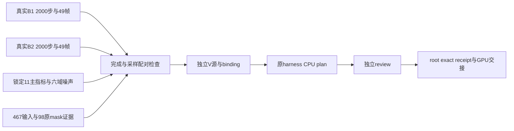

真实长窗 V 的最终 CPU 交接
==========================

真实 B1/B2 已各完成原30k→32000的2000步、exit0、末49帧及四状态验证。V 已在唯一独立副本中生成真实 binding/CPU plan，原 `93df22a4...` harness 默认 CPU prepare 返回 exit0，未初始化 CUDA。现在待独立最终 V review；没有创建 root 批准 receipt，没有启动 V GPU，也没有完成 V 实际 restore。

| 实际文件，相对 `long_pair_30k_32000/` | SHA256 |
| --- | --- |
| `materialized_plan/experiment_binding.json` | `5701482a50b078e980a39a4aec9b6747cdc1628882b2b48a2dd985d588314260` |
| `materialized_plan/opacity_outside_prepared_plan.json` | `1afe9a9b5f05dfcff1d565e064f276ef8161250060eecc0bb2b31a35be031065` |
| `v_binding_cpu/cpu_prepare_receipt.json` | `0d93907f924ad730415dd9ad8597bd034a222548a33c9dffd3a93dc9b6df497f` |
| `v_binding_cpu/pair_reference_validation.json` | `d9555323b446f20ca425a0f7448793628ca30e3559ed24e551610eb7c0996afc` |
| `v_binding_cpu/actual_algorithm_diff.patch` | `4ac897365605f30f91ac0a21d4440cbc79b86d60be20de274cfee50f5e6628de` |
| `v_binding_cpu/prepare_long_variant_binding_cpu.py` | `ec2adbf6b83ed3372fcd09b6007fcb2c91404a6f9068a0827dc601d243c58832` |

local 根为 `work/vgpu_bugfix_20261012/loss_audit/long_pair_30k_32000/`；remote 根为 `/root/autodl-tmp/drivingeditor_repro/campaign/vgpu_bugfix_20261012/loss_audit/long_pair_30k_32000/`。完整 `variant_frozen_repository` 的148个实际文件已同步本地，逐文件SHA等于remote binding。原源同样148文件，变化恰为 train.py与utils/paper_losses.py；两文件仍为短窗已审阅的 `ff82c0d8...` / `3832a7ce...` 原字节。实际 diff 的序列化字节与旧diff不同，其数学源字节不变。

配置保留原30k四状态、50000 LR horizon、seed0、30001–32000，以及原节点30001/30300/31000/32000、末49帧；仅新增原 flag 与 .05。实际 CPU plan 重验完整467原输入，记录796个保护/源/输入/辅助pins。绑定含真实两原版全部2000条 camera/time shift/LR、首10原目标scalar及150个辅助文件pins。

真实 B2 receipts 已冻结并绑定：full49 `2ded7dda...`、noise `e4ae32c0...`、common49 `dfd33893...`、release `3486faf0...`、terminal manifest `cce918f4...`、step rows `71759c95...`。噪声使用 component 原 `d2a5d00f...` 脚本的锁定11主指标和126条六域 context；没有另造统计口径。mask证据明确是同原467/245文件SHA、98张原sky/actor decoded输入及同frozen loader、真实region counts；NPZ没有runtime mask或独立actual Scene逐帧pose快照。

首次生成器 `4100dca1...` 在B2 release receipt字段名差异处停止，发生于任何 V 源/binding/plan创建前。仅修改自有严格schema解析，并加入6个真实B2 SHA pins；原B1/B2/harness/guard/数学均不改。失败源与回执保留 `attempts/01_release_schema_before_any_V_materialization/`。当前28项focused CPU检查通过。实际 materialize/CPU prepare第二次调用也返回exit0，binding/plan/pair/CPUreceipt SHA不变；冲突内容拒绝覆盖。

生成器、binding、plan、V源、guard、harness及所绑定B1/B2辅助字节从本次生成起冻结。请勿重跑含时间戳的 canonical export。最终 review 应绑定上述真实材料；GPU仍需root exact V receipt、唯一owner交接及原restore observer。首30001必须在真实backward前原10 scalar exact，后续每一步仅要求共同采样/time shift/LR，末49GT/domain及四状态继续验收。

本次仅测试既有退化模型的恢复性。outside complement 是背景域解释假设，不能用机制改善证明作者 Eq13 原本有该项，也不能证明从零正常。Eq14预测mask/shared-env、static时间语义、nearest-depth与其它算法缺口均保持不变。未来从零的最小预注册检查见本目录 `from_zero_minimum_preregistration.md`；深度跨页定义和harmonic900选择的独立说明见 `loss_audit/depth_definition_followup/`。
