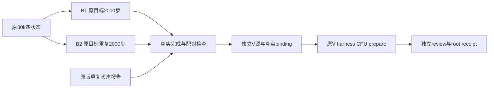

真实长窗 V 的 CPU 绑定工具
=========================

`prepare_long_variant_binding_cpu.py` 只负责真实完成引用、唯一独立副本和 CPU prepare。它复用已审阅的长 V harness `93df22a4...`、guard `83562013...`、两文件算法增量与 λ=.05；不修改 B1/B2、短窗工具、正式源、checkpoint，也没有 GPU 启动入口。



默认调用只检查；B2 完成导出和 GPU 释放 receipt 到齐以前，只写本目录 `gate_status.json`，不会创建 V 源、binding 或 CPU plan。显式 `--materialize-and-cpu-prepare` 仍受同一门槛限制。两臂实际完成后要求真实 30001–32000 共 2000 行、整段 camera/time shift/LR 相同、原数学与原50k horizon、实际 restore/评估 RNG PASS、末49固定帧、四状态 SHA/bytes 和既有 CPU load schema 证据。

噪声只绑定 component agent 的 `original30k_to32000_noise_reference/receipts/B1_B2_observed_noise.json`，源 pin 为 `quantify_long_original_repeat_cpu.py` 的 `d2a5d00f...`。生成器使用其原 `compare_metric` 函数核对锁定11主指标和126条六域 context，不导出另一套均值或阈值。一份原版重复差异不是置信区间，也不能作为 CUDA 噪声的普遍上限。

末49 GT 来自两臂真实 NPZ，并做 float32、尺寸与逐值比较；两套 NPZ 没有 mask arrays。mask 证据是原49 sky/actor文件哈希、同 frozen loader 和真实 region counts；没有独立逐帧 actual Scene pose 快照。原 V CPU prepare 仍重验完整467输入及既有独立 input-manifest receipt。

新 `approved_original_source_sha256.json` 只保存已独立审阅的148个原源文件哈希。该哈希清单来自冻结的 B96 短窗 source contract，未复制其短窗训练/评价/采样引用。实际 V 的全部 baseline/noise 引用只来自真实 B1/B2 的长2000步和末49结果。

幂等性规则：生成的 patch、pair receipt、binding 和 CPU receipt 只允许首次写入或复用完全相同字节；已有内容冲突直接失败。V 副本在临时新目录内校验148文件后 rename，既有副本只验证、不覆写。已有 CPU plan 通过同一冻结 harness 的 CPU `prepare` 重新比较，内容冲突拒绝覆盖。

准备完成后新文件位于 `long_pair_30k_32000/variant_frozen_repository`、`materialized_plan/experiment_binding.json`、`materialized_plan/opacity_outside_prepared_plan.json` 和本目录 pair/CPU receipts。所有正式运行仍需独立最终 V review、root exact receipt 和 component agent 独占 GPU；本工具不创建这些批准文件。

CPU 调用（仅 wm-vgpu-1011）:

```sh
PYTHONDONTWRITEBYTECODE=1 CUDA_VISIBLE_DEVICES= OMP_NUM_THREADS=1 /root/autodl-tmp/envs/drivingeditor/bin/python /root/autodl-tmp/drivingeditor_repro/campaign/vgpu_bugfix_20261012/loss_audit/long_pair_30k_32000/v_binding_cpu/prepare_long_variant_binding_cpu.py
```

两臂实际完成及 noise export 到齐以后，在该命令最后添加 `--materialize-and-cpu-prepare` 才生成实际 V CPU plan。`focused_generator_tests_cpu.json` 是24项小规模合成 gate/幂等测试，不能替代真实 B2 完成或 V 的 GPU restore。
