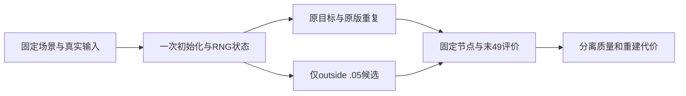

从零验证的最小预注册检查（尚未创建或批准实验）
================================================

当前30k恢复窗口只能测试已有退化模型的可恢复性。即使 V 相对两份原版方向改善，也不能证明从零训练正常、完整论文效果或作者认证 Eq13。

最小检查应在查看 from-zero 结果前固定：

1. 先冻结同一 scene0017_000_048、49相机及 RGB/sky/actor/LiDAR 输入、初始化输出、完整参数配置、源码/kernel、mask域及环境路径。原版、原版重复和候选必须共享同一保存的初始化、sampler/RNG及50k LR horizon；从零比较不能只声称 seed 一样。
2. 只改变同一 outside complement 的显式 flag 与 λ=.05。Eq13 背景域仍标注为复现解释假设；Eq14 预测动态 RGB 乘mask与 shared environment 的解释边界继续保留。静态时间不变语义与 nearest-depth 应分别形成独立候选，不能并入此项。
3. 预选连续训练检查点及 opacity reset 前/后/恢复节点，并记录分支 opacity/scale/time/velocity、有限参数和优化器、采样/LR，以及 checkpoint/eval 的先后顺序。评价新增动作必须保留全部 RNG，避免把 reset 瞬时损伤与此前分支分配退化混为一谈。
4. 复用固定49帧与原六域；保留 composite 误差、非sky车外 static 误差、dynamic alpha/support、actor 重建/alpha、真实图像道路与移除边界的完整可视证据。先注册聚合、原版重复噪声口径和代价解释；不得据候选结果调 λ、删帧或修改成功阈值。一次重复差异只作经验参照。
5. 原输入车外像素衡量已观测背景与编辑局部性；车内缺密集编辑 GT，不能把原车 RGB 当移除后真值，也不能据此声称 FID/移除精度。要求真实图像与完整49序列共同支持，不能用 composite 高 PSNR 代替静动分离正常。
6. 将“数值/配置/恢复有效”“机制方向改善”“从零效果正常”“论文完整复现”分开验收。前两者不自动满足后两者；任何新增 time/depth/SGCM/reset 或 mask 解释改动须另行预注册、独立对照。

以上是未来设计门槛，没有生成 from-zero 新源码或配置，也没有启动训练。
