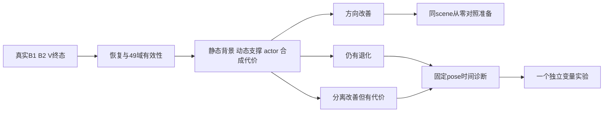

长 V 之后的最小诊断决策树
========================

先完成原锁定协议的终态验收，再选择一个问题继续。沿用 `long_pair_30k_32000/evaluation_protocol_locked.json` 与 `sgcm_data_audit/long_pair_review/interpretation_preregistered.json`：真实 restore/2000采样-LR/49域/四状态/exit0有效是前提；报告 V 分别相对 B1、B2 的全部固定帧和原版重复差异。现有重复差异是经验参照，不是置信区间；本计划不新增数值成功阈值，也不改变当前 V。

| V 结果 | 最小下一步 | 需要的验收证据 |
| --- | --- | --- |
| 车外动态 occupancy/support下降、已观测 static误差改善，actor保持；合成变化与原版重复一起报告 | 准备同scene从零原版、原版重复、同.05候选的共同初始化协议。先保留当前输入，隔离恢复成功能否从零形成；随后独立补预处理缺口 | 同一保存初始化和完整配置/输入/kernel；实际sampler/time_shift/LR；预定训练节点、reset前后和完整49终态；原版重复、actor局部性及静态/环境贡献。只证明该scene从零结果，尚无跨scene泛化证据 |
| alpha/support或static道路仍坏，或变化与原版重复相近 | 先以一个固定相机pose做时间扫描，读同一终态静态mean/有效opacity与point eligibility；需要时再安排只读渲染，固定env中心射线。然后优先一个已确认nearest-depth变量，保留原数学baseline | CPU需报告49真实时刻全部静态几何/opacity变化，图像扫描须固定pose、env和动态移除条件。nearest需目标顺序不变及独立旧/新深度目标验算、完整49/原版重复比较；没有改善不能否定已证目标bug，也不能证明它是主因 |
| 分离改善但composite/actor有可见或超过该次重复差异的代价 | 保留.05，先定位代价是否集中actor/边界、shadow未覆盖或整片背景。使用已有固定域和全49真实图，不调λ、不新增接受阈值；随后只选对应一个变量 | actor composite/alpha保持、车外改变局部性、道路/环境真实图与分支贡献；若时间诊断支持静态不稳定，单独测试静态时间路径；若shadow域遗漏，单独准备mask输入对照。报告tradeoff，不能据静态PSNR上升宣布正常 |

若任何配对/finite/source/restore/域门槛失败，只修验收或工程错误并重审；该次结果不能支持机制归因。上表“方向改善”也不表示道路、阴影或完整论文已正常。

| 项目与来源 | 已确定的事实及解释边界 | 最小独立验证 |
| --- | --- | --- |
| nearest-depth：`camera_utils.py117–133`；论文Eq16 p1702及p1703定义inverse | 同点集顺序反转改变稀疏监督已证，是继承的projection bug。3真实帧有8.09–11.73%非空像素last-write更远；nearest finite positive z是明确几何policy，论文未公开碰撞实现 | 复用既有小patch/7项CPU测试，原30k四状态→32000，仅改camera depth reducer。保持逆深度/HW、harmonic900、λdepth=.1及全部其它算法；新guard/harness另审 |
| static time：论文Eq4 p1700称G_s time-invariant；Fig3软约束；`gaussian_model.py149/153/178`、renderer259–273/341–349 | 实现和实际checkpoint确实随时间变化：30k静态中心49时刻位移中位4.16cm、p95 38.90cm。是否应hard freeze以及参考anchor未公开；参数位移与道路彩噪的因果仍需隔离 | 同固定pose时间诊断先定位。若干预，静态中心SHM与opacity temporal gate分别做独立候选，不能把同时zero所有time/velocity参数称作者认证修复 |
| shadow/M-detector：论文III-B p1699的[41]点流分解，p1700动态Md含对象及shadow；审计`audit_findings.json` | 当前DEVA/SAM复核silver body、mask投影/连通组件替代；无shadow mask/M-detector，是已确认方法组件缺口。当前车外RGB指标可能包含原车投影阴影，不能据其改善证明去阴影成功 | shadow只改变图像Md，先固定既有PLY/代码，单独检验mask漏覆盖与编辑局部性；M-detector只改变LiDAR分支初始化，需从零单独对照并声明初态点集差异。两项不要和新loss/depth同时加入 |
| SGCM与reset：`sgcm_data_audit/audit_findings.json`、train738–766 | 不可贡献的clone扩张和post15k周期reset行为已证。不可见dead clone在保持低于raster阈值时不能产生彩噪；作者clone eligibility/repeat policy未公开。reset解释即时global损伤，不解释此前20k彩噪 | 使用已有独立visibility候选须在15k前有真实SGCM调用的窗口；30k→32k不激活SGCM。reset要独立跨reset对照和pre/post保存次序，不与本V/nearest组合 |
| Eq13/Eq14及depth合成：p1702–1703、`depth_definition_followup/README.md` | foreground-opacity域、预测dynamicRGB乘mask/shared-env、harmonic900/缺测域/权重细节未完整公开。逆深度本身有跨页原文依据 | V仅检验补背景域的因果方向；不认证作者Eq13，也不据此取消预测mask或改metric-depth |

nearest 的可审阅草案是 `nearest_depth_only_cpu_plan_draft.json`（allow_training=false、无replica/harness/guard、无checkpoint拷贝）。源码直接引用 `loss_audit/candidates/nearest_depth.patch`，没有再造补丁。候选camera文件还原一个helper import和一个depth赋值后，完整AST与原source相同。首步门槛必须是原8项exact；depth与总loss允许由目标改变，记录同rendered depth下旧/nearest两目标的Eq16及原compose，不能套用V的原10项exact gate。

从零还需一个真实RNG边界：train297使用Python相机采样、311–312使用NumPy time_shift；`gaussian_model.py610/621`按split点数消耗CUDA随机数，`cameras.py97–100`环境jitter用同CUDA流。初态/seed相同不保证拓扑变化后增强流一直相同。记录实际sampler/LR、拓扑和CUDA-jitter流分歧，保留原版重复；不得偷偷重置RNG来制造配对。当前30k窗口已过densify/SGCM，不能把其完全配对结论外推从零。

从零同scene、预注册heldout、跨scene分别回答不同范围的问题。其它scene目前暂停。完整论文验收还要求预处理组件、静态语义、编辑局部性与真实观测支持共同成立；作者帧窗/权重/部分细节未公开，正式结果需如实列复现选择。车内缺密集edited GT，原RGB和一张好看的图不能认证移除精度或论文整体成功。

原始依据保留 `from_zero_minimum_preregistration.md`、`sparse_depth_collisions_cpu.json`、`candidates/candidates_tests_remote_cpu.json`、`sgcm_data_audit/static_time_summary.json` 和 `audit_findings.json`；均未重写。此计划只做CPU草案，任何新训练仍需实际source/config/guard/plan独立review、root exact receipt与唯一GPU交接。
