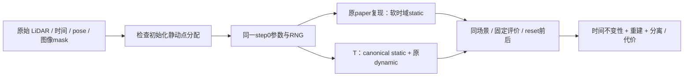

先确认初始化分支是否可靠，再选择从零的单变量训练。当前 S 仅测试原30k模型的静态 RGB 锚点，不能代替初始化检查，也不能说明从零会正常。本文件是 CPU 设计，未编码 T、未生成 GPU 计划、未修改 S 或任何已有运行。

初始化门槛优先复用既有 `sgcm_data_audit/initial_geometry_and_time.json`：静态 PLY600000点、动态36406点，现有 loader 按距任一动态点0.1m的规则排除4106点，留下595894静态点；49时间与actor manifest一致。这证明了现有几何筛选和时钟关系，**没有证明其余静态点都属于静态物体**。M-detector缺失是论文组件差异，尚无证据证明它导致本场景 actor 混入 static。先做一次只读逐原点检查：保留frame/原LiDAR索引与时间，复核选中actor原点是否仍在static；在各点自己的采集帧检查实际actor/sky投影、正深度可见性及RGB。不要把“落在actor聚合AABB里”或“投影在某个后续帧mask里”的真实背景也算作动态污染。没有原点追踪关系时，应报告可疑投影/时间一致性，不能把它当作运动标签真值。其他未被silver-car mask覆盖的运动物体另列。

若发现可证的分支污染，下一项是 **I：仅初始化分类对照**，两臂保留同一训练数学、mask和静态时域策略；原始分配与经核验M-detector分配分别训练，不加入S/V/T。官方M-detector已有Waymo接口，但其配置、去畸变、R/t、scan_end_time和输入顺序仍需单独核实；不能默认作者使用了公开默认参数。影子是像素外观域，需与点运动分类分开。若没有可靠运动标签，不应为了补齐模块名称就重新划分点。

T 的可执行语义固定为：对所有静态点、任意查询时间/训练time_shift，`xyz_s=_xyz`，`opacity_s=sigmoid(_opacity)`，`marginal_s=1`，时间筛选支持恒为1，实际速度为0。保留正常的相机投影、外部mask、空间可见性、空间尺度/旋转、SH视角颜色和共享环境；因此只有固定pose/rays时才要求静态画面与时钟无关。它不是把训练后位置或opacity绑定到raw10，也不是将某时刻的有效opacity写回base opacity。静态时间宽度保留有限的惰性兼容字段，不设无穷参数，也不得再用于时域cutoff。动态分支仍按原4D定义运行。

论文 Eq4/p1700 支持 time-invariant 的目标语义，但没有公开硬约束机制。Fig3/p1701和NPS文字说明压低静态spurious velocity；若T实际速度严格0，则当前基于实际速度的Eq11/NPS恒0。必须报告这个信号变为常量，不能另渲染latent速度冒充实际运动来声称仍复现了Fig3。T是对Eq4的明确实现选择，不能称作者完整算法已证。

| 必须处理的训练依赖 | 最小T策略与来源 |
|---|---|
| 两支现在都继续使用PVG位置、时间opacity和mask | 静态查询统一走canonical/base/ones；所有渲染、PLY导出和编辑split路径都不能残留时间或sigma_t筛选。实际原 `gaussian_renderer/__init__.py`341–349、386–400；`gaussian_model.py`147–178。 |
| 静态有t/scaling_t/velocity三Adam组，t LR每步被改写 | 保留九组与capture形状以兼容append/prune，但静态时间三组lr0、无更新；每步scheduler不能把t LR改回非零。其他静态和动态组维持原schedule。原269–291、399–407。 |
| 未参与forward的t没有grad | 静态`add_densification_stats`不执行 `_t.grad.clone()`，t统计恒0；不能伪造非零时间梯度。原718–722。 |
| spatial split也采样t并移动xyz；train会解除no_time_split | 静态只做空间split/clone；时间fields继承父值而不参与选择/位移，关闭静态time_split/time_clone，保持no_time_split。原570–699；train558–559。 |
| append/prune新Parameter会重新requires_grad=True | 静态三时间fields在init/restore/append/prune之后保持惰性约束；不得只初始化时冻结一次。原431–464、526–563。 |
| SGCM维护九字段及优化器，使用canonical xyz | 保留其距离、clone/split几何、预算和schedule；只保证其append/prune也遵守静态惰性状态。实际paper_sgcm232、272–302，不顺带修dead-clone policy。 |

实际静态初始化沿2024源码：点采集时间来自PLY，velocity0，base opacity0.01，`sigma_t=sqrt((time_end-time_start)*t_init)`，三时间属性均可训练（GaussianModel239–267）；当前49帧区间[-.48,.48]、t_init=.1，因此初始sigma_t约.30984。它从第一步就允许时间opacity衰减，并不因初始velocity0而不变。论文给出LiDAR/PVG基础参数化及后续分支目标，未给这套静态sigma_t/optimizer初始化配方。这里应记录“继承2024数值配方”和“作者未公开”两栏，不能混称论文指定。

若初始化检查允许测试T，最小因果对照为同一显式保存的step0初始化下 **B0：原paper复现** 与 **T0：仅上述静态语义模式**，两臂均无S/V/nearest-depth/shadow新项；保持scene0017、原输入与50k horizon。原版完整重复作为新from-zero噪声参照，不能拿30k后的B1/B2波动替代。先核一轮真forward/backward/Adam及首次增密/SGCM/静态时间split边界兼容，之后完成同一注册窗口；只短跑成功不能验收论文效果。T从第一步改变静态forward，因此不能沿用S的“原10损失必须exact”门槛；必须exact的是共同初始化字段与未改变的数据/动态算子，损失差异需如实分解。

记录共同camera/time_shift及未改变组的LR；静态三时间组lr0是已声明的差异。从零拓扑变化会改变CUDA随机数消耗（split数量、时间采样与环境ray jitter），相同seed或初始RNG不保证之后每个CUDA draw一致。记录首次分歧及其来源，不偷偷重seed，也不强行宣称全CUDA配对。额外评价仍保存/恢复全部RNG。

验收证据预先固定为：固定state/pose/rays在49时间上的静态参数与render结果时间不变；初始化分类证据；原六域/all49重建与actor代价；动态alpha/RGB支撑、真实道路和完整移除序列；reset前/后/恢复节点与四件状态。单一PSNR、全黑动态层或好看的一帧不算成功。这个同场景从零对照仍不是跨场景泛化；完整论文复现还须明确M-detector/shadow缺口与作者未公开的域/拓扑选择。nearest-positive-depth是已证的顺序工程问题，但应另成深度单变量，不能混进I/T/S。

复用证据：`initial_geometry_and_time.json`、root的`preprocessing_gap_audit/mdetector_readonly_audit.json`、已完成`component_diagnostic/fixed_pose_temporal32k/results/temporal_summary.json`；其110次实际渲染确认当前static有时间依赖。以上未重复扫描、未复制checkpoint、未创建新训练源或GPU任务。
