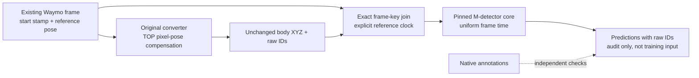

时间和几何能形成明确的自定义适配约定；**作者 Waymo 输入等价性仍未证明，真实 detector 执行和训练都未启动或获本回执授权**。此调查到这里即可结束，不需要猜 `.05s/.1s` 偏移或继续无界寻找未公开 producer。

已证明的源码事实：

- Waymo `dataset.proto:366–375` 定义 `Frame.timestamp_micros` 为扫描/帧起始，`Frame.pose` 约在中点且明确不对应该时间。`CameraImage.pose_timestamp` 只属于相机 pose。TOP 每像素 pose 有几何参考，却没有直接的逐点 timestamp 数组；当前49帧 flow 字段全缺。[固定版本的官方 schema](https://github.com/waymo-research/waymo-open-dataset/blob/62b97ad80bbff8b285dda3a9fb679888d34e6b17/src/waymo_open_dataset/dataset.proto#L366)
- 原 DrivingEditor converter SHA `2489c465...f5a62`，`372–396` 分别原样保存 Frame.pose/帧起始时间。`249–253` 的第六列实际是 TOP range pixel index（非TOP=-1），旧 timestamp 注释不能作为时钟。实际安装 SDK `range_image_utils.py:360–380` 将 TOP 点先用 pixel-pose 变到 world，再用 **原 Frame.pose 的逆**变到参考 body；保存的原 body XYZ 乘回同 Frame.pose 恢复原世界几何。该 SDK 文件 SHA `48abee3df4bc0c5d24e83909b7f149201ab95a08d6b383dfb11382bedab5f265`。这不是把 pose 外推到帧起始或扫描终点。
- 固定 M-detector `0645dabe...a39f`，`dynfilter_with_odom.cpp:74/112` 使用 odom stamp，cloud stamp 未核对、只按 FIFO 配对；`DynObjFilter.cpp:263–270` 用给定R/t变世界坐标并把同一时刻赋给整帧点。核心不读取我们的 column6 或虚构的逐点时间。[官方消费者](https://github.com/hku-mars/M-detector/blob/0645dabe307a99f3b59a5a3d3007acfdcad1a39f/src/dynfilter_with_odom.cpp#L63)
- 唯一公开 FAST_LIO release（2024-01-09，238366B，zip SHA `b8a81e56...0954`）确有 Waymo config，但没有 raw TFRecord→ROS bag producer。`config/waymo.yaml:28` 关闭 IMU；`laserMapping.cpp:511–521` 直接 `lidar_end_time=lidar_beg_time`，`929/1012` 同时发布同 stamp 的 cloud/odom。因此 API 的“end”名称不要求额外偏移；仍不能证明该输入 stamp 就是 raw Frame start。[官方 release](https://github.com/hku-mars/M-detector/releases/tag/FAST_LIO)

可审核的适配选择是 `WAYMO_FRAME_START_REFERENCE_CLOCK_SECONDS_V1`：先在整数微秒中算 `raw_start_us-first_start_us`，再除1e6得到 float64 物理秒；raw整数时刻保留在 frame/point ID 中。称它为 **帧参考时钟标签**，并明确它不是精确 Frame.pose 时刻或物理扫描终点。整帧几何继续原 bodyXYZ+Frame.pose，TOP 不再二次去畸变；不使用模型归一化时间或列6，也不插值/猜点时间。49帧跨度4.794396s，间隔99536/99983.5/100031µs（min/median/max）；每帧最多180332点，在原200000容量内。时钟共同平移仅在实数算术中抵消；原代码有严格 `< frame_dur` / `> frame_dur`，绝不能据此声称 epoch 与 relative 两种 float64 时钟的实际标签逐位相同。选定后的 clock 必须冻结并记入真实运行回执。

最小下一步顺序：

1. 由 root 及独立 reviewer 审 adapter 已准备的 **construction-only** 隔离计划，12GiB `RLIMIT_AS` /120s，既不读扫描也不 `filter`。compile-only 已列主payload约8.653GiB，加已列帧数组约8.727GiB；动态 cluster/allocator/transport/TBB scratch 尚未界定。12GiB峰值+8GiB reserve 是 agent 曾提出、未批准的保守预算，**不是作者/用户硬要求，也不是永久阻塞**。构造实测 RSS/限制/exit 才能决定下一步，不可称扫描 ready。
2. 独立 packet-only preflight 流式核对既有49帧的 original SHA、raw ID顺序、body/world参考几何、实际秒差、容量和 RAM。无需 native detector 构造/分类；不重复读完整大 checkpoint。共享该自定义 clock receipt，显式 `author_equivalence=false`。
3. 经 **另外的 exact root 执行批准**后，再做受时限/RAM限制的真实 CPU chronological filter；直接复用 source-pinned 原核心、原 Waymo配置、固定 clock，记录每帧结果/内存/exit，输出只进入隔离审计目录。构造通过并不批准扫描，扫描成功并不批准输入改写或训练。

I-only 的动态域条件必须补足。另存的 `other_dynamic_domain_followup_cpu.json`（`cfb561b5...14840`）只读统计既有 raw 标注+原 Tr0/P0/mask：除目标外136 tracks，包含其它快速车辆/行人；它们的当前前视投影例子不入镜。其它 center-FRONT379行是378 SIGN+1 VEHICLE，bbox-FRONT394行是390 SIGN+4 VEHICLE，最大标注速度只有0.04160m/s；98近裁剪box未完全解，最大0.06011m/s。这里的非零字段含微小噪声，**5626行非零值不是5626移动物体**。当前证据支持目标车是前视标注的显著移动主体，不能证明无未标注/遮挡 movers 或其它时刻的可见支撑；投影 box 也不是逐点身份。

因此，旧 `I_only_from_zero_cpu_plan.md` 中“全scene预测直接分配同632300行”的描述只是未ready草案，不能现在照此 materialize。必须先核实际 detector 所检出的其它 mover、未知/warmup/grouping 与当前 **single selected-car body Md** 的域关系；未解决则 I0 readiness 仍为false。GT boxes/semantics只能留作独立审计，禁止作为筛点/训练标签；不悄悄扩Md，不混shadow、S/V、hardT或depth。论文 III-B/Fig2 的 whole-scene foreground 与 body+shadow Md 的输入缺口仍在。可合法做一个初始化operator因果诊断，不等于完整论文预处理复现。

所有 canonical 初始化回执、B1/B2/V/S源/config/checkpoints均未改。主要小回执：`clock_source_audit_cpu.json` SHA `a1e47e6f7cd3688d6076a5bede9eca0c96a11eb1f8cfeea1bb7c8cece976cc22`，以及另存其它对象域回执；原始点sidecar和600k lineage继续复用，不生成训练数据副本。
