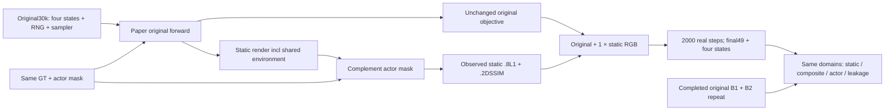

S is an isolated recovery diagnostic: original30k →32000 with the original paper objective plus one observed-static RGB term of coefficient1. It contains no V background-opacity term. The original10 losses must match B1 before S is computed; the actual first backward must also verify the captured original objective and the FP32 sum. This CPU package does not authorize training.

The paper and the implementation support a precise distinction. Eq4 (printed p1700) calls the static set time invariant. Eq10 (p1701) lists sky and NPS losses, without a mandatory static RGB term. Eq13 (p1702) does not specify its pixel domain completely. Eq14 on that page does not fully define the masked rendered prediction/target; the prose also shares the environment across all three renders. Thus S supplements the displayed objective for a causal test; it does not correct a proven omission from the author's equation.

The released2024 implementation masks both dynamic prediction and target, as does the paper reconstruction (`train.py`341/343). Canceling only the prediction mask would make its shared environment fit a black dynamic-background target as well as the composite RGB image. That intervention conflates leakage supervision with illumination, so it is not a demonstrated Eq14 fix. The old observed-static teacher is much more specific: official `train.py`348/349/353/356/363 computes full-image L1/DSSIM on `(1-Md)*render_s` and `(1-Md)*GT`, with coefficient1. S restores only that term, leaving the old ×5 dynamic/sky and ×100 opacity losses absent.

The prior V cost is not confined to tiny endpoint masks. The saved49 supplementary CPU analysis gives pooled actor PSNR38.459→33.940dB and actor-core39.929→35.539dB. Core dynamic opacity remains0.9976→0.9959. Boundary opacity changes more, but broad background RGB support persists far from the actor. These observations justify testing a static image anchor without a direct outside-opacity penalty; they do not identify a particular occlusion or environment gradient as the cause. The original adverse equal-frame results remain part of the report.

The comparator is the already completed B1/B2 pair from the same original30k state, with all2000 camera/time_shift/LR values and all49 GT/domains. S versus V is a descriptive comparison of alternative added terms. The locked S protocol reuses the original11 endpoints, reports every static/composite/actor tradeoff against both repeats, and adds no new numerical margin or coefficient search. A static gain alone cannot certify normal editing or the paper. An improved S recovery still leaves dynamic branch identification and from-zero reproduction unproven.

`observed_static_rgb.patch` adds nine lines to `train.py`. Its inverse exactly recovers the original CRLF bytes. All148 source files are pinned and only this one file differs; `paper_losses.py`, renderer, masks, time parameters, depth projection, SGCM, reset and optimizer schedules keep their original bytes. Two strict experimental configuration fields enable S with a float coefficient1.0. The isolated S guard does not change the formal resume guard. Small CPU checks confirm exact2024 static-image loss and gradient, zero direct static-prediction gradient inside the actor, no direct dynamic-alpha graph, exact FP32 loss decomposition, and strict rejection of configuration/type changes. Shared-environment parameters can still receive the additional loss; this is not an exclusively static-parameter gradient claim.

Actual artifacts are in `materialized_plan/experiment_binding.json`, `static_anchor_effective_config.yaml`, the148-file `frozen_repository/`, `static_anchor_guard.py`, and `focused_S_checks_cpu.json`. Component owns the independent `continuation_static_anchor_harness.py`, launcher and actual `static_anchor_prepared_plan.json`. Source/binding creation was idempotently repeated without changing bytes or copying checkpoints. The complete protected-file and actual CUDA restore gates remain mandatory in the reviewed runtime. SGCM independently reviews the final source/config/guard/plan; root alone approves the exact plan and component alone obtains the GPU slot.

The next from-zero design must define static semantics at initialization: canonical xyz, base opacity, temporal marginal/support identically1. The completed fixed-pose scan confirms current rendered static time dependence, but freezing a trained raw10 snapshot is only a diagnostic. Temporal optimizer, time-gradient densification and SGCM/clone dependencies must be adapted as one explicit static-semantics candidate and compared separately. Shadow/M-detector gaps and nearest-positive-depth projection also remain separate candidates; none is mixed into S.

Source evidence: the supplied DrivingEditor.pdf (Eq4/10/13/14), official Git revision560d57c3825ed2bdbc6a6602e0011ad51e8da60e (`work/DrivingEditor-official/train.py`), frozen original train SHA42b04bff…17f93 and original paper losses SHAc56580cb…053d8. Prior official all-heads/all-tags audit found no public2026/final-paper implementation; unresolved author mechanisms remain unresolved.
