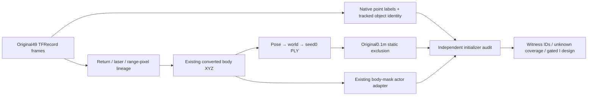

The actual input-to-initializer replay finds target-car returns in static initialization, but quantifies only the portion supported by native point labels. The600000 sampled PLY rows are reproduced exactly from seed0 draws over8667791 original converted returns, their ego poses, float32 world coordinates and normalized model times. All36406 actor PLY rows also replay exactly. The original0.1m exclusion leaves595894 static rows; all2568 sampled returns already selected into the actor PLY are excluded, with zero exact selected-return duplication between the two initializer branches.

Native TOP labels exist only on raw25/30/35/40/45. Each frame has a unique native CAR instance overlapping the actual actor returns inside the same-time Waymo target box; this is instance28 in these five frames, associated with track `5XnA21wBZZ__-ZJ2j35hrg` (annotated speed4.01–6.66m/s). Membership of the rest of that native instance is taken from the per-return label, without applying the RGB mask or box as a point cleaner. The track link is derived and fully recorded; the raw data does not supply that numeric-instance-to-string-track mapping. The channels and sparse TOP coverage follow the [official Waymo schema](https://raw.githubusercontent.com/waymo-research/waymo-open-dataset/master/src/waymo_open_dataset/dataset.proto).

There are169 retained static rows,160 distinct original returns, labeled as this target instance: a witnessed lower bound0.02836% of static initialization, **not an estimated full49 contamination rate**. There are541052 static rows (90.7967%) without available direct semantic identity. The884 same-time target-box-associated rows remain a separate geometric result;717 lack point labels and one is labeled ROAD, demonstrating why box membership alone cannot be counted as actor pollution. Three native target-instance witnesses even lie outside that box.

In their own acquisition frame,163 of169 witnesses are outside FRONT and6 are inside FRONT but outside the body mask. A separate CPU projection receipt finds143 rows/137 unique returns eligible in at least one observed FRONT camera; these also have an eligible initialized temporal/max-alpha upper bound. This is pinhole center eligibility, without covariance footprint, occlusion or actual raster contribution. It makes a rendering path plausible but does not prove confetti causality. The canonical audit was not rewritten for this followup.

The actual dynamic actor PLY has1716 returns with valid native semantic labels:1692 CAR and24 ROAD, plus4 UNDEFINED and34686 without labels. The24 ROAD returns (raw25=12,30=3,35=9) are all within the body mask and all outside the target3D box; their signed distance to the existing fitted ground is.036–.140m. Each has an original return/laser/range-pixel witness. TYPE_ROAD=18 is verified from the installed Waymo proto, not an assumed class number. Physical ROAD is not actor identity or a motion/shadow label. Moving shadow appearance on road requires its own pixel-domain treatment; these points were selected by the body adapter, with no explicit shadow mask. The24 points do not explain the trained dynamic-road layer by themselves.

The next controlled from-zero I design covers **both branch assignments**, with genuine source-pinned M-detector predictions for a fixed constructor row pool. Native labels are audit controls only; sparse semantic cleaning cannot be called M-detector reproduction. Its readiness remains false until a genuine filter output and scan-time/pose contract are verified. Body-only shadow supervision also confounds temporal interpretation, so H shadow input and T static semantics remain separate subsequent experiments. Current S and all original inputs/source pins stay unchanged.

Canonical files: `static_initialisation_actor_audit.json` (df97e5…b8ecd), `raw49_labels_layout.json` (fa0448…94806), original-point maps under `raw_layout/` and `all600000_initialisation_lineage.npz` (remote only). Separate receipts: `front_visibility_followup_cpu.json` (01fb4c…03f34), `dynamic_actor_native_semantics_followup_cpu.json` (9cc9bf…175da), with explicit witness CSVs. `I_only_from_zero_cpu_plan.md` is a design, not a generated training plan. No GPU, detector installation, dataset download, training input edit, checkpoint copy or source mutation was performed.
