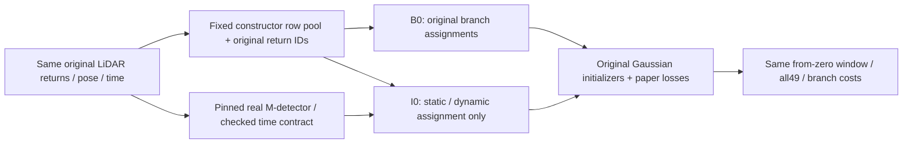

I is a from-zero **initialization assignment diagnostic**, with no new loss. Its readiness is false: the bounded M-detector adapter has not yet established a genuine verified partition or a resolved scan-time contract. No training source, data replica, checkpoint, launcher or GPU plan is generated here.

Use the official M-detector implementation at revision `0645dabe307a99f3b59a5a3d3007acfdcad1a39f`, its explicitly pinned Waymo configuration and a real filter invocation. Do not feed the five native semantic frames, Waymo boxes or their actor IDs into the detector or training. Those are independent audit witnesses. The detector must preserve every `(segment, raw_frame, return, laser, range_row, range_col)` ID through its predictions. The actual original cloud is ego-compensated body XYZ; Frame.pose is its matched coordinate reference. Frame.timestamp is scan/frame **start**, and the pose is roughly midframe, so neither may silently be renamed scan_end. Until the official filter's clock/pose requirements are satisfied and the genuine outputs are available, I cannot be called a verified separation experiment. [Official Waymo time and label schema](https://raw.githubusercontent.com/waymo-research/waymo-open-dataset/master/src/waymo_open_dataset/dataset.proto).

The controlled point basis is the **actual original constructor input rows**:595894 static rows plus36406 actor rows, total632300, with their reconstructed raw IDs, XYZ, time and original multiplicities. Do not add unrelated points or change the sample seed to make I look better. Run the genuine detector on the original full chronological raw point stream, then read its predicted role for this fixed basis. B0 keeps the original roles. I0 partitions the same632300 rows into static/dynamic according to the verified predictions. Thus a native target witness can move out of static, while a physically static ROAD return can move out of dynamic; capacity is reassigned rather than silently increased. If genuine outputs contain an unknown/warmup state, freeze and report that policy before generating inputs; do not replace unknowns with audit GT.

This direct partition needs one honest, isolated loader mode: consume the two verified constructor PLYs and an integrity/provenance manifest, then apply the existing PCA transform and original initializers. It must **replace** the old distance-to-dynamic-union0.1m assignment for this mode; otherwise a ROAD point deliberately returned to static can be discarded again merely for being near the car. Skipping that proxy is part of the one initialization operator, not a depth/time/loss fix. Original B0 source and inputs remain untouched. The I flag/manifest must be explicit and its source diff independently reviewed. No S/V term, hard-T mode, new mask, nearest-depth fix, clone eligibility policy or reset change is included. Preserve original role-specific Gaussian initialization and50k horizon; the branch counts and resulting role-specific parameter initialization may change as the declared intervention, so original10 loss equality is not a valid from-zero gate.

Before any launch, the CPU evidence must show a real source-pinned M-detector call and configuration, complete ordered point-ID coverage and world/body correspondence, the resolved physical scan-time policy and unchanged normalized model times. Report detector predictions for the169 native target witnesses, the24 ROAD actor-cloud witnesses, the existing selected actor returns and native ROAD negative controls. No new score threshold or GT cleanup is introduced: this establishes what the genuine method actually did and exposes failure/unknowns. The current adapter skeleton alone does not establish these outputs. The sparse native labels validate a subset; they cannot turn this into complete author M-detector parity.

B0 and I0 share raw inputs, fixed constructor basis, sampler seed/state, RGB/sky/body masks, depth operator, original paper losses/weights, time parameter semantics and SGCM/reset schedules. Use isolated input views with separate writable transform bookkeeping; the original scene/run cannot be modified by the loader. The runtime must not discover or consume the audit boxes/semantic labels. A matching from-zero B0 repeat provides empirical noise context; the post30k B1/B2 repeats do not substitute. Track actual camera/time_shift/common-LR/RNG and topology. Initialization/branch topology differences can alter CUDA random consumption, so do not claim seed equality guarantees every later ray-jitter draw.

Evaluate all49 original domains and both static and dynamic branch behavior, actor/composite costs, genuine removal locality, complete images/sequences, reset windows and full four-state snapshots. Include fixed-pose temporal behavior, but successful I does not certify the author's static parameterization or from-zero behavior on another scene. The known witnesses make initialization a testable gap; they do not prove that these sparse returns caused road confetti or broad dynamic RGB support.

The body-only mask leaves moving shadows in the outside domain. Static temporal changes can therefore fit missing shadow appearance as well as mislabeled motion; they are not all automatically a pure temporal implementation error. After I, the next paper preprocessing component is a **separate H shadow-domain plan** with source/association checks, rather than another added loss. Do not combine H with I or hardT in the first causal comparison. A hard time-invariant T candidate remains an implementation choice with its NPS conflict and should be assessed only with these input gaps explicit. Exact author M-detector settings, grouping and shadow representation remain unpublished choices.
