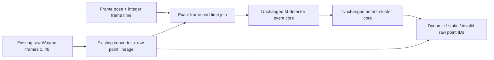

# Isolated CPU M-detector adapter candidate

This is a candidate transport contract and skeleton for the existing DrivingEditor vGPU debugging campaign. It contains no trained model, new data, detector run, installation or current-data edit. The native backend is not built or validated. `contract.py` does not implement event detection. All algorithm decisions remain in the unmodified pinned [author source](https://github.com/hku-mars/M-detector/tree/0645dabe307a99f3b59a5a3d3007acfdcad1a39f).



Author algorithms/configuration are `vendor/src/DynObjFilter.cpp`, `vendor/src/DynObjCluster.cpp`, their algorithm headers, and `vendor/config/waymo/waymo1.yaml` at revision `0645dabe307a99f3b59a5a3d3007acfdcad1a39f`. The author's launch selects waymo1; waymo0 is retained but not selected. The matching SHA256 receipt covers every vendor byte. We have not established that DrivingEditor authors used this particular config, sensor subset, return subset or ROS data producer.

Our adapter choices are exact keyed synchronization, segment-relative time representation, explicit point lineage, a direct offline backend call, ROS transport/header facades, and the separate invalid/other partitions. They are not author algorithm claims. No `Case1/2/3`, depth/occlusion/velocity math, cluster/ground/region logic, source default, or YAML threshold is rewritten.

## Input contract tied to actual existing data

The source scene is `/root/autodl-tmp/drivingeditor_repro/data/waymo_paper_scenes/scene0017_000_048`. Its existing raw source is `segment-10235335145367115211_5420_000_5440_000_with_camera_labels.tfrecord`, original records 0..48. The collaborating static-init audit has verified all 49 frame poses against raw `Frame.pose` and 8,667,791 converted rows against the raw validity/order/intensity/elongation/TOP index. The frozen converter is `DrivingEditor-run/scripts/waymo_converter.py`, SHA256 `2489c465873e7ffe4854d51ce05c20d40dbb066e3d636e976b90b2cd899f5a62`. The separate evidence is `campaign/vgpu_bugfix_20261012/loss_audit/next_diagnostics_cpu/static_initialisation_actor_cpu/raw49_labels_layout.json`, SHA256 `fa0448b99abc28c22f40fc7722ecb1d68dbcc68dbe88ae44b5aed0357b894806`, pinning all49 `raw_layout/0017xxx.npz`. This candidate does not regenerate or mutate those files and does not use native point labels or instance boxes as detector outputs.

| Field | Exact meaning and use |
|---|---|
| Frame key | `(raw segment SHA256, original TFRecord record index, Frame.timestamp_micros)`; integer microseconds, never a rounded filename or arrival order. |
| Point ID | `(frame key, return_index 0/1, LaserName 1..5, range_row, range_col)`; first/second returns at the same pixel remain different points. |
| Converted row | Existing `.bin` row, dtype float32, columns `[body x,y,z,intensity,elongation,TOP flattened range index]`; no new crop, voxel filter, sampling or reorder before detection. |
| Canonical order | Return 0: laser names 1..5, then return 1: laser names 1..5. Within each range image, row-major pixels passing `range>0` and `NLZ!=1`. Do not resort an already converted file. |
| Lineage sidecar | NPZ keys `return_index`, `laser_name`, `range_row`, `range_col`, one entry per converted `.bin` row. Ignore audit-only `instance_label` and `semantic_label` on the detector input path. TOP column6 equals `(return_index*H + range_row)*W + range_col`; return1 offset is H*W. The contract checks this with native TOP H/W. Column6 alone is insufficient: all non-TOP points carry `-1`. Bind the sidecar to exact `.bin` bytes and extraction receipt. |
| Native units and axes | Metres; Waymo vehicle body reference, +x forward, +y left, +z up. Keep body floats and pose doubles. Never feed scene-normalized XYZ, camera coordinates or world XYZ as body XYZ. |
| Deskew / pose | Existing official conversion compensates TOP points using per-pixel ego poses and `Frame.pose` to the frame's vehicle reference; non-TOP points use the ordinary calibrated laser-to-vehicle conversion. Preserve this established producer behavior. No second deskew or extra extrinsic application. |
| World transform | `p_world = Frame.pose[:3,:3] @ p_body_reference + Frame.pose[:3,3]`, exactly matching author `R*p_body+t`. Preserve native world coordinates; normalization belongs to the later initialization boundary. |
| Reference time | `cloud_reference_micros` and `pose_reference_micros` must agree exactly and have an evidenced coordinate reference. The official [Waymo schema](https://raw.githubusercontent.com/waymo-research/waymo-open-dataset/master/src/waymo_open_dataset/dataset.proto), audited lines366–374, states that `Frame.timestamp_micros` is the first TOP scan/frame START and `Frame.pose` is roughly the frame midpoint, not at that stamp. Their identity association is valid, but labeling the start timestamp as `scan_end_time` is invalid. The exact detector-time/reference binding remains blocked. No invented per-point timestamps or use of column6 as time. |
| Author scan-time mapping | A producer/schema receipt must justify mapping that body/pose reference into the author's frame callback time. The contract rejects an empty time-binding receipt. Subtract one segment origin in integer microseconds, then divide by `1e6`; all point times in a filter call still equal the author's `scan_end_time`. |
| Sensors / returns | The observed converter uses both returns and all five lasers. This is our observed-input profile, not evidence of the author's Waymo sensor selection. Any later TOP-only or return-only experiment needs explicit selection, row ID map and separate result identity; do not silently change the current input profile. |
| Capacity / history | The unchanged waymo1 capacity is 200,000 points per call. Reject excess points rather than truncate. One fresh backend per segment, original contiguous chronological frame order, retained warmup/history. No frame-parallel core instances or history reset between frames. |

`ExactSynchronizer` joins keyed messages and drains a frozen contiguous record manifest. A one-microsecond mismatch, cross-segment identity, duplicate, missing cloud/pose, changed point order, native-row mismatch, unresolved units, unproven time binding or malformed SE(3) pose fails closed. Out-of-order arrivals can wait for the exact expected pair. FIFO cloud/pose queues are not synchronization.

## Output contract

`DynObjFilter::filter` writes `dyn_tag_origin[i]` and `dyn_tag_cluster[i]` for the original input slot `i`. The native bridge captures the active point-buffer slot before the call, reads it immediately afterward, and exposes the final native `dyn_obj_flg` state. It does not rematch compact clouds by XYZ or trust mutable PCL curvature/intensity as a row ID. The input sidecar supplies `bin_row -> PointId` directly.

The unchanged waymo1 sets `cluster_coupled=true`, `cluster_future=true`, `dyn_filter_en=false`, `debug_publish=false`. `dyn_filter_en=false` does not disable `filter`; it affects displayed cloud intensity and publication behavior. Final frame-out assignment follows `dyn_tag_cluster`, while original event tags remain available separately. Author binary `.label` output is 251 for cluster tag 1 and 9 otherwise, including invalid points. Consequently label 9 alone does not prove static: our separate partition gives invalid tag -1 or native INVALID its own identity-preserving category, static requires native STATIC and non-dynamic tag, and other unresolved states are retained as `other`. Output count must equal input count, with original IDs and row positions intact.

At the later initialization boundary, join labels back to each native `.bin` row, then replay the already-audited world-transform/crop/downsample/sample lineage into initialization point IDs. This candidate does not overwrite the current PLY or substitute boxes/masks/native GT point labels for M-detector results. Static-initialization actor separation and scene/training effect must be verified independently after a real detector sequence run.

## Standalone dependency boundary and isolated build path

The stock CMake file requires catkin/ROS transport packages, Livox, PythonLibs, OpenCV, PCL, Eigen, OpenMP and TBB, and hardcodes the author's TBB path. The offline candidate does not use that build system or node subscriptions. The core is called directly with already synchronized body points, rotation, translation and scan time.

| Dependency | Candidate requirement |
|---|---|
| C++ / build | Existing C++17 compiler, CMake >=3.16, Python3 standard library for generated transport headers and parameter receipts. |
| Eigen | Headers >=3.3.4; actual algorithm vectors/matrices/eigensolvers. |
| PCL | Headers >=1.8: common/point types/cloud, IO headers, filters, search/kdtree, sample-consensus, segmentation and features headers pulled by upstream DBSCAN includes. Actual link symbols needed by these fixed sources are common, filters, search and kdtree plus their dependency closure. Source/build compatibility has not been validated on this host. |
| Boost | Shared-pointer headers explicitly used in upstream types and queue/point buffers; no Boost runtime library requested by this skeleton. |
| TBB | `TBB::tbb` compatible with the existing compiler's parallel STL backend; preserves `std::execution::par`. Author README uses TBB2019; host previously reported2021.5.0. Compatibility remains to be built, not assumed. |
| OpenMP / pthread | OpenMP runtime for upstream `omp_get_wtime`; thread library for existing C++ parallel/mutex code. |
| ROS and messages | Candidate typed-storage facades replace only NodeHandle parameter loading, Time/Duration for timing/header fields, publication and included message types. No ROS master or transport dependency. Bounding-box PoseWithCovariance fields remain double storage used by the author cluster logic. |
| OpenCV / Python / Livox | No OpenCV symbol is called by the two fixed algorithm translation units; generated header facade only declares namespace cv for their unused includes. No Python C API or Livox type is used by those translation units. Therefore no such native package is required for this offline target. |

The headers in `native/compat.hpp` are a candidate portability implementation, not ROS ABI emulation or proof of backend equivalence. Parameters are mechanically loaded from the untouched YAML; author `nh.param` calls still supply every omitted default. `generated/parameter_bindings.json` records every source key/member/default/effective value and unused YAML key. The facades never implement vector, depth, occlusion, clustering, ground, or detector logic.

Use only the independent candidate directory, for example:

```bash
cd /root/autodl-tmp/drivingeditor_repro/campaign/vgpu_bugfix_20261012/preprocessing_gap_audit/mdetector_adapter_candidate
python3 verify_candidate.py
cmake -S . -B build_transport -DBUILD_PINNED_DETECTOR=OFF
cmake --build build_transport --target compat_probe -j1
./build_transport/compat_probe
```

These commands use the existing CPU/compiler only. A later native dependency prefix must live under this candidate (e.g. `deps/prefix`, `build_native`) with an explicit `CMAKE_PREFIX_PATH`, no `sudo`, system symlink changes, shell-profile edits, CUDA/PyTorch/compiler replacement, or current training environment mutation. Do not install now. After supplying compatible Eigen/PCL/Boost/TBB in that isolated prefix, the future build-only command would be `cmake -S . -B build_native -DBUILD_PINNED_DETECTOR=ON -DCMAKE_PREFIX_PATH="$PWD/deps/prefix"`, followed by `cmake --build build_native --target mdetector_candidate -j1`. It builds an unrun static library. Existing system packages may be read for compilation; no global package is installed or altered. Restore/reversal is simply disuse of the independent candidate; no current dataset/config/source/plan file has been edited.

## Exact unresolved source and integration issues

1. No author source syntax fault is established. A visual suspicion about the compound condition in `DynObjFilter.cpp:723` was explicitly disproved by compiling its exact `InvalidPointCheck` body with the existing g++ in syntax-only mode (exit0). This probe uses only a signature-only vector/class stub and never invokes the function. It does not establish compilation of either complete translation unit; no source repair is applied or required by this probe.
2. Author `init` lines106-107 read YAML `ver_resolution_max` into member `hor_resolution_max` and YAML `hor_resolution_max` into member `ver_resolution_max`. Waymo1 values differ: YAML ver=0.01, hor=0.005, yielding actual member hor=0.01, ver=0.005. The candidate deliberately preserves this behavior. This naming mismatch is a source fact, not a demonstrated cause of the DrivingEditor failure.
3. Native PCL/Eigen dependencies are absent according to the authoritative host audit; no full core/facade compile has occurred. Compile compatibility, facade versus native ROS output equivalence, and author input-profile correspondence remain open.
4. Timing/reference alignment is unresolved despite exact frame identity: Frame time is first TOP scan START; Frame pose is roughly midpoint, not at the frame stamp. Retain both original facts. Do not simply add0.05/0.1 seconds, invent exact midpoint/end poses, or call the start time scan-end. A later adapter must explicitly establish the time representation for the actual undistorted body/pose reference, and any permitted interpolation/reexpression must be documented as our preprocessing choice. No detector labeling should start before this binding is reviewed.
5. Author cluster init allocates three dense voxel arrays with ceil(200/0.3)^2*ceil(40/0.3)=59,613,326 entries each. At an illustrative40-byte Point_Cloud, these arrays alone consume about6.66GiB, before 12*200,000 sophisticated point records and depth maps. Actual sizeof/RSS is not measured. Even a tiny scene test can allocate this full grid. Do not invoke native init alongside the healthy GPU worker without a resource assessment; do not reduce grid/resolution/points thresholds silently.
6. This skeleton's focused synthetic CPU checks establish only frame/point contract guards, configuration transport and source syntax status. They provide no dynamic/static labels, algorithm effectiveness, paper equivalence, initialization readiness, or training equivalence.

## Later real-scan validation gate

After native compilation and explicit time binding, first validate a complete contiguous sequence from this same existing segment, using an independent output directory. Record raw record/frame IDs, chosen laser/return profile, unchanged source/config hashes, per-frame point count/capacity, pose/time pairs, point ID correspondence, complete output length, raw and cluster tags, warmup/history, non-finite checks and CPU peak RSS. Include two-return same-pixel and non-TOP lineage cases. Preserve invalids separately and compare world transforms to the unchanged existing conversion without scene normalization. A candidate facade run should also be compared point-for-point to a native ROS build or another confirmed author baseline on the same synchronized inputs; tiny facade tests are insufficient.

The collaborating exact initialization audit is `campaign/vgpu_bugfix_20261012/loss_audit/next_diagnostics_cpu/static_initialisation_actor_cpu/static_initialisation_actor_audit.json`, SHA256 `df97e5d48ee2be553b54e127dbeff2be12dafa8561c93d6bc87bc630059b8ecd`. It replays all600,000 initialization rows and original returns exactly. The five sparse TOP native-label frames independently identify169 retained static rows (160unique IDs) on the moving target. These native labels may evaluate detector assignments on the matching raw IDs; about90.8% of retained rows lack native labels, so unlabeled points cannot be called static ground truth. Box-based counts alone are insufficient validation. Only after real scan labels and actor/static initialization assignments are independently checked should a separately authorized from-zero training comparison test the downstream effect.
