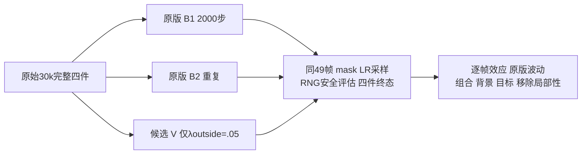

B1和B2的实际源码、完整配置与CPU prepared plans独立审阅通过。此处的PASS仅表示可以由root为精确文件另行批准受控GPU运行；没有执行GPU，没有证明实际恢复或效果正常。长V仍不可运行，须等真实B1/B2的2000条轨迹、末49帧、完整四件状态和原版重复差异进入新的binding及审阅。

17项聚焦CPU检查覆盖17实际生成文件、独立扩窗白名单、原eval/首backward函数、两份算法不变、完整配置字段及类型、无33k reset、V缺少真实参考的显式状态。另用remote标准库确认21份实际小源/config/plan/helper SHA。原型default CPU prepare各核61份受保护原数据/源码/四件30k；未重跑旧512类配置测试。

B1 harness为`88a2df38e5ac4df5905f1de030701189763d469f9eb3daf9e3339f1931aba829`，plan为`359b9d62ee9aec28951532cedbaed45401838dd6ea2b961d5704bec2d303a2d5`。B2 harness为`ede8591eb6ffbc4cca970439d1e8dcd5b75a2b008b408fc03cab73c145e7dd3a`，plan为`0b07086c6d425b7dc8526266b8520d5bd8d8d4736697833574029b2c22681329`。最终审阅绑定在`final_review_B1.json`和`final_review_B2.json`。

所有轨迹重新恢复原始30k，训练30001至32000，horizon仍50000。下次static reset为33000，densify/SGCM在15000结束。32000原SH hook保留；30k static/dynamic active degree均3，原实现只在未达max3时增加，因此不改变阶数。原数学、optimizer与其它hook没有关闭。

`interpretation_preregistered.json`与loss agent的固定协议共同界定解释：对两条原版分别报告全部49帧效应和本次重复差异，不设置新绝对数值阈值。动态占用下降须同时看到可见静态背景改善，且检查actor内容、组合重建和移除局部性；否则报告未解决或代价。单次原版重复不是统计区间，长恢复不证明作者公式、从零训练或其它模块已修复。

素材保留static foreground/environment贡献，固定查看raw0/10/17/20/24/30/40/48及完整49序列。既有raw10/17未遮挡道路的raw42/48真实图像证据可支持核对；未提供dense edited GT，也未证明raw48隐藏道路可恢复。body mask没有覆盖shadow/M-detector缺口。
