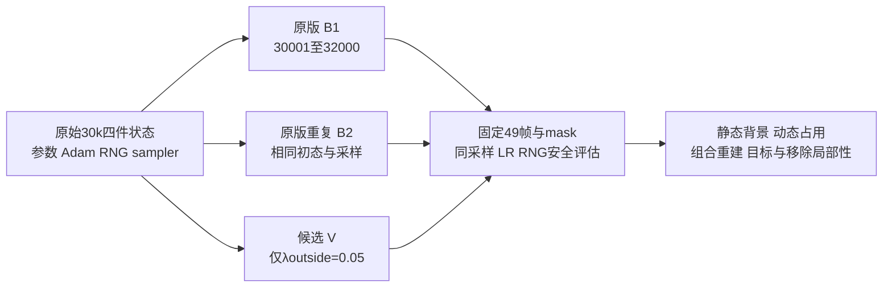

这个实验只回答：从已经退化的原始30k完整状态出发，唯一的 mask 外动态 opacity 项是否在2000步内持续改善分支分配、可见背景与移除局部性，以及是否付出组合重建或目标内容的代价。它不构成“算法正常”或论文复现验收，也不能确认作者公式。

三条轨迹都重新恢复原始30k static、dynamic、environment和完整training state，不接30300终端。Adam、RNG、sampler、EMA、scale、SGCM等状态须由实际observer通过；全部2000条camera/time_shift/LR必须相同。50k学习率horizon保留，32000前没有下一次33000 static reset，densify/SGCM已在15000结束。保留32000原SH hook并记录其状态。

主终点是32000的原始全部49帧。固定非天空、actor body mask外的静态MAE/MSE/PSNR；动态alpha与既有RGB支撑；全图和actor域的组合误差；actor内容和移除输出在mask外的改动。使用既定逐帧均值，同时给每帧差值与像素数。动态透明度单独下降可能是整层塌缩，必须一起检查目标内容与静态/环境贡献。

候选分别对B1和B2报告效果，原版两次运行报告同窗口逐帧差异。这个重复差异只描述本次运行波动，不是置信区间或所有CUDA波动的上界。效应接近原版差异、两次对照方向不一致或依赖挑帧时，结论保持未解决。若背景和分支分配改善，但组合、目标或局部性明显变差，报告代价；只有联合方向保持且真实图像支持时，才有理由提出下一轮受控验证。

不新增绝对数值阈值，尤其不把短300步结果反推成PASS标准。这里的方向与原版重复比较方式在长结果前固定；短实验已有“无事后阈值”协议保留。Root已向本agent报告短300步汇总，这一事实在JSON中明确披露。任何后续工程margin须单独在执行前冻结，不能冒充作者标准。

固定查看raw0/10/17/20/24/30/40/48和完整49帧序列，以相同比例展示原图、组合、static移除、alpha与static foreground/environment。既有CPU证据确认raw10/17的道路有独立未遮挡观测，raw42/48可作固定真实图像参照；这不是dense edited GT。raw48隐藏道路的候选尚未确认。body mask外还可能包含原车投影，缺少shadow mask/M-detector的限制继续存在。

此实验不改变SGCM、static时间参数、深度、RGB masking或shadow处理。20k路面彩色噪点已有环境贡献证据，因此需保留foreground/environment分解，不能把alpha下降后隐藏环境噪声等同于修复几何。失败也不能排除从零训练时这个项的作用。
