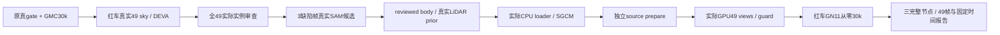

# GMC终态与红车真实输入/启动证据

本轮GMC完整30k、三节点原合同、保存数组导出与实际343原PNG工程复核完成。红车真实分割、逐49身份/32body审查、三帧真实SAM修复、原LiDAR来源构建、actualCPU reader/SGCM、独立prepare及GPU启动通过；owned124555仍训练，启动确认1000步，无完整10k节点，关机未执行。

- `scene8_terminal/`：原completion_contract三节点stat/header、49区域FP32指标、完整closed memory摘要/采样/阶段、六NPS节点和145次SGCM账目；没有大checkpoint实际恢复。
- `gmc_saved_export/`与`gmc_visual_review/`：真实CPU导出/复算和实际全覆盖像素审查。441PNG/HTML/ZIP在本聊天outputs，完整远端实验资产保留。
- `red_masks_initialization_failure.*`、`CPU_portability_validation.json`、`red_masks_attempt2_final.json`：原pidfd工程退出、目标CPU功能检查及新attempt真实完整分割。旧失败未覆盖；文件验证不等于body语义完整。
- `red_actor_review/`、`red_sam_candidates/`、`red_actor_adapter_sam/review.json`：原DEVA99/100车尾缺口、98边界欠分割；真cached SAM三候选、root/独立agent审查后选择98=0、99/100=1。候选不是GT框/手绘/填洞，原DEVA不改；root逐帧selection含全部49、3override来源，human quality=null。真实CPU prior29725点/sourceindices/worldXYZ/time及union/dynamicRGB通过，body仅工程完整性、不称逐像素完美/shadow完整。
- `red_readiness_adapter/`：实际600k原static sourceindices/worldXYZ/time、49canonical、strict.1m后597734static/29725dynamic、首pose0029069的SGCM与fixed0029079、新transform、153复制源码/worker/memory/config来源合同及独立prepare。CPU/gate/source验证不认证完整GPU模型恢复。
- `scene0029_launch/`与`scene0029_GN11_launch_20261013.json`：root真实dispatch，PID124555/cmdline匹配、1000步，无错误；实际GPU Scene49/480×320、SGCM guard/49views/lineage绑定。早期memory不是终态峰。

原四臂和GMC评价为训练观测重建，追加scene无C00，不能套原1dB相对判据或证明模块收益。采样峰是下界，gradient NV缺值不填0；预处理子进程Torch allocator不可读。完整3090迁移仍需red全程与目标机实测。`failure_ledger_delta=V82-F03`仅工程兼容问题；人工verdict只由用户填。
