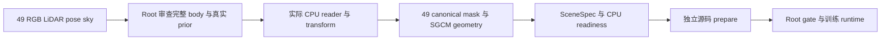

# 红车 CPU readiness 隔离适配

适配真实 `scene0029_069_117`，输入为 `0029069..0029117`，静态时间固定姿态为 local index10 的 `0029079`。不提供训练入口。默认 `check` 不导入 Torch/TF、不写文件，真实 actor 输入未齐时退出2。`build` 只在 root 通知 body/prior 完成真实审查及 CPU validation 后执行。

已执行只读 source check：实际 frozen source、GN11 reference、原 worker 提取及 Python3.9 语法合同均通过；GMC CPU 模板入口存在。默认 check 在实际 Python3.9.25 上正确拒绝未到齐的 actor 输入；未写 transform/readiness、未启动 GPU 或训练。本地证据为 `inherited_source_contracts.json` 和 `default_missing_input_check.json`。

## 真实输入完成后的结果

Root 的真实 body/prior 到齐并通过 `PASS_ACTOR_CPU_ONLY` 后，已完成实际 `check → build → runner validate → --prepare → verify_prepared`。原 seed0 的600,000个混合 static source indices、world XYZ 和 model time 全量核对通过；实际 loader 原 strict `<0.1m` 排除后保留597,734个 static 点，动态 prior 为29,725个真实 sensor 点。49 train/0 test、49 canonical mask/SGCM view 输入通过。SGCM scale 为0.1，ground RMSE 为0.03855038993m。

Spec 保存 selection pointer 和完整逐帧 `reviewed_frames`：98 的真实 SAM candidate0、99/100 的 candidate1 均有原路径、推理来源及 receipt；原 DEVA 数据保留，`human_verdict=null`。训练候选仍为原 GN11 30k、seed0、scale4、完整 opacity 监督及原配置。

独立 source 有153个代码文件，`verify_prepared` 逐字节核对其原来源及预期 `utils/hybrid30k_static_time.py` 替换，原 worker 提取、memory monitor 和 prepared config 均一致。既有 root gate 用 `--verify-paired-steps` 在默认 CPU runner 中重新检查通过：`FOLLOWUP_CPU_VALIDATED_GATE_RECHECKED`。没有执行 `--run`，actual GPU model/SGCM guard binding 与 restoration 未认证。

实际 prepared 路径：

- `training_source/scene0029_069_117`
- `training_support/scene0029_069_117`
- `training_configs/scene0029_069_117_GN11.json`
- 输出候选：`runs/scene0029_069_117_hybrid_30000_seed0_GN11`

这些路径均在独立 followup ROOT 下。真实回执、prepared config/source patch、只读来源验证及小结已保存本地本目录；准确启动命令另存 `red_gn11_run_command.txt`，仅由 root 执行。



## 必需输入

- 原红车 `preparation_manifest.json`、49 FRONT RGB/pose/calib/velodyne、原 600k seed0 world LiDAR 混合 static PLY 和 `static_seed_real_source_indices.npz`。
- `metadata/red_masks_20261013_attempt2/status.json` 的真实49 sky/DEVA terminal 回执。
- Root 提供的 `visually_reviewed` selection：实际 actor 数、逐帧 visibility/来源、49真实 body 审查、raw track identity。没有默认 actor ID。
- Root 生成的49 `dynamic_masks/dynamic_mask_0`、`dynamic_image/dynamic_image_0`、各 actor 的 body mask/source indices 与连续编号真实 prior PLY。
- `dynamic_multi_actor_preparation.json` 和通过的 `dynamic_multi_actor_validation.json`（`PASS_ACTOR_CPU_ONLY`）。真实 SAM body override 如需使用，由 root 在输入构建和来源回执中落实；本适配器不生成 mask、不把 body 固定成 DEVA ID 像素公式。

`check` 检查真实文件集合、headers、root actor 来源绑定、原配置及源码合同。`build` 额外逐帧核对 root body union/dynamic RGB、原 static seed0 source-index 顺序和 world XYZ/.02 model time、真实 actor source-index world XYZ/time，随后复用已成功 GMC 的 `prepare_scene0008_cpu.py:import_cpu_reader/cpu_views`，执行冻结源的 `readWaymoInfo_add`、canonical mask loader 和 SGCM factory。

原 static 种子完整保留600k；唯一 actor 排除仍为实际 loader 的 strict Euclidean `<0.1m`，没有 GT 框筛点、重采样、loss、点数或分辨率修改。CPU 使用 drivingeditor 环境、一个线程及空 `CUDA_VISIBLE_DEVICES`；仅 actual reader 导入 Torch CPU，CUDA 初始化和 `.cuda()` 受到 trap。没有使用 Camera/GaussianModel。

SGCM 的 ground/Hd 坐标继承首车 pose `0029069`：actor 时聚合真实 LiDAR AABB 并向拟合 ground 延伸，world-to-model 使用实际 loader transform。静态时间检查的 fixed-pose anchor `0029079` 单独记录，不能混为同一个 anchor。SGCM guard 在 geometry-only 中关闭，candidate training config 中保留开启；谱系与真实 GPU 绑定继续 pending。

## 执行

仅 SSH `wm-vgpu-1011`，Python `/root/autodl-tmp/envs/drivingeditor/bin/python`。默认部署独立 `tools/red_readiness_adapter/red_readiness_cpu.py`，输出独立 `metadata/red_readiness_adapter`，已有输出拒绝覆盖。loader 的既有 transform 只核对同值，存在不同 transform 则拒绝覆盖；新 transform 用 exclusive create。

```bash
ROOT=/root/autodl-tmp/drivingeditor_repro/campaign/followup_scene_prep_20261013
PY=/root/autodl-tmp/envs/drivingeditor/bin/python
CUDA_VISIBLE_DEVICES= PYTHONDONTWRITEBYTECODE=1 "$PY" "$ROOT/tools/red_readiness_adapter/red_readiness_cpu.py"
```

Root 通知真实 body/prior ready 后，将 `REVIEWED_SELECTION` 设为 root 的实际 selection 路径：

```bash
CUDA_VISIBLE_DEVICES= PYTHONDONTWRITEBYTECODE=1 "$PY" "$ROOT/tools/red_readiness_adapter/red_readiness_cpu.py" check --selection "$REVIEWED_SELECTION"
CUDA_VISIBLE_DEVICES= PYTHONDONTWRITEBYTECODE=1 "$PY" "$ROOT/tools/red_readiness_adapter/red_readiness_cpu.py" build --selection "$REVIEWED_SELECTION"
```

随后复用现有独立 runner 做实际 CPU contract validate 和小型源码 prepare（均不启动训练）：

```bash
OUT="$ROOT/metadata/red_readiness_adapter"
MATRIX=/root/autodl-tmp/drivingeditor_repro/campaign/hybrid30k_20261012
CUDA_VISIBLE_DEVICES= PYTHONDONTWRITEBYTECODE=1 "$PY" "$ROOT/tools/followup/run_scene_gn11.py" \
  --scene-spec "$OUT/scene0029_spec.json" \
  --readiness-file "$OUT/scene0029_cpu_readiness.json" \
  --reference-config "$OUT/scene0029_inherited_GN11_reference.json" \
  --source-repository "$ROOT/frozen_repository" \
  --matrix-tools-dir "$MATRIX/tools" --campaign-root "$ROOT"
# 同一命令追加 --prepare，生成独立 training_source/scene0029_069_117。
```

真实矩阵 tools 路径在执行前以当前实际目录核对。Root 负责 scene-specific gate、ownership 和 launch。本适配器没有 `--run`、后台控制器、hash/指纹或 Git 操作；旧资产、canonical/currentstatus/docs 不改。
