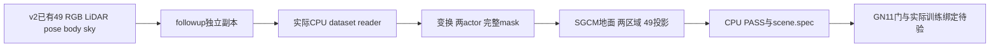

# scene0008：隔离 CPU 准备证据

主任务已 review 并实际执行 helper；本文只核对取回的 JSON、原49帧只读审计和配置/spec一致性，不重跑 dataset reader。执行 helper 的保存版本为 `prepare_scene0008_cpu.executed.py`；外层 `PYTHONDONTWRITEBYTECODE=1` 生效。此阶段真实 GPU训练0步。

| 核查项 | 证据结果 | 作用域 |
|---|---|---|
| 状态 | PASS_CPU_PREPARATION_TRAINING_GATED | training_ready=false |
| CUDA与训练 | gpu_used=false，cuda_initialized=false，training_started=false | 未调用Camera/GaussianModel或训练 |
| 隔离副本 | followup_scene_prep_20261013/inputs/scene0008_023_071_hybrid_cpu_v1 | 原 v2 输入保留 |
| actual reader | 新 frozen_repository/scene/waymo_loader2.py | 调用实际readWaymoInfo_add，不是伪造CameraInfo |
| 相机/时间 | 49 train、0 test，ID0008023–0008071；模型[-.48,.48]、间隔.02 | 全为已观测重建视图 |
| 原尺寸/渲染尺寸 | 1920×1280 /480×320，scale4 | 保持继承配置 |
| 固定 pose | 0008033，第10个相机，timestamp约-.28 | 不能使用银车0017010 |
| 初始点角色 | source静态混合600000 → 严格0.1m移除目标附近点后594981；dynamic42654 | dynamic=8592 pickup+34062 Jeep |
| 目标身份 | DEVA77 pickup/raw23–29；DEVA82 Jeep/raw23–61 | 两 sourcePLY串成一个动态分支；不宣称独立模型编辑 |
| 前车保留 | DEVA153 Corolla，全49与bodyunion重叠0 | raw track仅诊断，未用GT框滤输入 |
| 完整 mask | 原49并集和dynamicRGB exact；actual paper_masks scale4 nearest读取49帧exact | 保留body内809个红通道0像素，不能从RGB推mask |
| SGCM比例 | meter_to_model_scale=.1，dr=.5m→.05模型单位 | 有限各向同性变换 |
| SGCM地面 | 47945候选点、792 lower cells、677 inlier cells，fraction.854798，RMSE.0289076m，tilt2.40483° | 新v2 geometry结果；不复用旧v1数字 |
| SGCM区域与视图 | 两actor累计LiDAR区域，49个CPU实际CameraInfo投影输入均通过freeze校验 | 无遮挡/逐高斯贡献认证 |
| 训练guard | 候选配置True；CPUgeometry副本False | 实际GaussianModel/谱系绑定留待GPU运行检查 |
| 预算与节点 | 从零seed0到30k；10k/20k/30k完整保存 | 尚未启动 |
| 可复用资产 | RGB、rawmetadata、calib、pose、LiDAR、time、sky、DEVA、两body、union、dynamicRGB、两PLY、indices、staticPLY、rawTF | 不重跑segmentation，不下载大数据 |
| 未补足内容 | shadow absent，M-detector false；作者正式训练窗口未公开 | raw23–51作者视频匹配与raw23–71本地扩展分开记录 |

数据对齐读证据：`two_scene_readonly_input_audit_20261013.json`。实际 CPU 证据：`scene0008_cpu_readiness.json`。时间/帧锚点：`scene0008_spec.json`。训练继承配置：`scene0008_inherited_training_config_candidate.json`；geometry临时配置：`scene0008_cpu_geometry_config.json`。

剩余门：银车当前GN11完成并按同合同审查；新的scene-spec runner集成与硬编码解除；GPU所有权；真实模型/Camera/SGCM viewguard/谱系绑定；完整checkpoint运行验证。该CPU PASS不能替代质量评价或打开训练授权。

红车本阶段仍没有可核验的完整49帧输入、明确TFRecord和训练时间窗。旧检索只对first-record缩略图提供证据；身份不明确时不能借用某个排名源启动准备或训练。
