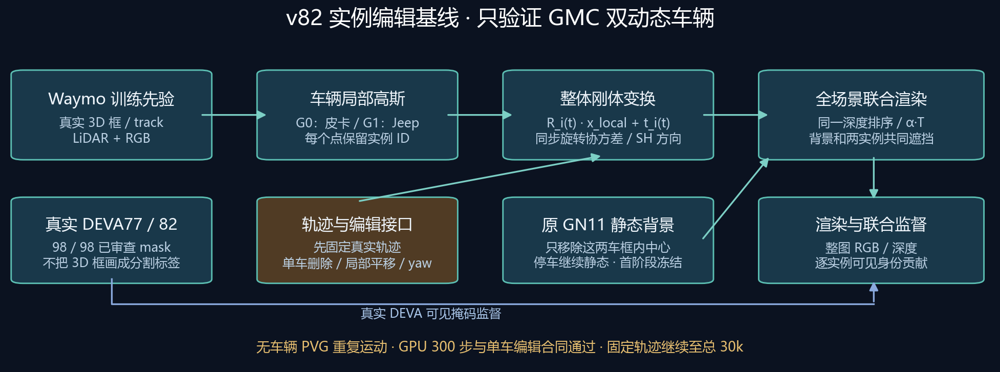

# GMC 实际30k：已保留28观测帧的工程图像审查

已实际逐页查看4张原尺寸contact页，覆盖raw `0008023–0008050`的28帧。当前材料不是完整49帧，也没有本轮编辑质量或固定相机质量结论。所有原输出只读，人工质量结论为`null`。

组件图引用既有outputs文件，未新建模型或图像内容。审查输入是实际30k checkpoint的保留PNG与partial manifest；FP32有限性由该manifest报告，本地未重新读取远端NPZ。420条PNG路径和480×320尺寸均已核对，contact不缩放、不拉伸对比度。

蓝色皮卡（instance0）在最初7帧的车窗、灯、车轮及蓝色车身已较清楚；body joint alpha的7帧均值为0.93046，范围0.87047–0.96001，之后21个保留帧mask为空，可见RGB也为空。边界与接地阴影仍有不足，静态分支没有明显完整皮卡复本，但这不能认证所有背景残留均已消失。

Jeep（instance1）前23帧仍偏灰、半透明，与GT明亮白车差距明显，车体区域可见道路/车道线纹理。最后5个保留帧raw `0008046–0008050`的白车身、格栅与车轮更清晰，body joint alpha约0.92–0.98；道路补片和接地感仍不理想。单ID visible RGB已乘alpha×transmittance，黑底上偏暗不能直接当作完整孤立资产的材质色。

大块浅灰道路模糊同时存在于static RGB与composite；早段static左前景另有暗色块，可能涉及残留阴影或Gaussian范围，具体机制尚未检查。它们不是干净道路恢复或编辑照片质量的证明。

| partial 28帧指标 | instance0 | instance1 |
|---|---:|---:|
| 本批真实非空body分母 | 7 | 28 |
| 原完整49帧非空body分母 | 7 | 39 |
| body joint alpha非空帧均值 | 0.93046 | 0.55859 |
| full-H×W mask MSE，28帧均权 | 0.00033285 | 0.00171365 |
| composite body RGB MSE，非空帧均权 | 0.00116553 | 0.01830257 |

本批整体clipped RGB MSE为0.00218154、逐帧PSNR均值26.67672dB；这些仅是保留28个训练重建视角的真实记录均值，不是完整49、held-out或编辑指标。partial SSIM缺失，未以PNG另造一个分数。

实际PNG给出一个值得优先定位的候选：raw `0008033`的Jeep mask内，joint target alpha约0.51185、isolated all-vehicle raw union约0.99679、static visible alpha约0.48748。raw `0008023`对应约0.35142/0.99986/0.64848；raw `0008046`对应约0.91992/0.98952/0.07931。因此前段透明不能只归为车辆自身opacity尚未学好，full-scene静态贡献/遮挡需要进一步检查。此处明确是8-bit显示PNG除255的诊断，raw alpha是所有车辆union；未证明具体静态点、深度或范围原因。

原尺寸对比页为每行同一实际frame的GT、composite、static、instance0 visible RGB、instance1 visible RGB：

- [gmc30k_partial_observed_00.png](contacts_observed28/gmc30k_partial_observed_00.png)：0008023–0008029。
- [gmc30k_partial_observed_01.png](contacts_observed28/gmc30k_partial_observed_01.png)：0008030–0008036。
- [gmc30k_partial_observed_02.png](contacts_observed28/gmc30k_partial_observed_02.png)：0008037–0008043。
- [gmc30k_partial_observed_03.png](contacts_observed28/gmc30k_partial_observed_03.png)：0008044–0008050。

完整逐页覆盖、原始帧身份、问题帧及证据边界保存在 [工程审查JSON](partial28_engineering_visual_review.json)；PNG诊断保存在 [诊断记录](partial28_reported_metrics_and_PNG_alpha_diagnostics.json)。
