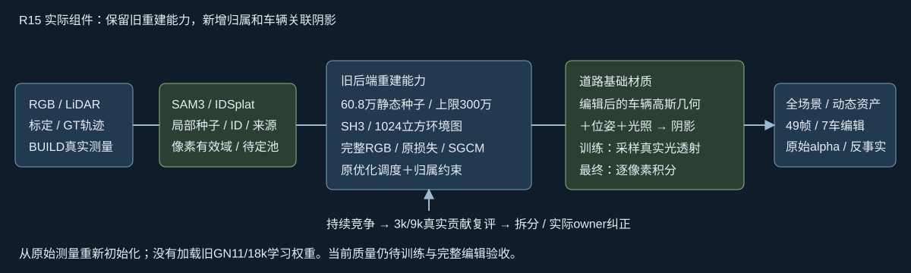

# R15：继承重建能力后的新训练

用户要求修正R14后先自查，再重启新训练。新run backend_restore_r15，R14不恢复。原始BUILD测量608434静态+163387 Actor，共771821。相同SAM3/DEVA区域融合、pixel-valid、IDSplat Actor种子、GT与待定池保留；没有加载GN11/18k学习参数，没有重分割或造LiDAR/mask。

恢复旧能力：SH3（静态非道路及Actor）；6x1024x1024 EnvLight与原轴变换/nvdiffrast；原hybrid整图、静态补集、动态、天空RGB及11x11SSIM；逆深度/衰减、深度平滑、alpha熵；100倍等实例整HW可见mask和软OBB边界；原xyz指数LR/SH进阶/空间clone-split-prune/opacity reset。实际旧SGCMController和clone谱系guard接静态子集，行/来源/Adam适配。物理米与旧归一化单位显式转换。

必要差异：静态无时间/速度自由度，速度NPS=0；道路基础albedo与共享车辆几何/编辑位姿/光照产生的衰减分离，完整RGB不再排除道路。干净参考59423/184019=32.29%，仍有未知；无参考道路也有RGB合成监督。G阶段允许道路基础颜色及低维光照解释全部RGB，M冻结几何，J受约束微调。新增valid、连续深度/alphaT竞争、实测owner复评/必要split和车体保护。训练新增光透射按16/8/4像素receiver网格计算后插值，原RGB/SH/cube未降采样，最终逐像素积分。不是完整车体BRDF分解、未保证光照唯一识别，不声称与旧后端逐像素等价。

22 CPU检查通过（当前包只包含迁移有效的22项）；实际生产容量三阶段CUDA ABI/梯度通过，旧新EnvLight输出maxerror0；抽检124596未参考道路有RGB梯度。实际SGCM自查prune233/clone1/split16，Actor几何逐位不变。工程探测SGD0；正式step1和修复后step2分别验证模型、非空Adam逐位恢复及重渲染maxerror0。

自查保留radii输出槽/空Adam修复记录；启动后复核发现通用增密起点误提前到100。失败段最后日志200（实际200..249）完整保留，从step1、尚未增密的模型/Adam/RNG恢复；尾部199..248次已耗更新单列历史成本，不冒充未耗或有效主预算。核心forward/model与原GPU证明逐文件一致；train_v3仅纠正调度：strict>500、strict<15000，每100，首600末14900，与SGCM550/650偏移不重叠，另有CPU检查。step2再次实际恢复通过。模型源/失败快照和日志在本地/远端保留。

新注册45k=G30000/M10000/J5000，修复前历史成本25049..25196另计，不自动加消融。初始前后向估计约25h，Adam/增密/teacher/审计/IO/49x65渲染另计，按实际日志修正。1k预览；3k/9k全46训练帧43身份alphaT审计/split/重审/actual owner；3k/9k/30k/40k等待根代理看图放行。3k正逢原opacity reset，需结合后续4k rawalpha。当前训练状态只见docs/RESEARCH_STATUS.md。

最终49帧65流待完成：动态独立/可见RGB、rawalpha、7车独立和delete后动态、旧三±1m同轴平移/15/30连续旋转，以及阴影开关/pose/caster反事实。仅7车5/6/12/18/25/26/37允许delete，旧0/1/2->5/26/18；其余4无旧独立资产。旧30k和30k+18k只读历史质量参考，不冒称匹配预算/初始化消融。QUERY已用于开发。

代码见scripts/worldsim_v82/drivingeditor_shadow_rebuild_20261017/r15。CPU日志、实际配置/自查/输入/恢复/修复receipt同目录。大数据、检查点和视频不写Git，但必须最终交付本地统一入口。human_verdict=null，problem_solved=null；failure_ledger_refs=[V82-F01]，failure_ledger_delta=none。
