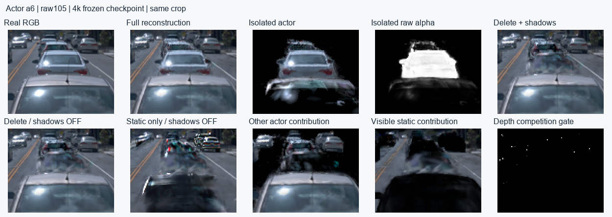
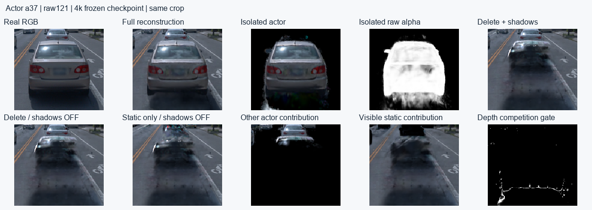

# R15暂停诊断：阴影性能、数值与a6/a37分层

更新时间：2026-10-17T20:14:35+08:00。task/run：`WS-V82-R15-PAUSED-DIAGNOSIS-20261017`。完整[HTML报告](report.html)，[实测严重性表](r15_diagnostic_evidence/severity_table.json)。当前执行授权只见仓库 `docs/RESEARCH_STATUS.md`。

结论：当前实现存在明确的性能瓶颈和已复现的阴影数值错误。4k原配置同帧前向+反传19.92s，关阴影1.68s，差额约91.6%。旧流程从头GN11 30k加实例30k的训练进程合计181.5分钟，不能仅引用最后27k的81.1分钟；两版初始化、目标、Actor及工作量不同。

本次暂停保存点是4000，最后日志4100。完整模型、13组非空Adam状态和RNG已读回，硬链接独立保留于远端 `backend_restore_r15/paused_checkpoint_004000_20261017/checkpoint.pt`。仅控制器增加暂停启动保护；生产训练表示、损失、参数、CUDA ABI和检查点均未用诊断候选覆盖。所有副本的参数更新为0；Adam单独计时使用lr=0。相关心跳原本PAUSED，未创建新任务或subagent。

## 按严重性排序

| 优先级 | 原因 | 证据与处理方向 |
|---|---|---|
| P0 | FP32世界协方差及其显式求逆失稳 | raw107的976,304个有效Actor高斯中，11个实际FP32协方差已非正定，8个逆矩阵对称部分非正定；最大物理条件数2.38e+08。仅chunk512→2048就使部分透射率从1变为约1.8e-35，FP64参考约1。 先改为保留正定性的因子化/局部坐标积分，配FP64参考、分块不变性与梯度检查；仅增大chunk或追加clamp不合格。 |
| P0 | Python/Torch逐Actor、射线块、高斯块的小算子循环 | 同帧F+B 19.92s，关阴影1.68s，差额91.6%。单次无梯度完整前向记录380,987次cudaLaunchKernel，7,551次nonzero及13,640次cudaStreamSynchronize；阴影前向5.54/6.12s。 批处理太阳方向与候选对，缓存每帧/每块边界，避免Python读取GPU条件；建立融合积分/反传内核。算子计数来自额外profiling，不拿profiling墙钟当训练吞吐。 |
| P1 | 对许多小积分块使用activation checkpoint | 1290次checkpoint使积分调用5715→7005，射线×高斯对3818万→6757万。禁用后F+B 16.82s，峰值约11.94GiB；原配置约19.92s、8.85–8.98GiB。 依据块大小和实际显存选择checkpoint，融合反传；当前只做副本诊断，未应用该变更。 |
| P1 | 5个太阳方向串行重复调度和粗筛 | 5→1太阳样本时F+B约5.00s；同样5方向批处理的可见性前向4.67→1.77s，但最大透射率差0.00858。 保留5方向覆盖，先修数值，再验证批处理等价；减到1方向改变了软阴影模型，不能当无损提速。 |
| P1 | 增密使Actor数量和阴影候选对急增 | Actor种子163,387→1,038,133（6.35倍）；总点771,821→2,068,305。a6由3453→123800（35.9倍）。训练相邻日志区间中位数从前1k约2.21s/步增至3k–4k约15.66s/步。 检查增密收益、空间组织和真实可见支持；先使用有效加速结构，不以删车底、截断点数或隐藏坏例代替修复。 |
| P1 | 76通道被容量10的ABI拆为8次整景光栅 | 单次无梯度前向：整景8通道批次合计0.276s；加43路独立alpha和2路分支，共46函数调用、51底层通道pass。反传也要经过这些分支。 复用几何预处理/排序/分箱，评估融合多通道输出；不可把config容量直接写大而突破现有CUDA ABI。 |
| P2 | 每步43实例独立alpha和2个孤立分支 | 无梯度独立alpha共0.125s，静/动态分支共0.039s。它们服务完整实例监督和竞争约束，有明确用途，但当前逐路提交有额外成本。 批量渲染/共享预处理，保持完整内外域与未知标签语义。不能为提速删掉监督。 |
| P2 | 逐步重新解码、验证、传输冻结监督；重复不变工作 | 本次frame构造/传输0.127s，旧诊断0.165s；每步还读legacy配置并把mask送CPU计算boundary_distance，即使本表示的NPS特征恒为0。 缓存冻结Frame/有效域、距离图、配置与相机；profile后再做异步搬运。该量级不足以解释十几秒的主差距。 |
| P2 | 增密/SGCM、归属审计、保存与GPU锁等待 | 3k两轮全46帧归属审计约148.0+147.3s，split约6.6s、owner约45.5s；约5.8分钟，另有保存/锁等待。它们不会出现在每帧F+B中。 单列周期与排队成本，按同worker相邻区间算吞吐。当前证据不支持把每步16s归因于这些间歇工作。 |
| P2 | Adam、梯度裁剪及天空采样不是主要瓶颈 | 零学习率副本Adam计时0.033s，梯度裁剪0.035s，屏幕梯度积累0.001s；场景几何求值约0.048s，天空采样0.0013s（无梯度）。 这些局部计时用于排除主因；父子模块耗时不可相加。无证据需要先更换GPU或增加CPU线程。 |

各行存在父子关系，不能把其时间或加速比相加。完整计时在performance.json；profiling的算子计数与未插桩吞吐分别记录。当前没有应用“减太阳样本”“改大chunk”“关阴影”等改变输出的方案。

## 阴影数值错误

当前用FP32旋转/尺度构造世界协方差后显式求逆；高度各向异性点会产生非正定矩阵，后续把a/transverse强行clamp为正，仍可能得到错误但有限的遮挡。扩大高斯块使此前被粗筛排除的病态点参与积分，结果明显依赖chunk。五个最大差异网格点的同模型FP64稠密参考（全部有效Actor点、无AABB）支持接近无遮挡；原FP32逆矩阵即使用FP64后续算术也给出几乎全遮挡。仅把c-b²/a改成残差二次型仍有非有限值，未作为修复采用。

保留有限梯度不等于阴影数值正确。先用局部旋转/尺度因子避免显式病态求逆，复核FP64、分块与太阳批处理等价及梯度，然后再提速。这里只定位错误，没有证明该错误解释全部外观差距。

## a6 / a37

49帧无阴影分层、46个训练帧精确alpha*T特征梯度审计，以及6个锚帧的阴影/删除反事实均完成。a6 raw105及a37 raw121删除后关阴影仍有残留；静态层单独渲染保留相同车形外观，a6还受其他Actor贡献影响。删除确实移除了目标owner的全部高斯，残影并非单纯漏删目标点或剩下投射阴影。

现有竞争门控只在静动态深度差<0.45m时工作。a6锚帧中位深度差15.35m、门控拒绝100.00%；a37为3.70m、拒绝98.66%。道路/远处静态表面上的车形外观没有被“同表面占用竞争”覆盖。不能把正确静态道路点全部转成Actor来消除图像残影。

3k审计紧接opacity reset：最大单点opacity约0.01。a6/a37没有任何点达到既定重复道路正证据；实际split=0、Actor→static=0、static→Actor=0，仅从待定真实测量池加入459点（a6 188、a37 114）。4k时静态点中source_candidate_owner为a6/a37的数量都为0，当前静态转Actor规则没有这两个目标的候选入口。该限制不能靠多跑相同审计自动消除；9k审计也与3000步reset间隔重合。

a6种子3453→123800点，a37 10349→83130；4k中心越出软OBB的点分别29834、14573。OBB项约束中心且为软惩罚，不保证高斯支撑范围或独立资产边界。raw alpha车外支撑还可能包含合法被遮挡部分，不能全部当作道路误入。处理应分开：Actor碎片的实际多帧证据、静态外观残影的真实跨时刻表面观测、以及opacity reset后的有效审计时机；保留完整内外mask监督，未知不当背景，不按高度切车底。

## 范围与验证

- 同一保存点raw107做重复F+B计时；9次测量，0生产SGD。43实例/2,068,305点/480×320，PyTorch 2.2.2+cu118、RTX4080SUPER。
- 计时覆盖数据、几何、环境、光栅、阴影、反传、梯度裁剪、屏幕统计与lr=0 Adam；周期审计用原日志单列，不伪造每步占比。后续material/joint实际训练尚未发生，旧零更新探测不作为最终吞吐。
- 暂停控制器在启动任何worker前读PAUSE_REQUESTED，实际执行返回0且未启动训练；原控制器已备份。该旧控制器并非通用恢复入口（仍有初始step2断言），不能删除暂停标记后直接当作4k恢复命令。
- FP64数值核查只覆盖一个帧的5个最大分块差异射线；不是全49帧FP64验收。当前没有修复后训练、完整编辑GT或最终质量通过结论。
- BUILD/QUERY边界不变；这些QUERY已用于开发。静态残影来源由反事实可定位，但无遮挡道路真值仍缺失；alpha覆盖率不是补景质量分数。
- 源码、输入、GT、mask、历史失败与检查点保留，human_verdict=null，problem_solved=null。

复现脚本：仓库 `scripts/worldsim_v82/drivingeditor_shadow_rebuild_20261017/r15/diagnostics/`。依次用共享GPU锁运行audit_performance.py、audit_actors.py、audit_shadow_precision.py；它们只读4000检查点，不恢复长训。服务器结果为 `backend_restore_r15/paused_diagnostic_20261017/`，checkpoint保持在远端，不推Git。

failure_ledger_refs=[V82-F01,V82-F05,V82-F06]，failure_ledger_delta=[V82-F05,V82-F06]。新的两条记录分别为阴影实现的性能/数值故障和归属审计的时机/候选覆盖缺口，不是作者方法或高斯表征的普遍否定。

一手参考：[PyTorch CUDA同步与小算子调度](https://docs.pytorch.org/tutorials/recipes/recipes/tuning_guide.html#avoid-unnecessary-cpu-gpu-synchronization)、[activation checkpoint重计算](https://docs.pytorch.org/docs/stable/checkpoint.html)、[病态矩阵数值限制](https://docs.pytorch.org/docs/2.1/notes/numerical_accuracy.html#extremal-values-in-linalg)。本案主张以实际代码与测量为证据，文档只用于解释机制。
