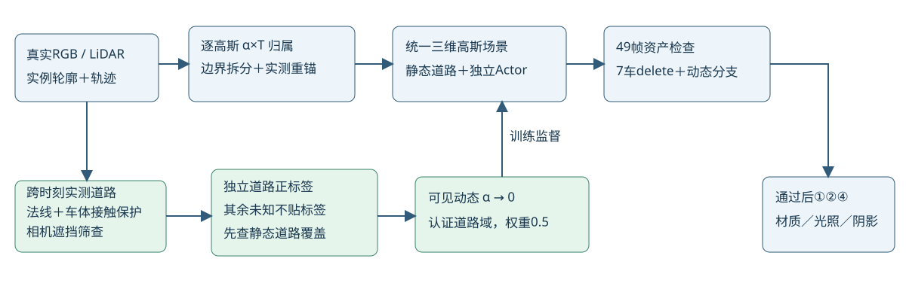

# 相机遮挡筛查与安全父状态重跑

任务WS-V82-DRIVINGEDITOR-SHADOW-REBUILD-20261017。当前执行快照仅见[RESEARCH_STATUS](../../../../RESEARCH_STATUS.md)。⑥资产归属／边界仍优先，未进入材质。R9使用相同implementation_r8内核（28CPU检查已过），修正测量可见性和数据监督，没有新建body mask。

## R8短测拒绝作为主方法状态

E4@9000的同7证据帧6/7车身MAE改善，但a37 rawbody平均alpha从约0.9676降到0.9428，车尾出现新的斑块。根代理看过同7帧、a37完整49帧独立RGB以及真实raw89 RGB；不能以平均误差下降当资产干净度通过。此为工程质量拒绝，不代填人工verdict，不归因唯一机制。

R8的“世界道路点”不等于“相机当前可见道路像素”。LiDAR与相机视角不同，路面点投影可能落在实际车体后面。将真实训练帧body LiDAR bank按实测轨迹变换到当前相机，使用1像素点支持与0.1米前景深度间隔，发现6921/252652个道路监督候选可能被已测车体遮挡。它是稀疏保守遮挡代理，不能反过来把没有body点的像素全部认证为无遮挡。

特别更正：此前“a37约96.6%的道路域动态质量在未知mask帧”来自旧R5道路投影域；该域含潜在相机遮挡，所以此数不是实际可见路面污染比例，更不是黑影真假比例。原始数字保留用于追溯，不能作为裁车体理由。

## 证据修正

data_r5_ray_visible_road从R8字段拒绝6921个潜在遮挡正标签，保留245731训练像素；同时拒绝7410个早前加入、可能把真实车体RGB排除掉的road域像素，保留最初保守data_r2 road标签。原RGB、body masks、mask_known、深度、seed、轨迹不变，测试帧无新证据。遮挡像素恢复“未知”，不新增body-alpha=1标签，也不生成轮廓或测量点。重新从真实训练RGB/深度刷新道路参考。

这是数据可见性修复，原完整已知mask内外损失仍在；独立road_identity仍权重0.5，只在新认证域；未认证未知没有新增背景梯度。R8所有失败图、视频、checkpoint均保留。

## 回退与预算

主方法从E3@8000安全参数、Adam、RNG恢复到新E5_ray_visible_from8k，刷新4731个道路参考。未采用出现新斑块的E4@9000学习参数；另有E5_ray_visible_s0从9k准备但从未训练的零更新备用fork，不是主方法，禁止误启动。

废弃E4的1000梯度更新仍计预算：工作模型几何目标29000＋废弃1000=几何资源30000；材质10000、联合5000；最终工作模型global44000，对应总GPU45000次训练更新。不通过改global_step伪造训练，也不事后把这轮挪出预算。E5只工作8000→9000，完成后累计资源10000；根代理再看同7与完整49帧、道路归属和车体/轮胎/背景决定下一步。

## 共同度量域

道路指标的筛选变化不能冒充模型收益。common_r9_metric_controller在E5完成后只读重新渲染E3@8000、失败E4@9000、E5@9000，统一使用同一data_r5的245731个训练正证据像素，保留静态和所有43Actor参与完整alpha*T。分别输出道路可见动态质量、已知body可见alpha和未知标签帧的道路质量。旧R5未筛遮挡域仅作历史诊断，不与新域直接比较百分比。无独立无影或反事实编辑GT。

E1/E2/E3/E4现有260条H264×49帧已本地保存、逐帧解码验证；比较入口可选版本。均为canonical几何阶段，关影恒等由构造决定，不冒称物理阴影通过。新E5还需完整49帧和共同域检查。delete范围仍7辆5/6/12/18/25/26/37；旧0/1/2→5/26/18，其余无旧独立资产时仅旧场景外观。

失败和修改接口保留：R8 --weight 0同源关闭新增道路项，R6边界/重锚/外部可见项开关和三阶段消融仍在，但未自动排队。当前是输入与工程修复，不讨论新颖性。failure_ledger_refs=[V82-F01]，failure_ledger_delta=none；人工verdict=null，problem_solved=null。
