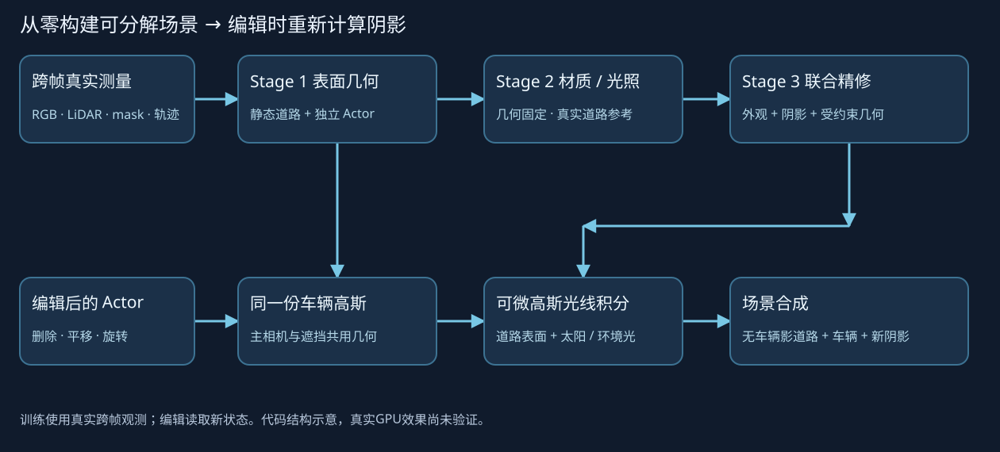

# 动态分支P0修复：监督归一化与车底贡献诊断

任务 `WS-V82-DRIVINGEDITOR-SHADOW-REBUILD-20261017 / E1_balanced_s0`。用户将动态分支带道路、残影和异常几何列为最高优先级。当前状态统一见[RESEARCH_STATUS](../../../../RESEARCH_STATUS.md)。

## 5000步门槛未通过

R3从真实RGB/LiDAR初始化，未读取上轮18k或GN11检查点；旧18k的车辆资产归属/去影没有完成认证，本轮复现同类分层缺陷，不能叫作参数继承。原E0@5000完整保留、停止进入材质。7个准入Actor同证据帧body线性RGB MAE均比1000步下降，但a37动态分支底部带道路板片，a18仍破碎（0.1421→0.0924）；平均重建改善不算分层通过。

冻结模型只读特征反传得到逐高斯精确alpha*T贡献。a37距所有已知车体6像素外的动态alpha质量3651.36，其中85.17%来自初始种子高度位于3D框底部15cm内的高斯。a5同域96.29%，a26为79.82%。此域可能含未知辅助对象，不能全部冒充已认证道路；板片有可视证据。细节见parent_layer_contribution.json。

同一a37帧已知实例36个，逐实例完整外部域均值相对全局域均值的梯度倍数38.08。原photometric对opacity梯度L1约0.010397，完整车外约束约1.676e-6；不表示两类梯度必然逐点对抗，也不单独证明全部外泄成因。底部点三维归属仍可能需要修复，不能仅靠更长训练掩盖。a18 body内raw alpha0.9894、可见自身贡献0.9071、静态可见贡献0.08975，外观与静态遮挡都应回看。

## 显式监督修复

保持原始数据、几何/拓扑初始化、原RGB/LiDAR/道路/可见身份损失、相机和旧内核。R3配置仍可重放。R4 scene0008_balanced.json：

- raw alpha不乘GT。mask内先逐实例域内MSE，再平均有正标签实例，权重0.05。
- mask外仍为每个已知实例的完整外部域MSE，各实例域内均值求和，权重0.5；未知不参与。没有缩减外部监督区域。以原实例数/场景决定的全局平均会使单车梯度变弱，因此显式改归一化与权重，不能把数字0.05与0.5直接解释成完整等价强度比。
- body RGB和教师先各实例域内均值，再在可见实例间等权；材质阶段每辆最多128个采样像素。可见身份仍是原全局定义、权重0.1。

--fork-supervision-from从E0@5000写全新E1目录，保留模型、Adam、RNG和已用global_step，只允许几何阶段false→true与outside权重0.5这两项配置差异，数据契约必须完全一致。父文件不修改，后续恢复仍严格同配置。先1000次修复更新至global6000；5k父训练计入主预算，总45k不增加。不是同一步数、单因素的因果消融。消融接口保留，不自动排七臂。

21项CPU检查通过，新检查覆盖空实例不稀释外部梯度、小车等权、fork/断点恢复逐位一致与其他配置变化拒绝。实际6000步分层/车身结果仍须看图和贡献检查；不提前声明动态分支解决。

## 验收门槛与证据边界

先对照同7帧E1@6000和E0@5000的GT、canonical、独立Actor RGB/raw alpha、可见贡献、静态背景和逐点贡献；修复不足则核对真实LiDAR底部点归属。动态分支完整49帧与7辆delete验收前不进入材质/阴影。旧三辆另保留同轴平移和±15°/±30°旋转及动态视频。

corrected camera_pairing_audit_r2.json仅修正新RGB缩放核文字：实际为PIL LANCZOS，r1误写bilinear；原像素与2.4097/255实测差值没变。49帧物理相机一致、旧native投影-0.125像素；共同相机/GT/显示线性域的实际GPU配对仍待执行。旧原生结果保留。

`failure_ledger_refs=[V82-F01]`，`failure_ledger_delta=none`；本目录记录工程分层缺陷与修复探测，不制造科学否定或人工verdict。human_verdict=null，problem_solved=null。
