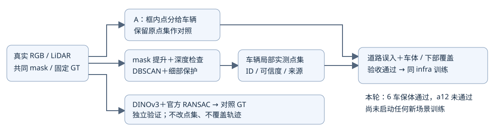

# ⑥ IDSplat 前端点集对照 R13

本轮只验初始化点集：相同原始 BUILD、冻结共同 mask、固定 Waymo GT 和 implementation_r12 后端。用户明确停止 B/C：A3000 步已完整导出；B3000 步在视频导出时停止，1500/3000 检查点保留；C0，不恢复旧队列。历史训练成本19500..19549，本轮新增场景优化0。

## 输入与适配

官方 IDSplat 固定 e3e08fcd794d18ab61fa4550235a6bbf41643726，参考 §3.2–3.3（https://arxiv.org/html/2511.19235v1#S3.SS2）。SAM3 替代 Grounded-SAM-2；共同 shared_sam3_masks_r2 不重跑、不事后改标签，a37 全49原生SAM3，其他Actor含DEVA/冲突回退，来源已明示。BUILD=train46 rawrow%5!=0；raw101/113/125及其他帧20%返回只QUERY。QUERY先前已用于开发，不称新盲测。

3D框仅候选。实际mask提升到同帧真实LiDAR，用BUILD独立重算相机frontmost深度；3像素腐蚀仅生成核心证据，不直接裁轮胎。官方DBSCAN eps0.5m/min10，保留所有有核心支持簇；15cm真实簇连接、2帧8cm语义表面支持或稀疏帧直接body证据保护细部。正世界道路冲突留未知池。近邻重复表面支持不是独立点跟踪或运动证明。无高度裁底、只最大簇、随机框内补点或停车过滤。待定不等于静态。

接口：车辆局部实测点、实例ID、固定GT轨迹、证据可信度及原始frame/rawrow/world来源。未改轨迹、RGB/监督文件、其他36Actor或静态种子属性（仅重排邻居索引）。actual_data_audit.json对真实输入逐项核验通过。未迁移SplatAD对象管理、Nerfstudio相机y/z翻转、LiDAR强度/raydrop/LOS专用损失；这是有边界的机制适配，不是完整官方复现。

## 固定门槛与结果

每车body与下部8cm覆盖至少保留A的90%；道路proxy A>=30的实例要求至少减少50%。阈值在QUERY前固定，没有根据本轮结果重调。

|Actor|道路误入代理 A→R13|body覆盖 A→R13|下部覆盖 A→R13|保体|
|---|---|---|---|---|
|5|1874→2|99.91%→99.11%|100%→97.42%|通过|
|6|无正道路证据|99.79%→99.03%|100%→100%|通过|
|12|3→0（分母小）|95.59%→75.98%|89.47%→60.53%|未通过|
|18|5→3（分母小）|94.59%→93.08%|97.50%→97.08%|通过|
|25|40→0|99.07%→98.76%|99.53%→98.60%|通过|
|26|483→8|99.41%→97.03%|99.29%→92.59%|通过|
|37|3835→165|99.71%→99.48%|99.36%→99.07%|通过|

这些是实际保留LiDAR+预测mask/正道路证据的几何代理，不是手工3D真值、车影比例或删除验收。下部指可见mask框底部25%，不是轮胎真值。a12的204body/38下部查询点全部来自训练帧保留返回，测试三帧没有body分母。

a12分步定位：深度可见95.59%/89.47%；共同mask提升78.43%/65.79%；聚类与细部保护75.98%/60.53%；该Actor正道路冲突返回0，因此不是道路冲突规则裁掉车底。其RGB可见部分是其他停车车辆后方局部片段；缺mask/投影偏差/查询标签误差尚不能唯一分开。本代理亲看全部7车真实点集图，a5/a26平坦基座明显减少，a37大片基座减少但仍有低处点，整体7车保体门槛未通过。

## 独立DINOv3/RANSAC

真实46训练图，ViT-B16层7去5prefix得20x30x768，原生双线性采样，无独立PCA/AnyUp，QUERY不提特征。每帧最多512真实点，规范帧按采样后点数选；7Actor各规划8配对。56对中9对不同源特征对应不足、47对得到官方余弦匹配+三点Umeyama/100000假设RANSAC变换；0.2m对应阈值、0.1m目标覆盖。完整结果dinov3_validation.json。没有用RANSAC改点/轨迹，也没用绑定高斯随车动来自证。

例如a37八对均达50%目标覆盖，中位旋转对GT1.81°、车中心2.07cm；a12中位57.0°、1.20m；a18中位37.6°、0.75m（仅5有效对，另3对应不足）。不能把高覆盖当运动正确，停车/小运动/冲突继续不确定，GT字节不变。

## 验证、交付与停止点

源文件AST检查通过；实际数据审计检查所有7车来源BUILD行、世界/局部变换、静态与其他36、全49RGB和监督、GT不变；无新SGD。root_pointset_review.json是代理复核，不是人工verdict。

本轮有局部价值，不能否定IDSplat策略；但未通过完整门槛，不启动3000训练或①②④，不伪造新动态/编辑视频。已有A65x49与旧18k比较保留；B的视频中断不能冒称完整交付。中文HTML、7车实测点图、21MB局部点集/待定原始来源/GT/实际配准对应包已保存本地outputs/shadow_rebuild_v3/idsplat_frontend_r13并追加统一入口。生成器report_IDSplat_r13.py可复建。

按用户此前停止条件，保存推送后核对全部本任务训练/数据/渲染/特征/评价/控制器及锁排队退出、其他GPU任务空闲，再用AutoDL官方/usr/bin/shutdown关机并暂停心跳；具体电源回执以本地shutdown_receipt为准。临时idle检查不是单独的关机理由。保留全部历史原始测量、检查点与失败证据。

task_id=WS-V82-DRIVINGEDITOR-SHADOW-REBUILD-20261017，run_id=idsplat_frontend_r13，human_verdict=null，problem_solved=false，failure_ledger_refs=[V82-F01]，failure_ledger_delta=none（本轮是点集适配未过门槛，未建立新的下游训练否定）。
