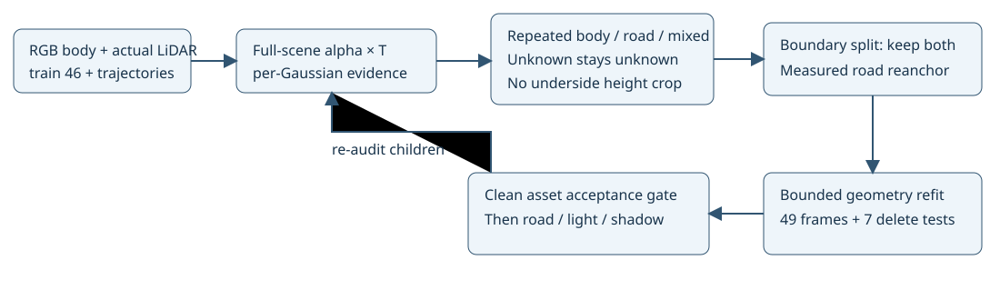

# ⑥动态资产混入道路：归属与跨边界修复

任务 `WS-V82-DRIVINGEDITOR-SHADOW-REBUILD-20261017`。当前执行快照仅见[RESEARCH_STATUS](../../../../RESEARCH_STATUS.md)。原GN11、旧18k、E0@5000、E1@6000均保留。用户优先⑥资产归属／边界，再①道路细节②阴影形状④车身外观，不讨论新颖性。

## 对照、证据与方法

E1归一化短对照只做1000更新，global5000→6000。a37车外raw alpha总量4642→918，但残片仍在，a6/a26/a37同帧body MAE分别增加0.00614/0.00380/0.00311；不能将透明度下降当归属成功。此对照改变步数和监督，不是同预算单因素因果消融。

BUILD只用46训练帧。全场景包括静态与所有Actor参与相同alpha*T合成；反传每行独立feature，累积逐高斯对自车body、其他已知body、真实道路像素以及全部可见像素的贡献。不是之前独立Actor去掉背景后得到的逐点贡献。后续49帧含3测试帧仅用于QUERY。403未知mask不伪造为背景。

原road监督使用OBB遮挡guard，车底附近留空，不能把这部分无道路标签解释为非道路。因此直接从真实LiDAR行构建额外道路正证据：同像素可见深度、排除已有真实body；与三个已测静态道路局部法线／表面在6cm内一致、邻域2m内，世界位置10cm球至少3训练时刻重复测到。323404候选实际点中308087满足重复支持，保留原始frame_index、lidar_row、xyz；这是保守几何道路证据，不是人工语义道路GT。不按车底高度裁剪，不把未知或不可见点判背景。

对混合贡献点，选择投影伸展最大的三维主轴，采样实际body轮廓交点；外侧须邻近已认证道路像素，至少3帧轴向和切点一致。62父点分为124子点，全部保留、原身份不变。以截断正态矩确定子均值／方差与密度质量，受影响Adam行清零，其余保留。随后用完整43已知身份通道和道路通道重新审计。

重复body证据优先保护：有至少3帧且body质量>=0.5的混合点不能整点转背景。道路候选要求至少3帧道路、质量>=0.5、道路占已知语义贡献>0.8、自body占比<0.05且没有重复body正证据；再要求高斯中心附近实际道路测量在至少3个帧中支持。636候选中426重锚到一条实际LiDAR测量的世界位置，采用已测路面局部几何朝向／尺度；不是冻结某一车辆位姿。原/新owner、实际世界点、选中原始LiDAR行、跨帧支持逐点存档。3136混合与91857证据不足点保留；不称为全部污染已经清除。法线邻居按新owner重建，clean-road参考按新几何和真实trainRGB/深度重新计算。

输入data_r3_ownership保留原RGB、实例mask、轨迹与原seed，只添加已认证训练道路像素，测试监督不变；checkpoint显式记录新契约与谱系，保留模型、Adam、RNG和已用6000步。新参考4853点，不是无影GT。原始data_r2不改。

## 完整监督与遮挡

配置outside_fullscene_visibility显式false→true。mask内仍为未乘GT的raw alpha→1，每实例域均值再平均，权重0.05；mask外每个已知实例的完整外域都保留，改用全场景可见alpha*T→0，逐实例域均值求和，权重0.5。全场景T保护被其他真实表面遮住的车体；没有裁小外部像素域。可见identity权重0.1、RGB/LiDAR/教师和其他权重保持。raw alpha完整交付用于独立资产诊断。此更改落实用户“不把不可见当背景”，是明确登记的共同工程干预，不是声称原raw外部约束未变。

25项CPU检查通过；模型大场景CUDA中继续做受界1000更新到global7000，之后根代理看同7帧、完整49帧动态/删除视频及逐点贡献，不能盲进材质。geometry_sequence_review是canonical几何阶段诊断，关影一致由构造决定，不冒称光照/阴影成功。正式材质阴影和45k主预算不变。

## 消融接口和来源边界

apply_boundary_split.py --skip-split --output NEW_RUN；apply_road_reanchor.py --skip-reanchor / --raw-exterior --output NEW_RUN --data-output NEW_DATA，分别可关边界分解、道路转归属与可见性外部约束。所有干预必须用独立目录，不能覆盖原臂，source-run与audit点表须同一源／拓扑；暂未排这些控制，不报告因果收益。训练阶段原七臂开关仍保留。

[Gaussian Grouping](https://arxiv.org/html/2312.00732v2)启发逐点身份与跨视图一致性，这里用可追溯贡献而非其16维身份分类器；[SAGD](https://arxiv.org/html/2401.17857v4)启发投影交点分解，这里保留两侧并用截断高斯矩，区别于丢弃外侧；[UnIRe](https://arxiv.org/html/2504.00763v2)启发时空LiDAR关联，这里使用已知轨迹和实测路面，未迁移场景流或高度剔地。这些是适配实现。

仅7准入车做delete：5/6/12/18/25/26/37，旧0/1/2对应5/26/18；其余4没有旧独立资产时仅做旧场景外观参考。车身正常暗面、自阴影／反射、不可见形状和未观测道路仍有证据边界。failure_ledger_refs=[V82-F01]，failure_ledger_delta=none；人工verdict=null，problem_solved=null。
