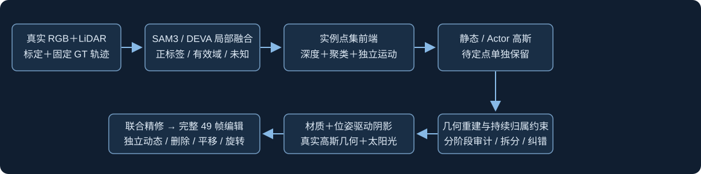

# R14：区域有效域、实例点集、持续归属约束与几何阴影

> **最新用户指令：R14已暂停。** 完整checkpoint5000、最后日志5350；后端存在容量/表示/道路监督简化，先完成[继承审计](backend_audit/README.md)。下文是暂停前的原实现与计划，不能作为继续训练或关机授权。

任务 `WS-V82-DRIVINGEDITOR-SHADOW-REBUILD-20261017`，run `ownership_rebuild_r14`。当前执行阶段只见 [RESEARCH_STATUS](../../../../RESEARCH_STATUS.md)。本文记录实现与3k检查证据，不声称已经解决动态资产带道路或完成49帧编辑。

## 输入与前端

相同原始RGB、LiDAR、标定和固定Waymo GT。BUILD为46训练帧且原始点行号不被5整除的80%返回；其余返回与raw101/113/125只QUERY。QUERY已用于开发查看，不称新盲测。复用已有原生SAM3预测，不重跑分割。框只提供候选ID，不等于车身。DINOv3 ViT-B/16真实特征和官方RANSAC用于新点集独立核验，不替换GT；没有从强制随车的高斯运动自证归属。停车、小运动、遮挡和冲突保留不确定。

旧DEVA与SAM3接受相同的可见、非道路真实LiDAR/连通域检查；取消整车回退和旧空标签优先。局部冲突只将相关像素标未知。`mask_valid[H,W,K]`支持有效车体、有效实例外和未知；未知不当背景，RGB/LiDAR实际观测监督仍保留。完整有效内外mask监督保留，body RGB、可见身份、评价与归属审计尊重valid。

实例mask提升到实际LiDAR，重算BUILD深度可见性；DBSCAN/语义邻域/稀疏帧证据保护细部，不仅留最大簇、不按离地高度裁掉轮胎、不在框内随机补点。前端向infra传车辆局部实测点、实例ID、固定轨迹、证据置信度与source frame/raw row/world。244004初始高斯，128654真实待定点单独保存。没有加载GN11/v2/18k学习参数。

## 持续约束和实际owner

每次更新同时检查分支独立合成alpha与表面深度，以及完整场景alpha×T贡献。近同表面深度门控默认0.15m、最大0.45m，门控不反传；真实body域惩罚重复静态分支，道路域惩罚重复动态分支，支持分支作为固定参照，不让两边一起透明。warmup500，occupancy权重0.1、render贡献0.05。没有直接使用NeRF密度比值，也不使用整像素静动态熵去压掉车辆后正常道路。材料阶段不透明度小学习率仍可受约束。

这是分支表面深度近似：接触处和多层深度仍可能混淆，不能称为精确三维占据真值。3k/9k执行真实46帧、全43身份的逐高斯alpha×T审计。混合高斯只有真实车体/道路各>=3帧、可分三维表面且协方差守恒受支持才拆分，保留两侧后重新审计。owner修正需正世界道路锚或独立实际三维运动，4sigma实际车体保护；坐标、几何锚、source、Adam和实际owner同步。待定车体只凭实际BUILD深度/mask或独立运动、重复贡献父点、3sigma体积和无正道路冲突接纳。未决点不默认静态。

3k实际：拆分0、Actor→静态0、静态→Actor0，接纳真实待定车体234，保留未知128420；原有opacity不变。没有为了非零修改放宽阈值。这并不证明污染不存在或资产已干净。调用与结果见evidence_003000。

## 位姿驱动阴影与训练

`C=C0*(1-rho(x, edited_actor_geometry_pose, L))`。rho来自同一套实际Actor高斯xyz/cov/opacity的太阳方向解析密度积分、环境光和可见道路接收面；编辑后重新计算。没有自由时间embedding、独立黑纹理或五盒体投影。太阳/环境光/强度/柔度为场景共享参数，尚未建模时间变化照明；车辆自身明暗也不是完整intrinsic分解。

注册预算G13000/M7000/J2400，总22400；历史19500..19549另记。CPU39检查通过，真实CUDA ABI与三阶段梯度/吞吐探测通过，探测SGD0。每1000步保存并释放GPU锁，他人优先；不自动加7个消融。完整代码在scripts对应r14/backend，campaign保留现场适配脚本。它们依赖真实数据缓存、原有CUDA光栅器和任务目录，不是自带数据、可任意路径直接运行的独立包。

原控制器3k调用`state(status,phase=...)`时原参数命名冲突，审计前退出。原日志、状态和119MB检查点保留。修复状态函数与helper的final快照导入；显式恢复控制器从相同3k模型/Adam/RNG/输入开始补审计，重复SGD0，剩余19400。原始学习代码未变。审计、处理和7帧预览实际通过后继续4k，不从0或DINO重来。

## 3k视觉边界与最终验收

根代理自行检查7车contact及a5/a12/a18/a37细图。a5本帧没有旧的大面积路板，但下沿仍有毛刺；a12只见遮挡后片段，小MAE不表示完整车体；a18白车外观失真，bodyMAE约0.103；a37删除后明显浅色缺口。道路、建筑和天空仍模糊。质量未接受，7帧不能冒称完整49帧验收；后续用户已明确暂停并要求恢复基线后端设计。

最终49帧65流包括独立/可见动态RGB与原始alpha、7车独立与删除后动态、旧三同轴同幅±1m和15°/30°连续编辑。delete仅5/6/12/18/25/26/37，旧0/1/2→5/26/18；另外4车无旧独立资产，只能比较旧场景外观。实际阴影反事实覆盖同时间改pose、对应caster删除、关阴影保持C0和固定pose/相机/光照重复。原GN11/v2/18k只读，为历史质量参考，非匹配初始化/预算的因果对照。

修图只读：原绘图仅检测背景→车身，现完整填色/四边/孔洞边界。49帧×7车二值PNG和mask_valid逐像素一致，原43通道冻结NPZ未改；这不是mask语义质量通过。完整PNG/LiDAR/NPZ和连续结果保留本地输出与AutoDL，不提交大型数据到Git。

human_verdict=null，problem_solved=null，failure_ledger_refs=[V82-F01]，failure_ledger_delta=none；控制器异常为已定位工程错误，不硬造新的科学失败ID。原完整训练/关机计划已由最新暂停指令挂起；当前心跳已暂停、GPU未关机。
