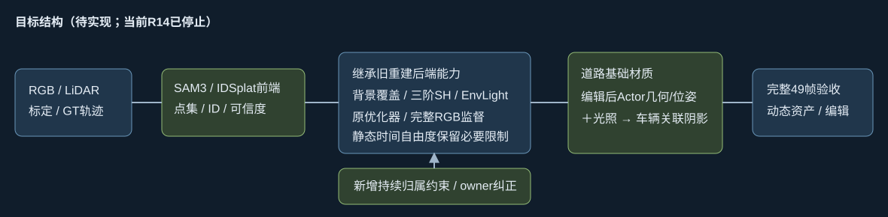

# 后端继承审计与用户暂停

用户2026-10-17明确指出R14相对旧30k/30k+18k过度简化，要求先停。08:20SGT已停止所有本任务控制器/训练/锁进程；心跳PAUSED，GPU未关机。不按历史“跑完再关机”继续自动执行。

完整可恢复5000步，最后日志5350，实际尾部范围5350..5399；checkpoint模型/Adam/RNG/输入完整，另存并核验SHA。证据见[pause_receipt.json](pause_receipt.json)和[evidence.json](evidence.json)。这些是实际CPU读取合同与张量形状，不是推测的默认配置。

| 核对项 | 旧实际后端 | R14 |
|---|---|---|
| 静态背景 | 915840已训练点，刚体30k保留全部且低LR联合优化 | 初始80617，5k83456；全场景上限450000 |
| 环境图 | 6×1024×1024×3，刚体阶段冻结已训练图 | 1×3×32×64，从零学习 |
| 外观 | 静态和Actor active_SH_degree=3，DC+15高阶RGB | 静态基础RGB，Actor±.08方向残差 |
| 道路几何阶段颜色 | 刚体全场景RGB/静态补集RGB、SSIM | canonical_domain排除道路，依赖干净参考 |
| 干净参考 | 旧18k局部路由修复 | 5k24746道路点，仅1809正confidence（7.31%） |
| 拓扑/调度 | GN11参考3M增密预算；实际刚体30k固定拓扑，SH进阶/指数LR | 每500步top-k拆2%、常量LR、20cm边界、45万总上限 |

这不是单因素初始化对照。不能认定各项造成多少质量退化，更不能把当前退化当IDSplat无效证据。7.31%是高斯参考比例，不是屏幕像素比例；无参考点仍可能受几何/邻域/投影尾部等约束，但缺少该干净颜色项和正常道路直接颜色重建通路。

道路完整RGB须通过含姿态驱动阴影的合成结果监督，跨帧真实干净观测另约束基础颜色。不能仅屏蔽大片道路，也不能把带阴影RGB直接烘焙回基础颜色。未见区域保留不确定性，先诊断深度可见性/标签/多帧覆盖，禁止造干净GT。

后续以旧后端实现为主体，继承高容量背景/EnvLight、三阶SH、优化调度与完整监督，再接现有SAM3/IDSplat种子、像素valid、独立观测运动、持续分支竞争、owner纠正/必要拆分及真实车辆几何/位姿阴影。静态道路时间限制保留。继承设计与复用GN11学习权重必须分清，原始测量从零条件仍需明确；不默认恢复已烘焙车影的背景。

旧18k实际冻结父几何/车辆SH，局部显式道路、路由与五盒体；该trainer已替换原全局/静态损失。它只作历史质量参考，不照搬局部补丁为新主方法。当前**审计完成，后端改造未实现，训练未重启**。完整49编辑和⑥验收未完成。

当前状态以docs/RESEARCH_STATUS.md为准；原始3k记录保留。没有新增SGD、消融、自动关机或科学失败结论。
