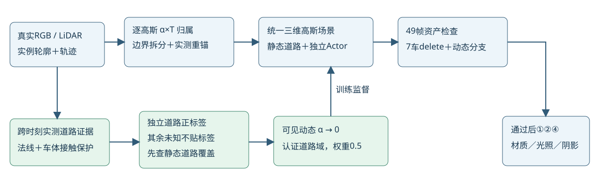

# 独立道路正证据补齐未知实例标签处的归属监督

任务WS-V82-DRIVINGEDITOR-SHADOW-REBUILD-20261017。当前执行快照仅见[RESEARCH_STATUS](../../../../RESEARCH_STATUS.md)。保留[R7源点修复](../v3_source_ownership_r7/)及所有父checkpoint，本轮继续⑥，没有进入材质／阴影。

## 为什么需要独立证据

8000步实测道路alpha*T审计：a37道路动态质量2531.12，其中2445.05在30个未知mask训练帧，约96.6%；已知mask16帧仅86.07。a6/a12也有多数泄漏在未知标签帧。辅助403未知mask正确地不进原maskloss；不能伪造这些body mask，也不能把全部未知当背景。原已有真实道路证据可以独立提供“这一实际道路像素不属于任何车辆”的正语义信息。此为新增测量信息，并非又加一遍原body mask权重。

## 道路证据与完整输入契约

从R5已在世界位置>=3训练时刻确认的真实LiDAR道路点出发，追加检查点自身真实12邻域PCA法线与已测路面法线相符、局部平面残差，排除接近跨训练时刻已知车体3D点4cm内的接触区域，要求真实相机深度及无已有可见body重叠。最终252652训练像素。保留原始RGB、masks、mask_known、road、depth、seed、trajectory完全相同（RGB/seed/trajectory硬链接，其余原字段逐数组核对），只增加road_certified；测试3帧不产生新证据。data_r4_road_identity的manifest明确来源和BUILD train-only角色。

这是保守几何道路证据，不是人工全图语义GT。未知非认证像素不贴标签；未使用按车底高度裁剪。点本身法线及真实车体接触保护减少把轮胎误当路面的风险，仍须视频与指标复查。

## 静态覆盖先检查

冻结E3@8000，单独渲染静态层：认证道路像素静态alpha均值0.98147，95.87% alpha>0.9，0.2719% alpha<0.5，30m内95.60% alpha>0.9；相机Z平均误差0.3243米（不是无影纹理GT）。完整场景动态alpha在该域均值0.01187。大部分已有静态支持，允许1000步受界探测；仍跟踪少数孔洞和深度，不能把删除后空洞算成功。没有补灰色平面或原图混合。

## 新项与原项

road_identity = mean_over_certified_pixels((sum_all43_visible_Actor_alpha)^2)，权重0.5；使用全场景alpha*T，目标认证道路动态贡献为0。与当前Actor mask是否已知无关，因为正证据来自道路测量，而非未知mask补集。其余像素该项梯度为0，原403未知仍没有mask内外梯度。原完整已知mask内域raw-alpha→1权重0.05、完整外域visible-alpha→0权重0.5、可见身份0.1、RGB/LiDAR/道路参考/教师均保留，监督域没有缩小。

默认road_identity权重0、旧数据新增字段全零，历史配置/检查点仍可重放。启用但没有正证据会预检失败；字段非bool、无真实深度或与已知body重叠会拒绝。28CPU检查通过，两个新检查分别验证未知mask与独立道路梯度、认证域外未知零新增梯度，以及缺证据/冲突输入拒绝。

prepare_road_identity_fork_r8显式从E3@8000保留全部模型/Adam/RNG和已用步数，新目录仅改权重与追加数据契约。--weight 0 --output NEW_CONTROL提供同代码/同data_r4/同源状态的无新增道路身份项控制；未排队运行、不提前声称单项因果收益。原边界/归属/外部约束与三阶段消融接口仍在。

E4_road_identity_s0仅global8000→9000，之后自动同7预览、完整49帧65流与全场景逐点复审，再由根代理决定。检查车底、轮胎／车身、背景覆盖和已知/未知域道路泄漏。总45k含已用，几何累计到30000、材质10000至40000、联合5000至45000；不盲跑、不自动加七臂。

仍只有7准入Actor做delete，新5/6/12/18/25/26/37；认证道路项约束所有可见动态贡献，不代表扩大delete准入。旧三0/1/2→5/26/18，其余四没有旧资产时仅旧场景外观参考。没有独立无影／编辑GT，人工verdict=null，problem_solved=null。failure_ledger_refs=[V82-F01]，failure_ledger_delta=none。本记录是工程归属监督修复，暂不讨论新颖性。
