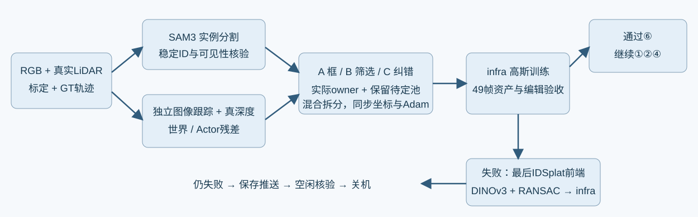

# SAM3、独立真实三维运动与可纠正归属接口

任务WS-V82-DRIVINGEDITOR-SHADOW-REBUILD-20261017。当前执行状态只见[RESEARCH_STATUS](../../../../RESEARCH_STATUS.md)，本文记录接口、协议和保留证据；不声称已解决动态资产带道路的问题。

SAM3替代SAM2/Grounded-SAM2。特征模型为DINOv3 ViT-B/16 LVD1689M，非DINOv2。用户准备的22项资源已做文件长度与校验，asset_download_validation只是下载完整性，不是实际推理检查。原Py3.12 SAM3环境指向缺失Torch路径，预处理采用任务内隔离Py3.12/Torch2.7.1+cu126/Transformers4.56.2；DrivingEditor训练仍用原Py3.9/Torch2.2.2+cu118，不修改共享环境。

原始49帧RGB/LiDAR、相机标定和Waymo轨迹进入统一输入。SAM3原生视频跟踪只看46训练帧；raw101/113/125分别单图QUERY session，不传播到BUILD。SAM3原始mask、tracker ID、GT实例关联的真实LiDAR支持和回退标签逐帧保留。框是实例ID候选，不是车体mask；原DEVA回退明确标出，三组冻结相同bundle，不能把混合bundle称纯SAM3。未知实例仍排除mask损失，RGB/LiDAR监督保留。

原R11缓存真实全部LiDAR的几何与source frame/raw row可复用；旧语义字段不输入新语义判断。BUILD只取训练46帧且raw_row%5!=0的80%返回；其余返回及三测试帧只QUERY。BUILD深度、着色和相机可见性从BUILD重新计算，不使用全返回frontmost缓存来指导训练。独立RGB LK前后向跟踪仅由真实LiDAR端点匹配提升到3D，7074条三时刻轨迹；再比较世界与车辆局部坐标残差。端点为稀疏实际表面采样匹配，不声称精确同一物理激光点。停车、小运动、遮挡和冲突保留待定；不从强制绑定高斯的运动证明归属。随车移动的暗纹仍要真实表面/深度证据。

## 三组与真实owner接口

A原始框候选分配、B共享SAM3/深度与独立3D运动筛选、C同B初始化再分阶段纠错，固定seed0、原始测量划分、损失、3000实际更新（1500检查点）及65条49帧输出。B未知点进入不渲染的显式候选池，不称静态背景；其造成的车体覆盖缺失必须计入失败。路面误入减少不等于成功，实际车体与下部细节、RGB以及独立编辑同时验收。数值与可见门槛见protocol.json；已查看的QUERY只算开发验证，不冒称全新盲测。

field/train可选保存source frame/raw row/world/candidate owner、证据概率和状态，旧checkpoint无这些buffer仍严格重放。identity.evidence_probability是Dirichlet证据分数，不是校准归属真值。reassign_rigid_owner实际变更刚体owner并转换位置、旋转和锚点、重建同owner邻域，重置受影响Adam行，保留其他状态和opacity；不可用owner=-2把未知当背景。append_measured_candidates只接有真实源点/正Actor证据的外部池点，新点使用正常初始opacity，保留旧点参数及Adam，实际进入渲染owner，非仅写语义向量。调用方必须提供真实测量与迟滞门槛，函数本身不替代证据认证。跨车/路的混合高斯先按真实轮廓/表面证据分解，保留两侧，重新审计后才改owner。分阶段C筛选脚本C_split_r12、C_finalize_owner_r12已接入控制器1500检查点。混合先拆分并保留两侧，第二次全场景审计后，真实世界道路锚和严格4sigma车体保护决定实际owner；静态转Actor还须精确原始独立运动来源。待定池车体恢复要求真实BUILD的body/depth或精确motion来源、>=3view渲染body父点、3sigma几何体积和无世界道路矛盾，几何从真实测量邻域PCA构造。其余点写出新的未解决池。现有opacity在owner/接纳步骤不变，split只作光学密度重分配；无关Actor邻域和旧道路参考保持。C源码真实数据结构/坐标核验和远端4身份检查通过；不以工程检查声称C资产通过。

完整mask监督固定R10：raw内部每正已知Actor域内均值再平均0.05；mask外全场景可见贡献在每Actor完整外部域均值再求和0.5；visible_instance内部逐正已知Actor均值再平均，加原完整known-HWK外部均值，整体0.1；认证道路可见动态alpha平方均值0.5。原三147完整内外对保留；辅助未知不新增背景标签。所有输出都从未预乘GT mask的原始渲染得到。

## 保留的失败输入与有限最后回退

historical_SAM2初始化记录不属于SAM3对照。旧SAM2 B在a12实际body覆盖0.9559→0.6225、低处0.8947→0.4737，a26低处0.9929→0.8754；虽然路面proxy下降，车体保留未过门槛，不能称成功。A旧SAM2训练因用户换模型而在有限1500步完整停止，四个controller/flock/worker/train进程退出，B/C未启动，参数不复用。此前有效11k＋失败R8一千＋0..49未记录范围，再加此1500，历史成本13500..13549；原始检查点与失败证据保留。

有限SAM3路线未明确改善后，只再做一次官方IDSplat前端（源码e3e08fcd794d18ab61fa4550235a6bbf41643726）的适配：SAM3→实际LiDAR投影/深度与保护细部的聚类→DINOv3对应/RANSAC→{车辆局部点云、实例ID、轨迹、可信度、原始来源}→infra。原实现使用Nerfstudio相机y/z翻转，必须和本系统+Z相机、米制世界/局部坐标、时间戳及轨迹方向对齐；不能直接import带SplatAD模型/对象管理/GTSAM依赖的整条pipeline假称替换一个类。相机Z监督与原LiDAR强度/raydrop/LOS能力分开，不声称完整SplatAD训练。DINOv3前缀1个CLS+4register剔除、patch16坐标、层7、CPU处理器输入迁移GPU必须核验；不做逐帧不同PCA基的对应。AnyUp先不启用。GTSAM可选且不自动覆盖Waymo GT，现有whl是cp310，不混装Py3.12。保留停车实例，不照搬is_dynamic/静态轨迹过滤；不腐蚀后仅留最大簇，不在框内随机补点。VGG/LPIPS可作辅助图像指标，49帧相关样本FID不作为归属成功证据。

最后回退仍失败就保存推送，核验本任务所有worker、控制器与锁排队任务退出，确认无其他GPU任务后按当前授权AutoDL关机并暂停心跳。⑥明确改善前不进入①道路细节②阴影精细度④车身外观。delete只限相机+同帧真实LiDAR充分的7车5/6/12/18/25/26/37，旧0/1/2→5/26/18；另4无旧独立资产只对旧场景外观。

证据边界：mask/道路标签均为模型或几何proxy，无独立反事实无影道路/编辑GT；车体下部2D ROI不是轮胎真值。无观测或零分母明确N/A。human_verdict=null，problem_solved=null，failure_ledger_refs=[V82-F01]，failure_ledger_delta=none；工程输入试验不硬造科学否定。

## 原生SAM3输入的工程复核

asset_inference_probe.json是真实BUILD raw107的SAM3/DINOv3 GPU记录：SAM3检出18车辆；DINOv3层7去5前缀，输出600×768有限特征。SAM3原生46训练帧视频跟踪与三隔离QUERY共49预测保存。初次标签合并出现原标签回退引入的重叠链，原shared_sam3_masks_r12.py和失败日志保留；finalize_sam3_inputs_r12b.py在CPU重用同49预测作联合迭代回退，逐帧互斥通过。完整新生产者为shared_sam3_masks_r12b.py，实际数据由prepare_controls_r12b.py构建。

summary.json记录各Actor来源，不能将DEVA/冲突回退冒称SAM3。a37全49使用SAM3；已知pair1748/2107，未知359显式排除maskloss，原三147完整内外对保留。根代理查看8行四列RGB/原DEVA/原生SAM3/共享输入+真实BUILD LiDAR证据，shared_SAM3_root_review仅准入有限初始化对照，非资产验收。A288526点、B257214点，参考点7455/7457，52741认证道路训练像素；46train/3QUERY，未加载旧模型。初始化QUERY仍失败a12：body A0.9559→B0.7059，下部0.8947→0.4737，204body点均是训练帧保留返回、三testframe body分母0；a26下部B0.9117；a37道路seedproxy3835→736、body0.9971→0.9936。道路proxy不是黑影真假比例，仍须完整49帧编辑与体积贡献检查。

同查询域已被用于开发验收，不是全新盲测；C运行不读取QUERY选择点，但机制开发已知此前覆盖不足，必须披露这一边界。三组共同输入在这次QUERY后不变。每组3k后才统一根代理比较。成功选中路线采用G15k/M7.5k/J2.5k，加全部先前成本和三组资源上界44549；若三组失败，最后IDSplat前端路线先3k，准入后总G13k/M7k/J2.4k，累计上界44949，仍不自动开始后续材质。全部配置、源点证据、失败与未解决状态保留。
