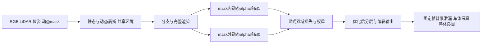

# V82-F01：DrivingEditor 论文适配替换 opacity 损失时丢失掩码外透明度监督
<!-- metadata: {"title":"DrivingEditor 论文适配替换 opacity 损失时丢失掩码外透明度监督","defined_ids":["V82-F01"],"referenced_ids":["V76-F03"],"versions":["V82"],"topics":["engineering","loss-domain","opacity","static-dynamic-separation","paper-reproduction","evidence-boundary"]} -->

- 登记 task/run：`WS-V82-DRIVINGEDITOR-OPACITY-FAILURE-20261012/r1`；证据来自既有 DrivingEditor vGPU 调试四臂 B1/B2/V/S。本次只登记工程教训和用户指定的后续默认规则，没有新增实验。
- 类型：复现工程的监督域选择与验收不足。不是作者实际实现已缺约束的结论，不是对 Gaussian 表示或作者方法的普遍科学否定。
- 命题和触发：将旧 2024 兼容代码的完整掩码 `100*MSE(alpha_d, Md)` 换为论文 Eq.13 的前景对数项时，移除了旧 MSE 同时承担的掩码外动态 alpha→0 监督；未在正式长训练前验证这项替换是否仍能维持正确分层。当前 vGPU 基线及 S 仅有掩码内不透明度目标，动态分支仍包含道路与背景。

## 输入、监督域与检查输出

图中双域监督是用户指定的后续默认工程策略，不冒充历史 B1/S 已采用，也不冒充已核实的作者 Eq.13 实现。

## 选择依据与遗漏

论文 III-D / Eq.13（印刷页1702）给出推动动态 opacity 趋向1的对数形式，但公式没有明确写出像素监督域。若将同式直接用于全图，也会推动车外 alpha→1；若按前景文字仅在 Md 内应用，车外就没有该项的直接梯度。

既有适配采用第二种解释：`-mean[Md*(1-alpha_d)*log(alpha_d)]`，以全图面积归一化、权重 .05。它是当时主动选择的复现解释，不是漏写整个 opacity 函数。工程遗漏是移除旧掩码外约束后，没有以充分的分支对照验证该域缺口；全图 RGB 重建好不能代替分层验收。

论文很可能没有完整交代监督域，但不能由公开公式确定作者实际实现也缺少掩码外约束。作者正式代码、精确域和相关权重未获认证。旧完整掩码 MSE 是合理比较基线，不保证最优，也不自动沿用数值100作为新配置最佳权重。

## 最强控制、正结果与代价

银色车 Waymo 1.4.3、FRONT raw0–48，共49训练视图。B1、B2、V均从同一原始 saved30k 的参数、Adam、RNG与采样状态恢复，训练30,001–32,000共2,000步，保留seed0、50k学习率horizon、FP32和原kernel。采样/time_shift/LR配对、终点49帧、RNG安全评价及四件终态已核验。B2为一次原版重复，仅描述本次波动，不构成通用CUDA噪声界。

V只在原前景项之外增加掩码外零 opacity 项，系数 .05：`-mean[(1-Md)*alpha_d*log1p(-alpha_d/(1+1e-4))]`。没有恢复旧完整MSE，也没有加入S静态RGB项。下表为49帧等权；背景域是非天空、现有车体mask外的已观测像素，不等同于无遮挡编辑GT。

| 指标 | B1原目标 | B2原目标重复 | V只补掩码外透明度 |
|---|---:|---:|---:|
| 背景动态alpha均值 | .675479 | .675413 | .113536 |
| 背景动态RGB非黑支撑 | 99.86136% | 99.85967% | 79.36881% |
| 背景static PSNR / dB | 11.96038 | 11.96283 | 27.33124 |
| 全图composite PSNR / dB | 36.43076 | 36.43047 | 35.90406 |
| 车体composite PSNR / dB | 37.14688 | 37.34637 | 33.19001 |

- V对B1/B2的背景static MSE全部49帧改善，但全图及车体composite MSE也全部49帧变差。动态图仍有背景纹理，不能以alpha降低或单个PSNR改善判定修复完成。RGB支撑沿既有8位任一通道>2定义，不等同于alpha支撑。
- 车体内动态alpha原本较高：B1/B2/V/S帧等权均值为.978169/.977249/.961456/.979828，像素加权为.995521/.995391/.987696/.995664。高均值不能排除局部孔洞或边界不足；当前直接证据更支持车外泄漏，而非整车没有前景不透明度监督。
- S独立补回静态RGB，背景static PSNR达31.76342 dB，但未新增掩码外opacity，背景动态alpha仍.516351。S与V是不同干预，只能描述比较，不能把二者当作叠加实验。
- 没有S+V联合、旧完整MSE恢复、对应从零训练或多场景验证结果。这里只建立监督域缺口可被干预的因果证据，不证明它是全部分层问题的唯一原因。

## 可复用教训与后续默认

用户2026-10-12明确要求：后续默认加入完整掩码不透明度监督，掩码内动态alpha→1、掩码外→0；可以采用完整MSE，也可以分别设计两域损失。论文没有明确写出某个约束，不构成静默移除已知工程作用的充分理由。

两域形式、归一化、clamp和权重需在实验前锁定；比较必须保留背景分离收益、目标/整体代价和全部固定帧，不按结果调阈值或宣称权重越强越好。 mask范围同样需明确：论文Md包括移动物体及其阴影，当前body-only mask缺shadow，完整双域目标不等于掩码内容已完整。新的默认规则见[DrivingEditor opacity规则](../../v82/DRIVINGEDITOR_OPACITY_DEFAULTS.md)。

## 证据、适用边界与人工指令

- [损失域审计及实际源码定位](../../autoresearch/worldsim_v82/drivingeditor_debug_20261012/r1/evidence/debug/loss_audit/handoff_summary.json)。
- [V与双原版：11主指标、六域上下文及全49配对效应](../../autoresearch/worldsim_v82/drivingeditor_debug_20261012/r1/evidence/debug/continuation_diagnostic/opacity_outside30k_to32000/receipts/three_arm_locked_metrics.json)。
- [V实际完成与状态恢复](../../autoresearch/worldsim_v82/drivingeditor_debug_20261012/r1/evidence/debug/continuation_diagnostic/opacity_outside30k_to32000/receipts/full49_summary.json)。
- [S实际独立干预与双原版比较](../../autoresearch/worldsim_v82/drivingeditor_debug_20261012/r1/evidence/debug/continuation_diagnostic/observed_static_rgb30k_to32000/receipts/S_vs_originals_locked_metrics.json)。
- [既有V精确算法补丁](../../../compatibility/DrivingEditor-v82/frozen_baseline_to_V.patch)；完整源/硬件/耗时/原始媒体恢复入口见[v8.2交接](../../v82/DRIVINGEDITOR_DEBUG_HANDOFF.md)。旧3090的21帧历史评价不能与新49帧曲线混用。
- `failure_ledger_refs: [V76-F03]`；`failure_ledger_delta: V82-F01`。既有r1冻结receipt的`failure_ledger_delta=none`保持原值，本卡是之后新增的工程知识。
- 人工指令：用户2026-10-12明确指定上述后续默认监督，并要求记入failure；这是用户给定的工程策略，不是代理代填效果评分。作者实现是否遗漏、最佳形式/权重及完整修复仍未确定。
