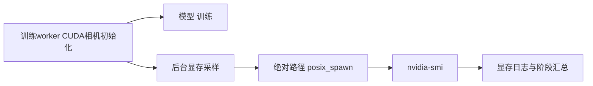

# V82-F02：CUDA 初始化与后台 fork 采样同时出现启动停滞
<!-- metadata: {"title":"CUDA 初始化与后台 fork 采样同时出现启动停滞","defined_ids":["V82-F02"],"referenced_ids":[],"versions":["V82"],"topics":["engineering","cuda-initialization","resource-monitoring","process-launch","evidence-boundary"]} -->

- task/run：`WS-V82-DRIVINGEDITOR-HYBRID30K-20261012/r1`，2026-10-13新加坡。
- 类型：显存监控接入时的启动工程问题，没有完成训练步，不是目标函数或方法的科学失败。
- 实际症状：C00首个worker1819持续超过5分钟停在相机加载1/49；GPU约352MiB、利用率0%，主线程与多线程等待futex，显存采样在22.566秒停止，worker没有已exec的nvidia-smi子进程。已加载cuSOLVER、CUDA linalg及cuBLAS；原生栈工具缺失且容器拒绝/proc stack与syscall读取，不能确定锁的具体来源。

原监控在Python3.9中使用短可执行名及默认close_fds=True，不满足subprocess的posix_spawn fastpath，进入fork_exec；第三方原生atfork锁与CUDA初始化并发是一个待隔离疑点。代码审查未发现Python监控锁与CUDA主线程构成直接锁环。缺少native stack，也没有进行可重复的启用/关闭对照，因此不把并发fork写成已确认唯一根因。

root终止自己启动的worker1819，controller1818观察SIGTERM失败后停止队列；已验证没有paired_steps或checkpoint。全部旧输出、日志、源码和启动receipt保存在远端 `campaign/hybrid30k_20261012/attempts/initialization_1/`，没有删除，也没有把这次采样用于3090容量判断。

监控改为绝对nvidia-smi路径和close_fds=False，并检查Linux posix_spawn前提；不可用时记录采样错误，不回退fork。补充真实CPU echo测试：spy Popen._posix_spawn，禁止Python3.9的_posixsubprocess.fork_exec及新版本别名；远端7项CPU测试通过，不访问GPU。测试首次在Python3.9因只patch新版本别名失败，兼容修复后通过，不能把初版5项PASS冒充这项验证。

同数据、seed0、目标与四臂配置从零重新启动controller2704/worker2705；第二次初始化约15.09秒，已完成至少300次真实前向/反向/优化，47次显存采样无错误，含首步Adam分配。改动后启动恢复是实际结果；库/内核缓存等环境差异未完全隔离，因果结论仍有限。运行正常不表示四臂完成，也不认证3090容量或方法质量。

后续资源监控应避免在CUDA worker后台反复fork；GPU初始化阶段需真实GPU检查、可触发的faulthandler和保留失败尝试。CPU fake通过不能替代CUDA并发启动验证。此规则针对监控进程启动，不修改训练目标、分辨率、点数或RNG。

- [旧尝试receipt](../../autoresearch/worldsim_v82/drivingeditor_hybrid30k_20261012/r1/startup_attempt_1.json)
- [资源监控CPU验证](../../autoresearch/worldsim_v82/drivingeditor_hybrid30k_20261012/r1/memory_monitor_cpu_checks.json)
- [实际重启receipt](../../autoresearch/worldsim_v82/drivingeditor_hybrid30k_20261012/r1/launch_20261013.json)
- [监控实现](../../../scripts/worldsim_v82/drivingeditor_debug/hybrid30k_20261012/memory_monitor.py)

`failure_ledger_delta: V82-F02`；`human_verdict: null`。
