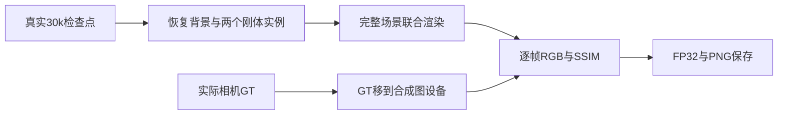

# V82-F04：评价入口的 GT 与 SSIM 设备不一致
<!-- metadata: {"title":"评价入口的GT与SSIM设备不一致","defined_ids":["V82-F04"],"referenced_ids":[],"versions":["V82"],"topics":["engineering","evaluation","tensor-device","instance-editing","evidence-boundary"]} -->

task/run：`WS-V82-DRIVINGEDITOR-INSTANCES-20261013/r1`。这是新评价工具的设备适配错误，训练已完整 30k，三个节点的真实模型、Adam 和 RNG 恢复均通过。故障不否定实例表征、训练损失或收敛质量。

2026-10-14 01:45 SGT，`post30k_r1` 在三个节点恢复后进入评价，原始相机 GT 为 CPU FloatTensor，合成图和 SSIM 卷积窗口为 CUDA FloatTensor；在第一帧 PNG 保存前触发类型错误。失败状态、日志、内存记录与三个成功恢复凭据全部保留。源代码与 CPU 预检不能替代真实设备上的评价执行。

修复仅将 GT 执行 `original_image.to(device=values['composite'].device)`，保留数值、相机、掩码、损失与训练配置；旧脚本备份为 `infra/evaluate_scene.py.before_GT_device_fix_20261014`。新目录 `post30k_r2` 实际完成连续 raw23–50 的 28 个观测帧，在第 29 帧前按既定策略让出资源给真实 StreetCrafter 准备进程，随后退出；固定相机与编辑导出尚未执行。资源让出不是本设备故障复发。

独立 CPU 复核实际 28 个 FP32 文件有限，420 张 PNG 逐像素等于原数组的显示转换；实际两实例 mask 与 prepared 完全相同，GT 与旧真实 GMC 保存 PNG 完全相同。118 项 CPU 测试通过、1 项 suite CUDA 跳过；真实 28 帧执行另行证明设备修复已经解除该卡点。逐帧 GPU SSIM 数值只驻留于未完成流程的内存，partial manifest 不补写它，也不冒充完整 49 帧均值、98 帧评价、评价末尾模型/Adam 不变证明或照片编辑质量。

后续边界：在完整实际设备执行前，不把 CPU 检查记为 GPU 兼容通过；评价源保留显式设备转换。完整评价与六项编辑仍待资源空闲，在新目录执行，保留所有旧资产；无需重训或增加损失网格。

- [真实30k与partial导出证据](../../autoresearch/worldsim_v82/drivingeditor_instances_20261013/r1/final30k_partial_preview_20261014/)
- [评价源码](../../../scripts/worldsim_v82/drivingeditor_instances/evaluate_scene.py)

`failure_ledger_delta: V82-F04`；`human_verdict: null`。
