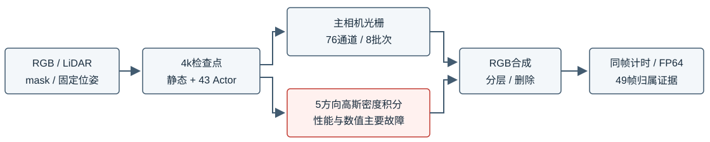

# V82-F06：opacity reset后审计与有限候选使R15归属修正空转
<!-- metadata: {"title":"opacity reset后审计与有限候选使R15归属修正空转","defined_ids":["V82-F06"],"referenced_ids":["V82-F01","V82-F05"],"versions":["V82"],"topics":["engineering","ownership","audit-coverage","opacity-reset","static-ghost","evidence-boundary"]} -->

task/run：`WS-V82-R15-PAUSED-DIAGNOSIS-20261017`。[完整49帧分层、46训练帧贡献及6锚帧反事实](../../autoresearch/worldsim_v82/drivingeditor_shadow_rebuild_20261017/v3_backend_restore_r15/paused_diagnostic_20261017/README.md)。没有新训练更新或用户质量评分。

3k先reset opacity再保存，随后运行归属审计；最大单点alpha约0.01。a6/a37无点通过既定重复道路正证据，实际split=0、Actor→static=0、static→Actor=0，仅添加459个真实待定池测量点。9k也与3000步reset重合。4k时静态点的source_candidate_owner为a6或a37均为0，已有静态转Actor分支对两车没有候选入口。脚本完成不是归属已纠正。

当前同表面竞争仅在静动态深度差<0.45m生效。a6 raw105中位差15.35m、拒绝100.00%；a37 raw121中位差3.70m、拒绝98.66%。删除明确移除目标owner全部点，但关闭阴影以及单独静态层仍保留车形外观；a6还有其他Actor贡献，独立资产也带下部碎片。它们不是仅漏删目标点或残留真实投射阴影。

教训：审计必须报告候选流量/各门槛拒绝及实际变更，并避开未恢复的reset瞬间或验证相应阈值；检查候选覆盖，区分同表面重复占用、后方静态表面上的外观残影与Actor外延。0道路正证据不授权把未知当背景；静态道路上有车形外观不授权把所有道路点改成Actor。保留完整内外mask、真实多时刻3D与保体证据，未知不作负标签，不按高度切车底。暂无修复后结果、配对干净道路GT或最终编辑质量通过结论。

## 2026-10-18：候选入口、数据覆盖与外观强控制

task/run：`WS-V82-R15-CLOSURE-20261018`。[本轮组件图与49帧控制](../../autoresearch/worldsim_v82/drivingeditor_shadow_rebuild_20261017/v3_backend_restore_r15/closure_20261018/report.html)。同4k几何做实际reset／不reset副本审计，a37混合候选2→0、道路贡献15.49→3.23；a6两种情况道路贡献仍0，不能只怪reset。去掉来源标签门后静态重复身体贡献候选为a6=8、a37=12165，但其中可有真实背景，不能直接转owner。

a6原局部道路正样本库为空；新增全部14589个独立世界道路测量入口后，只有13个Gaussian过宽阶段邻近，仍无≥3来源时刻道路支持，实际拆分／转移0。没有按高度裁车底，未知保持未知。

删a37后71746个静态贡献候选包含正常背景；9500点接近重复实测道路，只有137点有可靠跨时刻亮簇参考（75道路、62静态非道路）。冻结几何/opacity/owner/光照，只拟合这137点200次，参考点MSE降98.18%，但49帧原车身区域仅314/556034像素变化>1/255，raw121为0，区域残影未解。局部拟合成功不是纠错成功；没有配对干净路面GT。条件未满足，整模型多臂短训及组合跳过，不继续堆模块维持R15。

## 2026-10-18：同一a6旧30K＋30K基线核对

task/run：`WS-V82-R15-OLD30K-A6-20261018`。[同一track的49帧、组件图与贡献诊断](../../autoresearch/worldsim_v82/drivingeditor_shadow_rebuild_20261017/v3_backend_restore_r15/old30k_a6_20261018/report.html)。冻结旧最终checkpoint step30000及R15 step4000，参数更新0；旧完整RGB49/49逐像素匹配原报告旧基线，未混入18K道路修补。

旧版只有3个独立实例，对应R15 a5/a26/a18；a6由旧静态/PVG表达，无独立owner6。主比较始终使用同一a6 track，其他车辆不代替它。以真实轨迹及训练固定框尺寸做49帧几何选择，在固定raw105/113/137计算原全场景精确alpha*T：旧a6车身贡献100%来自静态/PVG，其中中心位于a6框外的贡献质量占92.12%／93.38%／92.45%；最大主轴σ>1m的高斯贡献约15%。原观察画面正常并不保证局部3D几何与可分离资产干净。

98%可见贡献集独立渲染及共同物理相机中有明显大尺度支撑、条带与外溢。该集合可含真实道路、背景或遮挡物，不能当作a6归属真值；旧版没有owner6，无法证明旧版有同一批、同样归属的车底碎片。R15从原测量重训，未继承这些已训练高斯；本证据不授权直接转owner、裁车底，也不构成R15修复通过。新视角色彩固定原SH方向，只用于几何/alpha诊断，不作新视角外观评分。human_verdict与problem_solved保持null；不新增失败编号。
