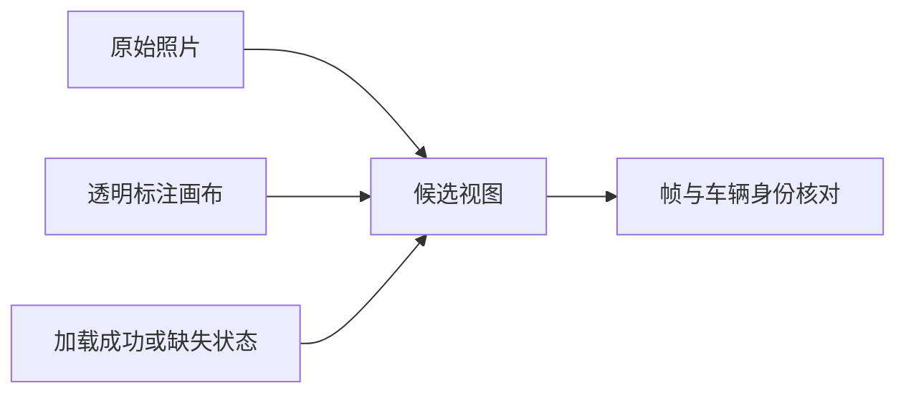

# V82-F09：候选页标注画布不透明，遮住原始照片
<!-- metadata: {"title":"候选页标注画布不透明遮住原图","defined_ids":["V82-F09"],"referenced_ids":[],"versions":["V82"],"topics":["engineering","visualization","candidate-browser","css-cascade"]} -->

类型：工程 / 展示接线。用户在 2026-11-01 提供车辆候选页截图：标题和绿色车辆代号可见，原图区域却呈黑色。原始 JPEG 均存在；标注 canvas 绝对定位覆盖照片，继承全局 canvas 的不透明深色背景，造成视觉遮挡。此前的引用存在性和 JavaScript 选择器测试没有覆盖实际样式叠加，不能称浏览器验收已完成。

修复覆盖层背景为透明；图片加载失败时隐藏画面、显示明确提示并禁止导出。新的同步视图在照片成功加载后才共同更新照片、框、轨迹和帧号，采用轮次标记处理切车/切帧竞态；当前帧 LiDAR 独立采样，不能过滤全片去重点集后假报“此帧无点”。

验证包括真实图片引用、透明背景、缺图、跨场景/车辆/帧和异步顺序的本地逻辑检查。真实浏览器交互受工具策略限制，仍未测试。此故障不改变原始图片、模型、V43 归属结论或数据来源；不把工程修复算为 D/C 改善。

证据入口：[逐车时序与几何核查](../../autoresearch/v43_ownership_20261028/actor_diagnostics_20261101/report.html)。原用户截图与修改前页面保留在本地工作目录，原科学归档不覆写。

`failure_ledger_refs: []`；`failure_ledger_delta: V82-F09`；`human_verdict: null`。
