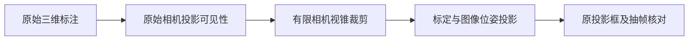

# V82-F10：视野外三维框在大畸变处折回画面
<!-- metadata: {"title":"视野外三维框在大畸变处折回画面","defined_ids":["V82-F10"],"referenced_ids":[],"versions":["V82"],"topics":["engineering","visualization","camera-projection","field-of-view"]} -->

类型：工程 / 诊断投影。候选全片可视化初版使用真实三维框与 Brown–Conrady 标定，但对侧向/相机后方框先做近裁剪，再将过大归一化坐标送入畸变多项式。视野外框被折回画面；scene-035 raw100 的 a74 产生横穿照片的长线。该初版在独立抽帧审查时发现，未作为合格候选或归属编辑结果发布；旧边数据和视频保留为 projection_diagnostics_r1。

修正先以同帧原始 FRONT 投影标注确定展示白名单，再做有限视锥、近裁剪与图像裁剪；未在 FRONT 出现的车辆仍保留轨迹、框、点云和其他相机观测事实，不能判无观测。scene-035 修正后 6,202 次车辆观测的所有非 FRONT 边均为空；1,217 个可比较框的 AABB IoU 中位为 0.96570，p10 为 0.90584，raw100 a74 错误长线消失。

独立复核又确认相同的投影域问题影响点云取色：初版仅检查畸变后的像素边界，允许过远视场的方向折回 FRONT 取色。修正为同一有限视锥后，scene-035 的 76,328 个无效颜色对应改为灰色、有效颜色标记归零；独立逐项核对 XYZ、原始帧、源点行号均未改变。可视化默认统一颜色，RGB 取色即使在视锥内也未做遮挡 z-buffer，不能当作颜色或可见性真值。

该对照仅证明投影展示恢复合理；使用提供的图像位姿近似，未做逐行滚动快门及物体曝光时刻运动补偿，不是像素精确三维真值。LiDAR 坐标解码未因本问题重算或改变，不能把该工程故障归为几何表示失败或 V43 决策失败。

证据入口：[逐车时序与几何核查](../../autoresearch/v43_ownership_20261028/actor_diagnostics_20261101/report.html)。修正前后 raw100 对照及完整投影检查随独立说明保留。

`failure_ledger_refs: []`；`failure_ledger_delta: V82-F10`；`human_verdict: null`。
