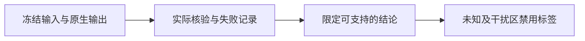

# V82-F11：原生伴随贡献严格总量核验尚未闭合
<!-- metadata: {"title":"原生伴随贡献严格总量核验尚未闭合","defined_ids":["V82-F11"],"referenced_ids":[],"versions":["V82"],"topics":["engineering","numerics","adjoint","qualification"]} -->

五例GPU审计中，FP32光栅与特征伴随的全图质量和在部分帧未通过0.05绝对/2ppm相对门禁；原始绝对门禁失败也保留。改用FP64标量归约后仍有564帧差异，未通过继续放宽门禁改写为PASS。原因尚未完全定位，不能只凭误差量小就宣布严格闭合。

原生none与真实源renderer前向一致、保存/恢复重放可以独立通过；这不等于伴随质量的严格验收通过。伴随值只用于冻结开发候选域，不能升级为精确owner、完整表面覆盖或P资格。受影响的训练好坏标签全部禁用。数值故障与科学否定必须分开。

证据：[五例报告](../../autoresearch/v43_ownership_20261028/fivecase_gpu_20261101/report.html)、[机制核对](../../autoresearch/v43_ownership_20261028/fivecase_gpu_20261101/mechanisms/index.html)。`human_verdict=null`。
