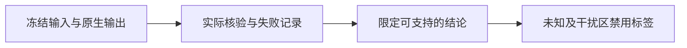

# V82-F12：局部LiDAR近邻不能替代完整来源候选
<!-- metadata: {"title":"局部LiDAR近邻不能替代完整来源候选","defined_ids":["V82-F12"],"referenced_ids":[],"versions":["V82"],"topics":["candidate-recall","scope","ownership","capability"]} -->

五例固定0.25米实测近邻只覆盖本次三个锚点高车身贡献显露来源池约2.8%–13.8%的质量。该分母是原生贡献定义的候选池，不是物理车辆owner GT。不能把这个局部有限域的负结果当作D没有改善空间或固定表示全局不可行。

整段原位可见贡献纯度筛选还使212/a0、564/a0静态候选为空；预登记剥离在原U内仍未恢复这些候选。原始错误绑定会影响跨时的可见贡献，当前可见纯度不能等同正确身份。保留这些对照后，在新声明域读取全部原始静态行的三锚原位/显露贡献，冻结完整来源控制；未读编辑评分或学生输出，未修改原几何颜色。

完整来源池可能含道路、阴影、混合与大足迹高斯，更多候选不等于正确归属。三个粗来源组也不是逐行完整搜索。几何/颜色/背景/新面等干扰仍须逐例隔离，未知区域不生成归属好坏标签；不能把分组或召回瓶颈包装成修复必要性证明。

证据：[五例报告](../../autoresearch/v43_ownership_20261028/fivecase_gpu_20261101/report.html)、[机制核对](../../autoresearch/v43_ownership_20261028/fivecase_gpu_20261101/mechanisms/index.html)。`human_verdict=null`。
