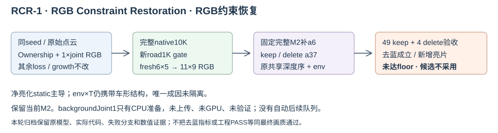

# V82-F13：RCR-1恢复RGB约束压住持续蓝通道，但完整组合新增亮片未达floor
<!-- metadata: {"title":"RCR-1恢复RGB约束压住持续蓝通道，但完整组合新增亮片未达floor","defined_ids":["V82-F13"],"referenced_ids":["V82-F01"],"versions":["V82"],"topics":["RCR-1","rgb-supervision","densification","clamp","scene008","negative-result"]} -->

> **当前用户处置更新（2026-11-05）：** 用户已采用RCR-1 delete，确认异常蓝色RGB修复成功，scope=`abnormal_blue_RGB_fix`。完整画质无回退未作新结论，raw130/137亮片继续作为开放项；a5属于独立的更早版本/代码提交排查，具体引入commit尚未定位。见[用户采用决定](../../autoresearch/scene008_rcr1_20261105/evidence/user_acceptance_20261105.json)。
>
> 下文“未采用”等处置保留为采用决定前的历史评审，不覆盖当前限定范围的用户采用；原始失败事实、指标、26,609更新账本和收据不变。

RCR-1（RGB Constraint Restoration，RGB约束恢复）为本轮研究代号。完整 full-joint native10K、新road1K、fresh6×5→11×9与固定M2已完成；去蓝证据成立，但raw130/137新增银灰矩形残影，未达当前floor，候选不采用，当前M2保留。

原始raw103点云行65911（从零计数）、初始RGB=0的lineage64990，在新ownership训练100步时已R/G负、B正，早于该族首次普通clone。原ownership10K保留64颗蓝SH，旧single10K为1颗黑SH。当前推理加载后不写native SH；完整M2/road/fine开启时，raw113删37使同窄ROI家族alpha×T升至keep的37.26倍，说明删车显露了已有蓝色贡献。

旧joint XY增长接1×global RGB，不接独立static RGB；新把两份光度权重折为2×static并交给static增长。只替换同权RGB增长来源仍1500步clone、2K9颗；half只减RGB增长分量后延至1700、2K5颗但仍蓝。两者均未采用，也未解释旧single为何恰好1颗。旧诊断重放的NPZ没有逐点gxy/gt/denom，不能把缺项写成0。

RCR-1仅补原系数1的整图joint RGB，static2、其它loss、增长、SGCM、采样/LR不改。100步B仍正，200步起SH输出黑色；实际native10K为7颗黑SH，并经原native publish保存全状态、10000→10002真实完整恢复。该干预支持global遗漏影响持续正B学习，不证明最初正B梯度或旧新增密差异的唯一原因。

完整新native+新road/fine+固定完整M2在同共同mask上，raw113原框/白线和raw137右框/横条强蓝点462/224/664/8→0。49keep道路MAE0.03168865→0.01645815，天空0.02317623→0.02051919；天空49帧raw、maskSHA、count、GT严格相同。a37 pooled小幅回退，32帧回退且最大raw122+0.00202537；a6有单帧与delete小回退。HELD9只对6×5/11×9道路RGB校准target留出：native和road gate已使用同一49帧clip，故这不是独立native泛化验证。delete道路是重观测proxy。

亮片315点的真实预乘RGB增量为static(+0.293346,+0.333195,+0.366756)、env×T(−0.200625,−0.191717,−0.186205)、road近0、M2/a37=0，合成为(+0.092740,+0.141500,+0.180580)；static alpha×T0.177727→0.828968。**净增亮由static主导，但env×T仍携带车形结构**，不能归纳为static独占纹理来源。315点原a37区域的road fit/native_keep/guard均0、road lookup未覆盖；尚未拆到具体static行或唯一训练原因，也未区分EnvLight纹理与T空间模式。

本会话实际新增26,609次更新，包含前期颜色后拟合失败尝试12,532、growth反事实3,000、native10K10,000、native检查9、4K road预检34和新road正式/预检1,034。正式RGB校准另有54次线性求解、0梯度更新；4K finalizer预检另54次，工程开销单列。渲染/评价/归因新增SGD为0但有GPU开销。

backgroundJoint1仅本地CPU准备，未上传、未GPU、未验证，不计实验结果、不形成后续自动队列。hide64/cleanSH/oldEnv/half均不采用。GPU研究工作停止、不关机，实际源码、模型、日志和失败分支保留。本条为研究阶段最终归档，非最终画质成功或候选部署记录。

证据：[交互验收](../../autoresearch/scene008_rcr1_20261105/index.html)、[机制研究](../../autoresearch/scene008_rcr1_20261105/research/index.html)、[运行清单](../../autoresearch/scene008_rcr1_20261105/source_archive/run_manifest.json)、[实际源码与轻量证据](../../autoresearch/scene008_rcr1_20261105/source_archive/index.html)。完整模型与原始输入继续保留在AutoDL，轻量源码归档不等于完整备份。

## R0实测覆盖后续证据（2026-11-07）

当前V44的raw137另登记固定720像素域，旧道路贡献为0、静态约.78968、环境透射约.20970；不是原未提供坐标570像素域的精确复现，也不沿用旧M2的15%/85%。后续真实观测与几何支持用于补建同一世界道路资产，联合道路贡献升至.973858、环境降至.000357。这补充了缺路覆盖的可干预证据，没有定位原训练中静态残片的唯一形成原因，也不把所有银片归为环境。

完整49帧保护门仅12/13，delete原观测道路RGB仍超原阈值；推断下体还存在车地几何与Gaussian有效足迹的混合兼容性问题，候选不采用。原RCR-1限定去蓝采用决定保持不变。各控制、独立重放、35条有限首交探针及R1输入盲化的证据边界见[后续道路报告](../../autoresearch/scene008_road_r0_v44_20261107/index.html)，不把有观测道路恢复计作生成先验成功。

## 道路支撑与接缝分项后续证据（2026-11-07）

同一世界道路细分与parent-relative Mip幅度控制减轻了固定车面在前射线的错误遮挡，地面在前组未被强行露车；但仍有严重缺失，不构成隐藏几何正确或完整首交保证。该成分候选没有更新C2车辆、父道路颜色或原生参数。

接缝证据进一步区分了新/旧道路交接与新道路/暗蓝静态层混合。raw128/delete原蓝框改善，但5关键帧世界patch的部分DELETE横向边界回退，KEEP可相反；18RGB系数的持久边界颜色强控制没有解决分项接缝，未选入主资产。原始RCR-1去蓝采用与本轮成分候选分开，不能用整图MAE下降或保护门通过替代局部接缝验收。见[分项报告](../../autoresearch/scene008_road_seam_contact_20261107/index.html)的固定ROI、双状态、分母和负例；没有新增原训练唯一根因或学习道路先验结论。

## 道路融合目标与三维写回后续证据（2026-11-07）

共享atlas Poisson与固定预算材质回写让raw128颜色均值下降，却使固定近端与全49横向接缝更差。独立目标诊断显示投影有效mask的硬切会重新引入边缘；不能把世界chart连续当成目标图或最终渲染连续。

随后唯一固定10px观测RGB边缘控制C取得实际成像改善：raw128/delete原1385道路像素RGB .029598→.015966，全49/delete横向277bins .016715→.009164；近端248bins .009340→.009739仍回退，原框6bins .009794→.011725。C平均atlas权重仅.1866、无纯atlas内域，是观测主导的融合强控制，不能算学习型道路先验或Poisson独立成功。保护均值改善仍有逐帧负例。

道路几何/alpha/AA/车辆不变，固定71射线的车辆贡献变化0，原严重车地读出缺失保持。三份资产各10次重放全字段/PNG字节相同；近端新旧层兼容性仍开放，旧静态没有被盲剪或重新调色。见[完整分项证据](../../autoresearch/scene008_road_fusion_bake_20261107/index.html)；不更新原RCR-1限定去蓝采用决定。

## 冻结21K与C49材质预算后续证据（2026-11-07）

任务SCENE008-V44-A5-ROAD-FUSION-INTEGRATION-20261107与SCENE008-V44-A5-C49-RGB-20261107。[接入控制](../../autoresearch/scene008_v44_a5_road_fusion_integration_20261107/index.html)和[C49完整生命周期／2K／49评价](../../autoresearch/scene008_v44_a5_c49_rgb_20261107/index.html)。用户要求保留原v44＋a5恢复的累计21K组件，新增只训练道路RGB；未执行端到端重训。既有C能覆盖旧native_static／env透射的大片银片，但可见C2轮胎同时受损，C对AA的几何恒等不能替代对21K底座的保护。

固定安全行D仅62／40392，保车却无主缝改善。E／F分别400步旧表面颜色回写：全图几何／贡献恒定，E主缝改善不足，F横向变坏并在DELETE新增暗条；独立数据表明原fit mask没有直接覆盖37车身，不能据暗条推断目标body mask混入。G只做22F／22B签名算子诊断，后续solver与合成扰动取消。相关原门、负例、状态和账本保留，不用单一MAE或容量上界冒充成功。

H2保守可见性控制对模型C2／语义a5／KEEP37贡献为正处迭代剔除整道路child，使用冻结3D模型渲染而非queryRGB／观测mask。H1的16轮工程上限在105K失败，54F／47dummyB与三份已收敛输出保留；H2仅资源cap升64，复用三清单并重渲一致，补齐8输出113F／100dummyB。128银片ROI static均值.37629→.06541，137 .82410→.04294，C2可见贡献基本保留；但仍有轮胎薄边及近／横向回退，不采用。

新C49用旧C400材质初始化、fresh私有Adam，在完整49BUILD上重新资格2119父／6357RGB标量（原2053基础增66），7979父冻结。资格98F／98B，真实600.208s与完整保存／评价／fresh恢复／next2共1996工程更新，均不占新正式时钟。新正式2000步4016F／4000B后按实测停止，不续5K／10K；并完成Cwarm0 vs2K完整49双状态196F，geometry／alpha／8groups／a5原色读出逐帧一致。Cwarm49完整float未落盘，以执行断言／源码与已存2K float为证，不能宣称后验独立CPU全49逐值重算warm。

末5完整epoch pairedMSE相对前5仅−0.0009545%，但500→2000父RGB平均变化.03643／最大.4198，不能称参数已收敛。128近缝K／D=.00570204／.00933907仍不及21K基线，横向变坏；模型C2遮挡随材质不变。H2＋2K只有KEEP主缝.00461353这一局部正收益，DELETE及其它边界仍失败，不以此覆盖其余退化。本轮停止是预算决策，不是证明所有材质方法不可能。

I固定0.4m源边界coverage在128/137 KD四次前向更差，停止、不补早帧、不搜宽度；仅否定该单侧算子。所有原资产、失败状态与默认viewer保留，human_verdict=null，failure_ledger_delta=updated:V82-F13。

固定源边界的单侧coverage控制I随后完成128/137双状态4F／0B／0训练。原road1K裁剪面与C的10098来源行逐值核对；0.4m平滑权重只作用新增road的Mip后有效alpha，原场景、intrinsic opacity、几何和材质不动。128主缝K／D由H2＋2K的.00461353／.00933907变为.00817736／.01183441，137横向.00909287→.01063763，故不扩早帧或搜宽度。前景newroad贡献仍0，保护机制正确不等于接缝修好。旧road中心止19.75、新child中心始19.78，尚无已验证共同纵向带；单侧渐入的负例不能升级为所有互补交接无效。J后续受限RGB affine控制结果见下节，不以更多材质步数解释或覆盖此负例。

## J/K固定RGB可行性与保护域未决（2026-11-07）

J以24F/16dummyB验证2119父RGB对106 signed读出的仿射映射，原生扰动最大误差1.21e-7。一次HiGHS LP最小化原C49可见mass加权L1变化，6池可行、8F复验但逐bin回退；μ仅可观测proxy，不是H2颜色变化上界。

K保留同目标/变量/box/6池，增106个target=min(H2C2K,21K)+1e-6−1e-7约束，26个A=0常量行原样检查。一次CPU solve0.537s成功；40父变化/maxRGBΔ约.506，7979冻结父和非RGBexact；新8F实测6池＋106原容差门过，仿射误差5.13e-8，0Adam/0原模型更新。相对21K KEEP12改善/24微退/17同，DELETE12/32/9，回退均<1e-6；最小原余量7.54e-8，额外reserve超出2.46e-8，不修改或隐藏原门。

主128 K/D=.00377605/.00629795，worldnear=.00500314/.00560753、lateral=.00368891/.00343041。原94门仍55PASS/31FAIL/8unsupported（7protectedNR RGB、8originalroad RGB、16alpha/depth）。相对H2几何全exact不等于对21K无侵入。真图128细黑缝、137色边、自行车道亮点保留；两个白点在H2/J/K同值，不用LP可行称修复。几何最大差多数在37旧足迹，但真实protectedNR及a26/a18单像素尾不能全豁免；137坏bin与H3地先无交集，拒绝简单归因白尾。

K未扩49或替换默认；完整C49为477PASS/462FAIL/100unsupported，不能冒充K49。human_verdict=null，failure_ledger_delta=updated:V82-F13。

真实两点全父贡献测量另2F/2dummyB、0优化：128/137各12父，>99%道路mass来自2119可训练父而非7979冻结父。Σmass闭合到newroadW、四版本RGB_T重构通过，Cwarm明显较暗、formal2K变白、J/K不变；据此撤回冻结父假说，尚未据两点外推整场监督冲突。合同和完整质量权重已归档。

监督覆盖源码审计：真实资格只用跨49KD aggregate fit alphaT>0，材质目标仅fit_mask RGB MSE，虽读取protect_mask却未作为损失或资格约束；两个白点fit=false/protect=true。主父13 positive fit仅135–137KD，原真实源153–160，颜色由Cwarm(.391,.425,.471)到2K(.990,1,1)。这是主要可见保护域缺少监督的证据，未发现target路径错读，尚未证明具体白线混入/多视冲突。唯一12父回滚CPU控制对106A全零、6+106预测同K；不能仅预测宣称真实修好。

L原生8F反事实完成：两白点所有positive父并集12行精确回Cwarm，实际10父/40child变；0反向/0优化/0新solve。原106 signed与K逐值exact、6+106原门全过；两点总RGB同Cwarm，128 MAE .47224→.03038（底座.01314仍优），137 .42410→.01774（底座.02492）。原94仍55PASS/31FAIL/8空域，黑暗邻点/细缝/色边负例保留。支持2K学习对白点的因果作用，不能作为通用保护算法或整体采用；不扩L49。

## 保护监督接口与单场景收口（2026-11-08）

[实际四帧证据](../../autoresearch/scene008_v44_a5_material_protection_20261108/index.html)：旧C资格只要求正fit贡献、训练未用protect，保护白/暗点有真实材质退化。修接口后登记完整保护依赖（5246父/20725已有child），同9966保护像素直接RGB控制R/Rchild消除四处异常，原生车顶/身份/几何/opacity exact。Rchild原94为61P/25F/8U，保护7/16、K6+106全过，未整体通过。

整片接缝RGB固定K的额外guard，有4保护域连独立像素box下界也超门；只撤guard的S保护9/16但6池全退、106仅40过。该证据只说明附加guard过强以及单纯全域MSE存在接缝代价，不证明冻结几何或道路材质本身不可能。9LP与1QP的有限数值控制没有有效改进材料或不可行证明，T超时且RGB盒越界，未修补出图。原门未放宽，不把软件不可行/Unknown当科学否定。

用户要求本轮收口并关GPU，未扩49、未改旧默认；完整正负例/颜色表/浮点图/源码/日志本机取回。后续仅交接多场景边界，未启动泛化或新学习模块；human_verdict=null。
