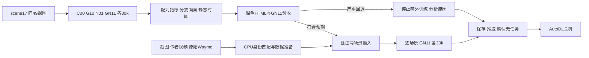
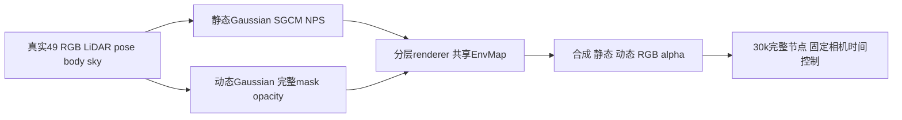

# DrivingEditor 四臂验收与两场景后续协议

task/run：`WS-V82-DRIVINGEDITOR-GN11-GATE-OTHER-SCENES-20261013/r1`。用户已确认 C00 动静态分支符合预期。现有 `C00→G10→N01→GN11` 从零各30k的矩阵继续执行，新增 GPU 训练尚未开始。执行状态只见 [RESEARCH_STATUS](../RESEARCH_STATUS.md)，机器可读规则见 [后续协议](DRIVINGEDITOR_FOLLOWUP_20261013.json)。

## 四臂报告与 GN11 准入

四臂都完成后，使用同一30k节点、同49个 frame ID/timestamp、同RGB裁剪规则和同显示标尺制作深色 HTML。保留全部帧、GT/合成/静态/动态/alpha，以及固定相机改变49个模型时刻的控制；支持同步播放、逐帧、车体局部比较。报告给出完整显存峰、速度、点数、NPS梯度量级和SGCM统计。

以 GN11 相对 C00 的完整30k结果作决定，G10/N01用于解释两个模块与交互。用户已明确接受的判断为：全图或车体的49帧等权PSNR下降超过1dB，或者出现明显且持续的分层/静态时间视觉退化，则停止额外训练。用户通过本聊天异步回复“按这个判据执行”确认该规则。C00的参考均值分别为34.0624/32.7312dB，确认的数值边界分别为33.0624/31.7312dB；同时检查逐帧坏例，不把均值持平当作自动通过。单seed单scene不支持统计等价结论。

先核对四臂完整10k/20k/30k节点、49帧资产、配置差异白名单、全30000步独立采样配对及finite诊断。资产/合同问题归工程诊断，不能写成模块的科学失败。检查点stat/header通过不等于模型、Adam和RNG实际恢复通过。

若GN11严重回退：保留全部资产，分析SGCM、NPS单臂和交互、支撑区域/谱系与梯度；不追加loss、分辨率、seed或点数搜索，完成报告与推送后关机。若总体符合预期：仅在新增输入准备通过后，逐场景执行GN11，从零seed0各30k、10k/20k/30k完整保存。新增预算60k，条件满足后的总授权预算180k；不在新场景再做四臂矩阵。

## 两幅截图的输入准备

| 截图 | 身份与窗口 | 当前准备和边界 |
|---|---|---|
| 住宅路口横穿红车 | Waymo training index29、segment10526338824408452410_5714_660_5734_660，作者21帧全部对应raw69–89；[作者Urban1视频](https://github.com/user-attachments/assets/5aae487d-e05e-44ef-9566-e23da980f467) | 本地49扩展raw69–117已提取真实RGB/pose/calib/LiDAR及600k混合静态种子，anchor0029079；实际sky/body/actor prior和GPU训练仍待准入 |
| GMC pickup与Jeep迎面驶来 | Waymo training index8；[作者Urban3视频](https://github.com/user-attachments/assets/1e5fc249-94e9-456f-9db5-e32185455a42)对应raw23–51 | 已有原始TFRecord及49帧raw23–71扩展输入。29帧作者可见窗口确认，作者训练窗口没有公开确认 |

scene0008 在独立目录 `/root/autodl-tmp/drivingeditor_repro/campaign/followup_scene_prep_20261013/` 复制约359MiB输入与代码，原输入和当前四臂源码未改变。实际CPU `readWaymoInfo_add`、49视图/时间、canonical mask、scale4尺寸、相似变换与SGCM地面/区域输入通过。静态种子600000点，原读取器严格0.1m排除后594981点；动态真实LiDAR合计42654点（pickup8592、Jeep34062）。地面RMSE0.02891m、倾角2.4048°，区域面积合计141.74m²。固定相机锚点明确为 `0008033`，不复用scene17的 `0017010`。

车体并集为DEVA77/82，Corolla153与该并集在全部49帧零重叠，保留静态。掩码含809个红通道为0的车体像素，不能以动态RGB是否黑色推断body范围。两个actor PLY由实际读取器拼为单个动态Gaussian分支；这不是两个独立可编辑GaussianModel。静态点仍按2024读取器的原规则处理，不另用GT标签裁剪训练点。v2只去除pickup/raw29误纳入的20个地面点，保留该帧可见车体掩码。

CPU准备没有初始化CUDA，也没有加载模型、训练或渲染。CPU几何检查临时关闭model guard；候选训练配置中的corrected SGCM guard仍开启，真实49 Camera/GaussianModel/谱系绑定须在通过GN11验收后的启动阶段核验。`training_ready=false` 表示这些运行阶段准入尚未执行，不能把CPU通过写成完整GPU合同通过。body-only、shadow缺失和M-detector未进入真实预处理的边界仍保留。[输入审计与实际CPU读取证据](../autoresearch/worldsim_v82/drivingeditor_followup_20261013/r1/)。

后续入口使用独立训练源码、sceneSpec和显式gate receipt，默认只验证。原矩阵根目录、四臂controller及当前训练配置不变。新scene绑定真实49 frame IDs/timestamps、输入目录、actor角色和固定相机锚点；所有目标、权重、衰减、预算和SGCM/NPS公式继承已完成的GN11共同配置。红车身份现已完成，不再继续候选搜索。可以在原GN11准入通过后先跑已prepared的GMC场景，红车真实GPU分割则共享锁串行接续；raw准备spec不能直接当训练sceneSpec。若真实输入最终无法齐全，记录缺口并暂停心跳等用户决定，不能伪称两个场景完成或提前适用两场景完成后的关机授权。

红scene0029的完整raw为1,160,423,074B，镜像existing pinned LFS size/digest验证通过；199条record的CRC/context通过。全部21作者GT帧独立最佳映射69–89、stride1，mean RGB MAE0.01224435，最小次优间隔0.01935491；root和独立agent分别审查9/12帧，覆盖全部21。这里验证源身份，未填写GN11或新场景human质量评价。[身份与CPU raw证据](../autoresearch/worldsim_v82/drivingeditor_followup_20261013/r1/scene0029_identity_review.json)。

新CPU raw helper纯protobuf/NumPy翻译既有Waymo equations，未导入Torch/TF或使用CUDA。真实scene8/raw23对照178112点：点数/顺序/非XYZ、标定/pose/RGB精确；TOP XYZ maxL2差0.002013756m、全点RMS0.000600118m，非bitwise，浮点算术控制通过不代表最终质量影响已认证。600k真实LiDAR静态种子保持原seed0/有放回与零初始化颜色；sky目录空，body与actor PLY没有占位，GT track/box只审计。实际body/sky、mask关联actorLiDAR prior、actualCPU loader/SGCM检查与GPU绑定均是后续必需项。共享下载body账1,756,572,098B低于5GiB，找到精确身份后不继续435候选搜索。

训练入口发布passed receipt时固定`max_psnr_drop_db=1.0`，allowed_scene_ids显式为`scene0008_023_071`和`scene0029_069_117`；实际--run带`--verify-paired-steps`。确认阈值后14项Python3.9 CPU检查通过，包括将receipt阈值改成2dB也无法掩盖严重退化。完整GPU恢复和新场景模型/SGCM绑定未认证。

图中红场景body/sky与actor prior仍是待完成的真实输入；已完成CPU raw与静态种子不等于这些模块已运行。

## 定时检查与关机

当前聊天的 `drivingeditor-30k` 心跳保持每小时一次：现有矩阵、终态报告/验收、条件成立后的两个场景和最后关机均在同一路线。无变化保持安静；完整10k节点、显存接近容量、异常、完成或必须用户决定时才通知。其他旧自动化继续暂停。

用户已明确授权两条终止路线的AutoDL关机，无需重复询问。关机前必须保存结果和完整资产、推送本分支，确认训练/评价/渲染/数据任务以及会启动任务的controller均结束。无关活跃任务须报告，不擅自杀掉。平台 `/usr/bin/shutdown` 包含未授权的Trash递归清理，因此电源执行时重新确认准确supervisord PID，只执行它的日志和TERM关机后端，省略清理。当前尚未执行电源操作；SSH断开本身不足以证明平台电源已停止，验证不了平台状态时应准确写“已发出关机请求”。

`failure_ledger_refs=[V82-F01,V82-F02,V76-F03]`，`failure_ledger_delta=none`。人工评价只记录用户对C00“符合预期”的确认，GN11及新场景的人工评价留空。
