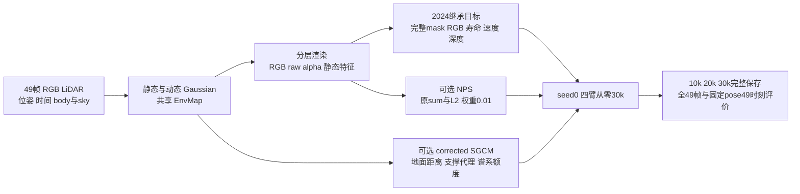

# DrivingEditor 四臂30k：结果与工程验收

更新：2026-10-13（新加坡）。task/run：`WS-V82-DRIVINGEDITOR-HYBRID30K-20261012/r1`。四臂各真实完成30,000步，共120,000步；本报告评价同一30k节点的完整49帧，追加场景仅列07:25左右的启动证据。

**GN11在本次相对工程验收中符合预期，并保留局部车体代价。** 相对C00，全图合成PSNR提高0.3254 dB，车体下降0.1287 dB，非天空车外静态背景提高0.3175 dB。用户已确认严重回退判据：完整49帧的全图或车体均值下降超过1.0 dB（差值小于−1.0 dB），或出现明显持续的视觉/静态回退。均值与实际视觉复核未触发该判据，工程gate为`passed`，`agent_engineering_verdict=expected_with_mild_local_actor_costs`；用户仅确认C00符合预期，**GN11的`human_verdict=null`**。[最终gate](../autoresearch/worldsim_v82/drivingeditor_hybrid30k_20261012/r1/final_four_arm_20261013/GN11_gate_passed.json)、[工程审查](../autoresearch/worldsim_v82/drivingeditor_hybrid30k_20261012/r1/final_four_arm_20261013/root_engineering_gate_review.json)。

## 组件与固定对照

输入为`scene0017_000_048`的FRONT视图`0017000–0017048`，原图1920×1280，scale4渲染480×320，模型时间−0.48至0.48。C00关闭SGCM/NPS；G10仅开启corrected SGCM；N01仅开启原公式NPS；GN11二者都开启。四臂均为seed0从零训练，`iterations=position_lr_max_steps=30000`，没有种子或权重网格。

共同目标保留2024公开代码的活跃RGB、静态寿命/速度、LiDAR衰减等约束；动态opacity明确使用未预乘mask的`100*mean((raw_alpha_d−Md)^2)`，覆盖mask内外。静态RGB分别对预测/GT乘`1−Md`后计算全图`.8 L1+.2 DSSIM`；NPS没有替代绝对静态约束，也没有硬冻结静态参数。body二值mask、静态opacity reset在15k前截止、独立采样流及完整保存/评价RNG保护为四臂共同工程设置。天空/深度的共同适配与未知作者细节见[固定协议](DRIVINGEDITOR_HYBRID30K_PLAN.md)，本结果不等同于已认证的完整作者实现。

## 完整49帧的质量、增量与交互

每帧RGB先clip到[0,1]，计算指定区域MSE与`−10log10(max(MSE,1e−12))`，再等权平均49帧；不是pooled MSE，也不是末步训练PSNR。车体域使用canonical body mask；静态背景域为非天空且车体外。alpha始终为raw、未预乘body mask。四臂全部49帧保留，不剔除不利帧。

| 臂 | 全图合成PSNR / dB | 车体合成PSNR / dB | 静态背景PSNR / dB | 同背景域动态alpha均值 |
|---|---:|---:|---:|---:|
| C00 | 34.0624 | 32.7312 | 34.0154 | 0.00017098 |
| G10 | 34.3458 | 32.2922 | 34.3005 | 0.00017333 |
| N01 | 34.3263 | 32.8188 | 34.2434 | 0.00018218 |
| GN11 | 34.3878 | 32.6025 | 34.3329 | 0.00017387 |

| 对比 | 全图 / dB | 车体 / dB | 静态背景 / dB | 车外动态alpha差值 |
|---|---:|---:|---:|---:|
| G10−C00 | +0.2834 | −0.4391 | +0.2851 | +2.3505×10⁻⁶ |
| N01−C00 | +0.2639 | +0.0876 | +0.2280 | +1.1200×10⁻⁵ |
| GN11−C00 | +0.3254 | −0.1287 | +0.3175 | +2.8936×10⁻⁶ |
| GN11−G10−N01+C00 | −0.2219 | +0.2228 | −0.1956 | −1.0657×10⁻⁵ |

SGCM单独开启的车体代价较大；NPS单独开启的车体均值略升，但车外动态alpha增加。联合臂的全图与静态背景增益没有简单相加。上述交互是本单场景、单seed、指定指标尺度上的代数对比，没有统计显著性或机制证明。

GN11的车外动态RGB支撑比例由0.004164降至0.003854（差值−0.0003104），而同域合成与静态RGB绝对差由5.6935×10⁻⁵升至6.3684×10⁻⁵（差值+6.7486×10⁻⁶）。因此不能把背景PSNR改善概括为所有分层指标改善。[全部逐帧FP32指标与资源manifest](../autoresearch/worldsim_v82/drivingeditor_hybrid30k_20261012/r1/final_four_arm_20261013/manifest.json)、[49帧配对CSV](../autoresearch/worldsim_v82/drivingeditor_hybrid30k_20261012/r1/final_four_arm_20261013/all49-paired-metrics.csv)、[配对质量与静态时间图](../autoresearch/worldsim_v82/drivingeditor_hybrid30k_20261012/r1/final_four_arm_20261013/paired-quality-and-static-time.png)。

## 不利车体段与真实视觉复核

GN11车体PSNR在28/49帧下降，其中19帧低于C00超过1 dB；中位差值−0.4589 dB。**raw20–46连续27帧下降，段均值−1.3809 dB；最差raw42为−3.0940 dB，C00 27.7365 → GN11 24.6425 dB，canonical body mask仅249个像素。** raw42的小区域分母解释了读数的敏感性，不消除这项真实回退。完整49帧均值通过不能扩大为逐帧通过。

实际像素审查覆盖C00/GN11全49帧的composite、static、dynamic和raw alpha；另对连续27帧不利车体段逐页复核，并放大raw24/42/46。统一clip/alpha标尺、同一canonical ROI，放大仅重复原像素，无逐图归一化、预mask、滤镜或坏帧删除。主体形状与不透明支撑保持连贯，未建立持续大孔洞、整体车体塌缩或大片道路重新进入动态层的证据。

代价确实存在：车尾局部亮度/颜色、尾灯及后杠细纹更平；后段车辆大部分出画，raw46出现较软的灰色alpha外缘小凸出。raw47/48两臂静态层仍有左边缘车辆颜色/残影。道路残影在C00常呈较硬亮边薄片，在GN11多呈更软暗斑；这不认证补景成功。8bit图像近黑也不证明车外raw alpha严格为零。[不利车体审查](../autoresearch/worldsim_v82/drivingeditor_hybrid30k_20261012/r1/final_four_arm_20261013/visual_review/body_adverse_visual_review.json)、[完整observed工程审查](../autoresearch/worldsim_v82/drivingeditor_hybrid30k_20261012/r1/final_four_arm_20261013/root_engineering_gate_review.json)。

## 固定相机的49时刻：变化略减，未完全静态

固定pose`0017010`及光线，仅替换49个实际模型时刻；各臂相对自身anchor时间−0.28的静态渲染计算MAE。此组反事实组合没有对应GT，不计算或认证重建PSNR。

| 臂 | 静态RGB MAE均值 | 静态RGB MAE最大值 | 静态alpha MAE均值 | 静态alpha MAE最大值 |
|---|---:|---:|---:|---:|
| C00 | 0.02271235 | 0.03939939 | 0.00321083 | 0.00510433 |
| G10 | 0.02003103 | 0.03414871 | 0.00255311 | 0.00430894 |
| N01 | 0.02217092 | 0.03736869 | 0.00255519 | 0.00412843 |
| GN11 | 0.02153641 | 0.03737893 | 0.00274517 | 0.00473522 |

GN11−C00均值为RGB −0.00117593、alpha −0.00046566；RGB仍有9/49时刻更高，alpha有2/49更高。C00/GN11的全49固定时刻真实RGB与alpha已逐页审查：两臂路面残影均随时间移动，后半段道路/横道纹理继续变化；未观察到GN11新增大块路面alpha塌陷。**绝对时间不变性及完整静态补景均未通过**，模型时间/位移也不能解释为物理秒或速度。[固定时间审查](../autoresearch/worldsim_v82/drivingeditor_hybrid30k_20261012/r1/final_four_arm_20261013/visual_review/static_time_engineering_visual_review.json)。

用户截图回看（2026-10-13）：固定pose0017010、local29/raw28/t=0.08，两臂中央道路残影均从anchor位置移到左侧远端横道，近景白条顶端均有黑块；C00硬亮边更明显，GN11较软。该时刻RGB MAE分别0.0263978243/0.0243896767，变化略减不等于补景正确；锚点MAE为0仅因为自比。已查看target两臂raw alpha_s，路面主体近白，未建立对应大块alpha孔洞。实际逐帧静态图也独立保存于`assets/{arm}/observed/{index}_static.png`，与固定相机`static_time`分开。

源码机制核对：静态renderer仍使用`get_xyz_SHM(t)`以及时间marginal opacity，寿命和速度仅软正则，不是硬冻结；速度惩罚输入还有寿命衰减，位置变化仍来自raw velocity。NPS是当前渲染的局部静态速度特征L2 sum，没有比较t1/t2的RGB。body mask缺投影阴影，在mask外动态opacity强压0、静态RGB仍拟合含阴影GT的共同机制下，推断影子容易留入静态层；具体残影的逐高斯归属尚未验证。通过相对C00的工程门槛，不等于绝对静态与补景合格。[回看与统一入口修订证据](../autoresearch/worldsim_v82/drivingeditor_followup_20261013/r1/unified_viewer_20261013/)。

## NPS与SGCM：有效性及证据边界

NPS保留原Eq9的sum、L2范数、checkerboard四邻域、既有距离图与权重0.01。真实GN11的1/1000/10k/15k/20k/30k六节点损失及梯度有限，weighted值按0.01缩放。`static_feature`连接NPS，却与static RGB目标断连；日志中的feature比例0为**无效哨兵值**（`ratio_valid=false`），不能解释为两目标梯度平衡。`static_alpha`对两目标均连接，同一张量上的weighted NPS/static-RGB梯度L2比例20k约0.03309、30k约0.006283，可比较该中间张量量级，不能推断所有Gaussian参数的梯度平衡。[梯度与数值摘要](../autoresearch/worldsim_v82/drivingeditor_hybrid30k_20261012/r1/final_four_arm_20261013/quality_and_gradient_summary.json)。

G10/GN11各记录145次SGCM，真实执行范围550–14950；地面距离0.5 m对应0.05模型单位。账目、每步新增额度、49视图guard及谱系同步检查通过。新增点准入使用static SHM中心投影、离散训练timestamp、temporal marginal>0.05、有效alpha≥1/255及view depth>0.2；两个split子点都检查。这是**几何/时间支撑代理**，无真实遮挡判断，不是逐Gaussian渲染贡献认证。每初始谱系至多一次SGCM clone，generic/SGCM后代继承spent状态；开启SGCM的恢复必须具备`sgcm_lineage_v1`。3M与每次净新增10k是SGCM预算，generic增密可能越过其旧阈值，不能宣称严格全局点数上限。

## 四臂完整资源与3090容量初筛

以下来自各臂关闭后的完整`memory_summary`；显存单位为GiB。wall包含初始化、优化/增密、保存及评价；终段速度只覆盖29901–30000，不能与全程速度混用。本轮设备日志名称为`NVIDIA GeForce RTX 4080 SUPER`。

| 臂 | 全程wall / min | 终段 / iter·s⁻¹ | allocated峰 | reserved峰 | 进程采样峰 | 设备采样峰 | 30k静态 / 动态点数 |
|---|---:|---:|---:|---:|---:|---:|---:|
| C00 | 82.921 | 4.547 | 5.233 | 6.287 | 6.533 | 6.582 | 986,061 / 1,028,966 |
| G10 | 86.143 | 4.422 | 5.954 | 6.637 | 6.902 | 6.893 | 1,156,723 / 1,018,163 |
| N01 | 82.147 | 4.558 | 5.343 | 6.342 | 6.686 | 6.676 | 1,024,184 / 1,018,225 |
| GN11 | 84.857 | 4.401 | 5.806 | 6.596 | 6.820 | 6.850 | 1,089,276 / 1,051,866 |

四臂均覆盖30k增密增长、10k/20k/30k保存、LPIPS及静态时间评价，monitor已closed，采样错误0；阶段资源保留在manifest。最大观测峰为G10进程6.902 GiB，四臂均满足24 GiB减2 GiB预留的22 GiB容量初筛。采样间隔1秒，峰值是下界；allocated/reserved未包含全部非PyTorch CUDA内存，设备采样可能含其他进程，进程/设备查询口径与时刻也不同。**仍需目标RTX 3090和额外场景的完整实跑，当前不能认证迁移容量或3090更快。**

## 核验范围与关联追加场景

四臂10k/20k/30k共12节点的static、dynamic、EnvMap、training_state四文件stat，以及49帧/49时刻的FP32数组header与文件集通过；全部30,000步camera、time_shift及学习率配对一致。共同配置白名单通过，scene8继承配置只改变source/model路径与场景start/end字段；真实49帧身份以loader与GPU绑定为准，不凭旧start/end字段推断原scene17输入窗口。继承的冻结源码153文件直接字节比较无差异，scene8 prepared源码另明确适配固定相机时间控制的场景锚点。真实导出器对4×49帧保存FP32的GT/body/sky跨臂一致性及六项区域指标进行复算，满足rtol 1e−7/atol 1e−9。[配置及源码审计](../autoresearch/worldsim_v82/drivingeditor_hybrid30k_20261012/r1/final_four_arm_20261013/final_gate_config_audit.json)。

保存契约包含模型、Adam、RNG、独立采样器和SGCM谱系，但此次检查**未加载完整检查点，也未实际恢复模型/Adam/RNG继续训练**；`restoration_verified=false`。stat/header通过不能替代恢复验证。轻量网页/证据包也不是大型检查点与全部FP32的完整备份；原始大资产保留在AutoDL的`campaign/hybrid30k_20261012/runs/`。

| 关联场景 | 已有真实证据 | 尚未获得的结果 |
|---|---|---|
| `scene0008_023_071` | GN11、seed0从零30k已由PID96504于07:16:27启动；49帧Scene绑定与SGCM/lineage绑定均PASS，anchor=`0008033`；07:25左右记录5100步、wall约557秒、采样错误0 | 10k/20k/30k完整保存按计划执行；该快照尚无30k质量或恢复结果 |
| `scene0029_069_117` | raw69–117的49帧RGB/位姿/真实LiDAR及600k静态种子CPU准备完成，anchor=`0029079`；未启动训练 | GPU空闲后仍需真实49帧sky/body、dynamic RGB、物理actor映射与actor LiDAR先验，再核验loader/SGCM并准入 |

scene8作者可见raw23–51，本地训练扩展为raw23–71；保留Corolla为静态，两目标进入同一动态Gaussian分支。scene29作者可见raw69–89，本地扩展为raw69–117。两组49帧均是本地窗口，不冒称公开确认的作者训练窗口。scene8启动receipt中的初始runtime待验状态由后续真实Scene/SGCM绑定证据补证。[scene8启动与绑定证据](../autoresearch/worldsim_v82/drivingeditor_followup_20261013/r1/scene0008_launch_20261013/)、[scene29 CPU准备](../autoresearch/worldsim_v82/drivingeditor_followup_20261013/r1/scene0029_cpu_raw_readiness.json)。持续执行状态只见[RESEARCH_STATUS](../RESEARCH_STATUS.md)。

本轮全部质量数值是49个已观测训练视图的重建结果，没有独立heldout/test、dense edited GT或真实MOVE/遮挡补景验收；body-only监督缺shadow，M-detector未成为真实预处理。GN11相对工程gate只用于两个追加场景的准入，不证明普遍收益、作者完整方法、编辑质量或绝对静态性。`failure_ledger_refs: [V82-F01,V82-F02,V76-F03]`；`failure_ledger_delta: none`；`human_verdict: null`。
