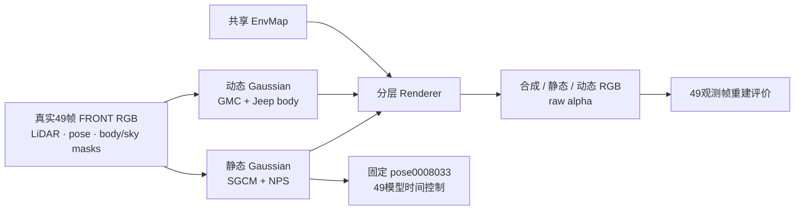

# GMC 场景 GN11 30k：终态与工程视觉结果

`scene0008_023_071` 的 GN11、seed0 从零训练已完成30,000步。10k、20k、30k三个保存节点通过原始 `contracts.completion_contract` 的实际只读核验，进程96504已退出。49帧合成重建的全图PSNR为 **34.308 dB**；非天空、车体外区域的**静态分支**PSNR为 **35.582 dB**；车体合成PSNR为 **29.698 dB，仅39个非空车体帧有效**。

工程像素复核支持两个目标车体在动态分支中的原位重建，以及前景 Corolla 在静态分支中的保留；同时明确发现车体细节模糊、接地阴影不足、删除后路面残影和固定姿态下的静态RGB时变。本结果没有同场景C00对照，不能验证SGCM或NPS的独立收益，也不能沿用原场景的相对下降1 dB准入判断。`human_verdict=null`。

## 输入、组件与数据流

这张组件图展示输入、静态与动态组件、共享环境、渲染输出和两类检查。交互页另附[架构SVG](C:/Users/dengyunlong/Documents/Codex/2026-10-12/w/outputs/drivingeditor_GMC_GN11_30k/architecture-components.svg)。两个动态目标在当前实现中合入同一动态分支；图中的支持不等于独立实例编辑能力或精确遮挡贡献认证。

真实输入是FRONT/image_0的 `0008023–0008071`，共49连续原始帧；源图为1920×1280，scale4渲染为480×320。模型时间取49点 `[-0.48,0.48]`，固定相机锚点为local10、`0008033`、模型时间−0.28。模型时间与坐标不应解释为真实秒和物理速度。

已有作者视频身份核对覆盖raw23–51；本地训练扩展到raw23–71。**作者实际训练窗口没有公开确认**，因此这49帧窗口是本地复现协议，不冒称作者原始训练窗口。全部49帧用于观测训练重建，没有heldout或独立test，也没有车辆删除后的无障碍GT。

## 30k重建指标与有效帧

| 指标 | 数值 | 有效范围 |
|---|---:|---|
| 合成全图PSNR | 34.308231 dB | 49/49帧 |
| 合成全图SSIM | 0.965337 | 49观测训练视图 |
| 合成全图LPIPS | 0.033749 | 49观测训练视图 |
| 车体合成PSNR | 29.698454 dB | 39/49非空车体帧 |
| 非天空车体外**静态RGB** PSNR | **35.582229 dB** | 49/49帧 |
| 同一背景区域的合成RGB PSNR | 35.617300 dB | 49/49帧，区别于静态分支指标 |
| 车体核心5px合成PSNR | 34.529660 dB | 39有效帧 |
| 车体内边界5px合成PSNR | 26.114430 dB | 39有效帧 |
| 车体外边界5px合成PSNR | 20.772755 dB | 39有效帧 |

区域PSNR按每帧clip后的RGB计算，再对有限、非空区域帧等权平均，不是pooled MSE。raw62–71十帧的车体、核心和边界区域为空，均保留在逐帧结果中；这些缺失车体分数不填0，也不宣称49个车体分数的均值。静态背景指标采用非天空、车体外区域，不能与论文指标中包含天空的静态区域直接混用。

合成全图最低分出现在raw53（29.612410 dB）；车体最低分为raw29（22.734170 dB，仅865个车体像素）。这些帧保留在实际像素复核中，均值不覆盖局部限制。

## 实际像素复核

已实际使用 `tools.view_image(detail="original")` 查看17张观测拼图、13张固定姿态时间拼图和4张细节拼图。完整覆盖49帧的GT／composite／static／dynamic／alpha_d，以及49个固定姿态时间点的static RGB／alpha_s，共**343个不同的所需原PNG**。另外98张观测alpha_s／body mask属于导出包，但本次这项全覆盖复核不声称逐图审查它们。

观测拼图保持原480×320像素；细节图仅将裁剪像素整数复制2倍或3倍，没有插值、逐图归一化、曝光调整、滤波或body预乘，标签放在图像区域外。审查没有修改原PNG、模型或训练。

| 观察 | 实际证据与限制 |
|---|---|
| 目标动态支持 | GMC近车与迎面Jeep在可见时刻位于动态RGB／alpha支持中，离开左边界的过程大体对应GT；不证明单实例可编辑性。 |
| Corolla静态保留 | 前景银色Corolla贯穿49观测帧及固定姿态控制保留在static／composite，不是大块白色动态alpha目标；细纹和亮度仍有小差异。 |
| 车体细节 | GMC边缘有局部色边、细节变软；raw29–33的小Jeep前脸／格栅模糊。 |
| 接地阴影 | raw50／52／53尤其清楚：GT的Jeep下方有完整自然接地阴影，composite缺失其中较大部分，轮子显得悬浮。阴影未纳入body监督是可能的协议解释，未证明是SGCM／NPS的作用。 |
| 删除路面残影 | raw23–27、raw54–58的static路面有明显黑色shadow-like残影，附近还存在细暗痕；不能宣称删除后的干净路面恢复。 |
| 固定姿态时变 | pose0008033保持不变时，raw23／55／56模型时间有黑色路面块，raw33锚点路面清楚；黑块随时间移动／变形／消退，该处alpha仍广泛不透明。严格静态RGB时间不变未成立。 |
| 空车体尾段 | raw62–71没有看到车辆尺寸的大块动态ghost；原显示接近黑色，但不是严格零。raw62的dynamic有116像素>2/255、alpha_d有303像素>2/255；raw63的dynamic为3像素，raw64–71各2像素。 |

没有观察到大范围前景、场景结构或分层连续崩坏；这不抵消上述绝对重建和删除背景限制。固定姿态时间控制属于反事实pose/time组合，没有对应GT质量分数。

固定姿态49时间点相对自身锚点的静态RGB MAE均值为0.003363634，alpha MAE均值为0.000928915。单时刻RGB MAE最高为0.021965750（raw23时间）；单像素RGB绝对差最大为0.894071043（raw55时间）。小的全图均值与明显局部黑色路面残影可以同时存在，不能据均值认定绝对静态性。

## 训练速度、点数与完整资源

总wall为5066.929729秒，即**84.448829分钟**，包括初始化、训练、梯度诊断、完整保存、训练图像／LPIPS评价和固定姿态时间控制。全阶段速度为5.920745 iter/s；按记录的training exclusive wall扣除子阶段后为6.307940 iter/s。末100步为4.839860 iter/s，最后一轮forward/backward记录为150.368 ms，这些口径不能混为同一训练速度。

30k最终渲染点数：静态**646,337**，动态**1,004,003**。记录的设备名称为NVIDIA GeForce RTX4080 SUPER；这里报告实际运行记录，不据此推断目标RTX3090的速度。

| 阶段 | allocated峰 GiB | reserved峰 GiB | PID采样峰 GiB | device采样峰 GiB |
|---|---:|---:|---:|---:|
| 初始化 | 0.325675 | 0.416016 | 0.738281 | 0.748047 |
| 训练，含子阶段 | **4.997530** | **5.726563** | **5.824219** | **5.775391** |
| 梯度诊断 | 4.367416 | 4.779297 | **不可用** | **不可用** |
| 保存 | 2.047114 | 4.017578 | 3.412109 | 3.421875 |
| 图像评价，含时间控制 | 3.505548 | 4.017578 | 4.361328 | 4.371094 |
| 固定姿态时间控制 | 3.505548 | 4.017578 | 4.361328 | 4.371094 |

总体allocated／reserved／PID／device峰分别为4.997530／5.726563／5.824219／5.775391 GiB。闭合的memory_summary覆盖35个完成阶段实例和5,068个约1秒采样，没有记录错误。梯度诊断阶段没有NVIDIA采样，缺值保持不可用，不能填0。status内嵌memory是关闭前的running快照，终态资源采用独立的closed、complete memory_summary。

采样峰是下界，allocator峰不含全部非PyTorch CUDA内存；这次完整单run观测满足24 GiB减2 GiB的初筛预算，但**未认证目标RTX3090的容量或速度**。

## NPS、SGCM与保存合同边界

六个NPS诊断节点为1、1000、10000、15000、20000、30000；记录梯度有限，raw到weighted符合0.01缩放。30,000步记录的NPS loss均有限、启用且按0.01缩放。static_feature与staticRGB的梯度比例在六个节点均无效，因为staticRGB对应feature断连；记录的ratio0不能解释为梯度平衡，更不能认证完整Gaussian参数梯度平衡。

SGCM实际调用145次，步号550–14950、间隔100；点数守恒、增量／总点数限额、49训练视图guard以及候选账目检查通过。累计prune1494、clone111、split parent5878，SGCM调用净拓扑增量为+4495。此处累加的是每次调用观察，不是独立Gaussian或谱系数量，也不是全部训练增密造成的静态点数增长。

Guard是中心投影、时间alpha与训练视图支持代理，没有测量真实遮挡后的精确逐Gaussian贡献。日志中的clone谱系排除和重复计数不能独立重建所有源谱系历史；same-step重复字段只在50次调用中出现、95次缺失，已记录的重复计数为29。以上运行账目不建立视觉收益或RGB噪声因果解释。

10k、20k、30k每个节点均核验了static、dynamic、environment、training_state四组件的非零文件尺寸与manifest一致；49个FRONT raw23–71的身份／时间、196张四通道PNG尺寸、49个raw FP32 NPZ头，以及固定pose0008033的49时间FP32头均通过。**没有加载大检查点，没有实际恢复模型、Adam、RNG、采样器或SGCM谱系状态**；`restoration_verified=false`，文件stat不是恢复认证。

## 可查看产物与结论范围

[真实30k交互页面](C:/Users/dengyunlong/Documents/Codex/2026-10-12/w/outputs/drivingeditor_GMC_GN11_30k/index.html) 提供GT、合成、静态、动态、raw alpha、body mask与固定姿态49时间控制。导出包共441张PNG，由已保存FP32在CPU上导出，原导出验证状态为 `PASS_SAVED_FP32_CPU_EXPORT`；页面及PNG不是大检查点完整备份。

本报告对应的工程状态为 **ENGINEERING_VISUAL_REVIEW_COMPLETE_WITH_LIMITATIONS**。证据支持已完成运行和所需通道的完整复核，保留局部接地／残影／时变限制；不作同场景模块收益、heldout泛化、删除后GT质量或完整恢复的认证。人类质量评价保持 `human_verdict=null`。

可核对[工程摘要JSON](C:/Users/dengyunlong/Documents/Codex/2026-10-12/w/outputs/drivingeditor_GMC_GN11_30k/engineering-results-summary.json)、[实际视觉观察JSON](C:/Users/dengyunlong/Documents/Codex/2026-10-12/w/outputs/drivingeditor_GMC_GN11_30k/engineering-visual-review.json)和[逐帧视觉覆盖JSON](C:/Users/dengyunlong/Documents/Codex/2026-10-12/w/outputs/drivingeditor_GMC_GN11_30k/engineering-visual-coverage.json)。原index、manifest、summary和441张PNG未因编写本报告而修改。
