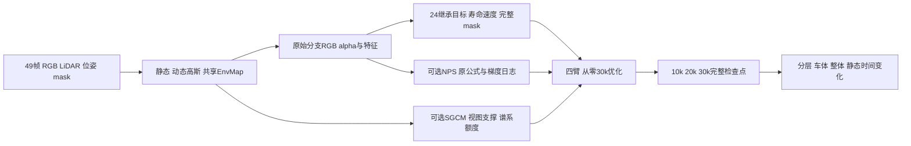

# DrivingEditor：2024继承基础与30k模块消融

更新：2026-10-13（新加坡）。task/run：`WS-V82-DRIVINGEDITOR-HYBRID30K-20261012/r1`。用户重新指定复现原则：论文没有明确要求改变的机制，优先保留2024公开代码；论文的省略不能当作删除指令。先准备实验，等用户将 `wm-vgpu-1011` 切回GPU后运行。本轮完成CPU准备，真实GPU训练0步。

## 固定基础与恢复规则

实际核对 `/root/autodl-tmp/drivingeditor_repro/DrivingEditor/train.py`（2024作者公开源）和 `DrivingEditor-run/train.py`（兼容实现）。本轮恢复活跃项，旧注释项不复活。完整mask MSE取代此前仅前景Eq13适配，不再叠加那条前景log项。

| 项目 | 四臂共同配置 | 来源与边界 |
|---|---|---|
| 完整动态opacity | `100*mean((raw_alpha_d-Md)^2)` | 恢复24活跃目标；真实未乘mask alpha。100是历史控制系数，不认证最优 |
| 静态RGB | `(1-Md)`分别乘预测/GT，再全图`.8 L1+.2 DSSIM`，系数1 | 恢复24项；已有S对照支持背景收益，也已发现整体/车体代价 |
| global/dynamic/sky RGB | 系数1/5/5，DSSIM=.2 | 保留24活跃系数；论文没有明确删除这些系数/sky photo，不仅根据省略替换 |
| 静态寿命 | `.1/mean(abs(duration_map))` | map来自`exp(_scaling_t).clamp_max(2)`，不是全局timestamp或`_t`；分母下界`1e-8`是显式数值保护 |
| 静态速度 | `.01*mean(abs(static_v_map))` | 恢复24绝对约束；没有硬冻结参数 |
| 归一化 | 寿命/速度用24的combined-alpha分母；NPS单独用既有static-alpha分母 | 明确区分两条图，不默换旧约束语义 |
| 深度、速度平滑与总alpha熵 | `.1/.1/.05` | 24活跃项保留；`static_lambda_opacity_entropy`配置不对应活跃调用，不凭空新加 |
| 天空opacity与LiDAR | 保留既有Eq7静态sky项和Eq16全图面积归一的稀疏逆深度，系数`.05/.1` | 明确的共同改写；作者权重未认证。旧/新sky和depth同前向值与梯度会记录，不能假定影响小 |
| 深度衰减 | `exp(-iteration/8000*lidar_decay)`，`lidar_decay=1` | 恢复24调度，不轻易删除；10k/20k/30k系数分别乘约`.2865/.0821/.0235` |
| NPS | 原Eq9 sum、L2范数、checkerboard四邻居、既有距离图，系数`.01` | 只按消融flag开启；不改成平方范数或像素均值，不代替寿命/绝对速度 |

`paper_method=true`只沿用原始渲染、mask及完整检查点基础设施；`hybrid_method=true`标记新的继承目标。它不表示已经认证作者完整论文实现。未再使用旧`.05`仅前景opacity训练默认，也没有将旧50k检查点当作本轮起点。

## 矩阵、预算和对照

| 臂 | corrected SGCM | 原公式NPS | 起点与训练预算 |
|---|---|---|---|
| C00 | 关 | 关 | 同输入、seed0，从零30k |
| G10 | 开 | 关 | 同输入、seed0，从零30k |
| N01 | 关 | 开 | 同输入、seed0，从零30k |
| GN11 | 开 | 开 | 同输入、seed0，从零30k |

每臂`iterations=position_lr_max_steps=30000`，固定10k/20k/30k保存，总计划120k步。先只用银色车 `scene0017_000_048`、FRONT raw0–48，scale4：原图W1920×H1280，渲染W480×H320。四臂的参数文件除模块flag、输出和臂标签完全一致；没有额外权重网格或种子网格。

相机仍按无放回循环，time_shift仍用旧概率和幅度分布，但采样器使用独立Python/NumPy流，不受SGCM/generic拓扑或评价的随机消耗影响。每步保存frame/time_shift/LR用于逐一配对；同一源数据与种子初始化，实际首步模型点数/配置在GPU阶段核验。独立采样流及其栈、RNG进入完整sidecar，严格拒绝残缺、异常步数或旧计划恢复。

已有2k SV只保留为历史CPU候选，已被本方案取代，不入队。`scene0008_023_071_fresh30k_v2_groundonly`只有现有双车输入验证，还缺本轮正式readiness和SGCM ground确认，只列后续确认候选，不自动启动。

## SGCM修复与作用域

保留Eq8的地面距离prune/clone/split、`.5m`距离、既有ground fit与Hd；500–15000区间按offset50/interval100执行，避免generic densification改变索引的同一步。SGCM预算按3M static点与每次净新增10k限制；旧generic增密继续使用原点数阈值，批量新增可能越过阈值，因此记录实际峰值，不冒称严格全局点数上限。

新增点使用真实训练相机的离散timestamp、static SHM中心、temporal marginal>`0.05`、峰值有效opacity≥`1/255`、实际投影和view depth>`0.2`模型单位的支撑准入；两个split子点均检查。它是保守的几何/时间代理，没有遮挡判断，不能叫精确渲染贡献。`render_pkg.contrib`已从实际kernel确认是每像素last-contributor索引，不切成逐高斯贡献。

每个初始谱系最多SGCM clone一次；generic/SGCM clone、split子代共享并继承spent额度，append/prune按准确父/当前行索引同步。原18字段模型capture保留，optimizer中单独携带`sgcm_lineage_v1`；Adam只加载标准state/param_groups。关闭SGCM的臂无该payload；开启后恢复缺谱系直接拒绝。

实际meter→model scale为`.1`，`.5m`等于`.05`模型单位，ground RMSE约`.0493m`、2048个inlier cells。Hd是时间累计动态LiDAR AABB加地面与`.25m`margin，XY面积约360.36m²。raw0/24/48的近裁剪投影覆盖body mask均100%，面积分别是mask的7.45/17.41/138.79倍；相机与独立calib投影误差均<`.000279px`。它明显宽于当前车身，本轮不按结果临时缩作用区，也不从该测量推断彩噪唯一根因。

## 共同工程修复与输入角色

1. 保留已有canonical body二值mask，不退回24按RGB红通道判mask。实际49帧核对显示旧规则会漏掉共719个黑色车体像素；DEVA ID154对应body，dynamic RGB严格等于GT乘body，尺寸/二值输入已核对。
2. 静态opacity reset限定`iteration < densify_until_iter`（15k），保留增密阶段的原3k周期。原24代码在该窗口外仍reset，30k恰好会保存低opacity状态；这个已知保存/调度问题是四臂共同修复，不声称它解决全部分层失败。
3. 保留完整checkpoint机制，在optimizer/SGCM之后同参数评价再发布。LPIPS、额外分层及静态时间控制均保存/恢复全局RNG；不能让评价改变训练轨迹。

输入仍是现有body-only外观mask及对应LiDAR分支，缺shadow与真正M-detector流程；GT/native标签及框只用于之前的审计，不作为新训练清洗策略。本场景已反复开发，`eval=false`，49帧全是已观测重建；不报告独立test/heldout成绩或四场景paper均值。

## 评价与停止规则

10k/20k/30k保存static、dynamic、EnvMap及完整训练状态，包含Adam、全局RNG、独立相机采样器、scale、EMA与SGCM谱系。每节点保留全49帧四通道PNG及未预mask的FP32 RGB/alpha数组，不只选好帧。

固定报告全图、车体、非天空背景、5px core/内外边界的composite/static MSE与PSNR，原始内外alpha、动态RGB支撑、composite-static差异及点数/显存/时间。新增固定raw10位姿、全部49实际model timestamp的静态RGB/alpha变化，以及raw velocity、temporal width和SHM位移界；这些是反事实时间控制，没有对应GT，不作为重建质量分数。旧get_inst_velocity具有时间宽度衰减，map正则小不自动证明原始SHM位移小。

NPS在1/1000/10k/15k/20k/30k记录raw/weighted值，以及对同一原始特征、alpha和RGB的梯度L2/均值/最大值。诊断保留retained非叶子`.grad`、参数槽和RNG，不能污染真实backward。CPU合成例只检查代码与日志，不代替真实图像上的梯度量级。

G10/C00、N01/C00及GN11的增量和交互分别解释，模块收益必须同时检查分层、车体/整体代价与资源；某项背景PSNR好不能判编辑成功。没有dense edited GT，MOVE/遮挡补景仍需后续真实编辑验证。任何恢复、采样配对、有限值、CUDA/GPU所有权或完整检查点失败立即停止当前臂和后续队列，保留日志，不自动改权重/分辨率或清旧资产。

## 执行入口与CPU完成边界

远端新目录：`/root/autodl-tmp/drivingeditor_repro/campaign/hybrid30k_20261012/`；源码在`frozen_repository/`，四配置在`configs/`，工具在`tools/`。默认入口只检查，输出`PREPARED_WAITING_FOR_GPU`；只有GPU开好后调用`run_matrix.py --run`才串行启动。

实际服务器CPU检查使用正式DrivingEditor环境Python3.9.25、Torch2.2.2+cu118、线程1、CUDA不可见。损失6组、SGCM18项与源码/四臂/采样/完整sidecar/原始指标/时间控制7组集成检查已通过。训练模块及实际rasterizer扩展已在CPU模式成功导入，VGG16和LPIPS缓存已确认可用；没有加载大型模型检查点，没有GPU forward、backward或训练。真实GPU光栅化梯度、显存和完整模型/Adam恢复仍待GPU阶段验证，不能把CPU PASS当质量验收。

[矩阵与策略](../../scripts/worldsim_v82/drivingeditor_debug/hybrid30k_20261012/experiment_matrix.json) · [工具及实现](../../scripts/worldsim_v82/drivingeditor_debug/hybrid30k_20261012/) · [本轮CPU证据](../autoresearch/worldsim_v82/drivingeditor_hybrid30k_20261012/r1/)。当前状态只见[RESEARCH_STATUS](../RESEARCH_STATUS.md)。

`failure_ledger_refs: [V82-F01,V76-F03]`；`failure_ledger_delta: none`；`human_verdict: null`。本轮只准备实验，不认证完整作者方法、不改写旧S/V结果、不复活其他自动化。
