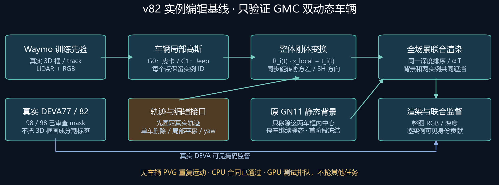

# v82 DrivingEditor 实例编辑基础设施

当前 task/run：`WS-V82-DRIVINGEDITOR-INSTANCES-20261013/r1`。按用户最新范围，只用 GMC 的两辆动态车验证，其他停车保留原静态分支。代码、真实 CPU 输入和单实例编辑合同已准备；GPU 当前被其他训练持锁，300步兼容短测正在等待，尚无新的照片编辑质量结论。



## 表示与监督

新车辆采用 `G_s ∪ T_0(t)G_0_local ∪ T_1(t)G_1_local`。实例本身不再有 PVG 速度或时间 envelope，时间变化来自整体刚体轨迹。三维框和 track 明确作为训练先验；非刚体不属于本版。局部高斯旋转与协方差同步，SH 颜色使用局部视线方向。删除、车辆局部米制平移、局部 yaw 和场景内实例资产替换共用统一渲染入口。

二维身份贡献使用完整场景一次深度排序中的 `alpha * transmittance` 权重，包括另一辆车与静态背景的遮挡。身份通道不足时分批提交同一完整点集，绝不只渲染一辆车的孤立 alpha 来监督可见 mask。每个已知身份全 H×W 内外两域 MSE 再等权平均，系数100；未知 mask 不当作0。原静态RGB1、RGB/深度衰减、静态寿命/速度约束及原 NPS 公式保留，首阶段静态/环境参数冻结。

背景使用本 scene 原 GN11 30k 先验，按两个真实车框移除静态 Gaussian 中心。它不保证移除 Gaussian 跨框尾部或车影；移动车后补景仍需图像审查。旧 SGCM 只以背景已训练结果继承，本版不把静态点克隆直接塞入新的刚体实例；新 SGCM 迁移尚未做。首轮固定拓扑；core 有保身份及 Adam 的 clone/prune，但各向异性 split 尚未接入。

## 真实输入

| 目标 | DEVA | raw track | 真实LiDAR点 | 标注有效 / 可见 / 已知mask帧 |
|---|---:|---|---:|---:|
| GMC皮卡 | 77 | NoQttdyd4C16Y_zkGhiFKg | 137,174 | 49 / 7 / 49 |
| Jeep SUV | 82 | fXVhuN-RuJDvZwnkQ-0YSQ | 160,901 | 49 / 39 / 49 |

共298,075点，98/98真实已审查 mask。标注存在与 FRONT 可见性分开；离场空 mask 有真实审查来源，不能由缺失3D标注自动推断。原600k静态 seed 仅过滤两车框后保留579,855点；这是数据准备数量，实际继承模型经 GPU 删点后的静态点数待测。真实RGB可测颜色仅以投影/深度可见规则赋值，未测颜色显式记录 color_known=false 并零初始化；没有合成XYZ模板点。

框内点的实例归属是先验，并不保证每个框内点都是车体；二维可见监督和后续编辑坏例用于检查道路或背景污染。原掩码、3个scene旧资产与早先全车辆准备均保留，最新范围没有新增银车/红车训练。

## 已验证和待验证

本地67项CPU检查通过，1项实际CUDA检查待验。远端实际Python3.9、4CPU线程/nice10完成全49时刻真实GMC查询：删/移/转目标车，另一实例的几何、方向、外观和opacity参数严格不变；查询不写回模型，刚体 core CPU状态恢复逐元素相同，CUDA未初始化。编辑后另一车辆的可见像素可以因合法遮挡改变，这不等于其资产被修改。

CPU合同不认证完整场景模型/Adam/RNG的GPU恢复，也不认证照片重建或编辑质量。首个GPU任务300步，用于接口、梯度、资源与兼容核验；通过后先看两个实例的真实编辑，再在同一GMC固定轨迹基线上继续到总30k预算，每10k完整保存。不会增加另外两个场景、seed/loss网格或自动启用位姿细化。

目前等待controller PID20065，目录 `queue_gmc_r1`。等待不导入Torch、不持GPU锁、不建GPU worker；5分钟稀疏检查、最长24小时。其他GPU任务和StreetCrafter优先，CPU最多4线程/nice10。兼容异常不自动重跑；竞争任务新出现时worker保存priority_yield状态退出。每小时心跳已改为只跟踪本任务，无变化安静。此新阶段没有关机或终止其他任务授权。

## 运行入口

```bash
ROOT=/root/autodl-tmp/drivingeditor_repro/campaign/instance_editor_20261013
PY=/root/autodl-tmp/envs/drivingeditor/bin/python
# 默认只验证，不导入模型或启动GPU
"$PY" -B "$ROOT/infra/train.py" --spec "$ROOT/specs/scene0008_023_071.json"
# GPU测试已由queue排队，不要重复运行--run
# 真实实例checkpoint产生后，按raw track独立编辑
"$PY" -B "$ROOT/infra/render_edits.py" --spec "$ROOT/specs/scene0008_023_071.json"   --checkpoint ACTUAL_CHECKPOINT --track NoQttdyd4C16Y_zkGhiFKg   --operation translate --translate-local-m 0.5 0 0 --output NEW_DIRECTORY
```

渲染入口也默认只验证，真实导出需显式 --run 和空闲资源。平移是当前车辆局部x/y/z、单位米，yaw绕当前局部z和车体中心，考虑scene PCA旋转。替换第一版仅支持同场景已有实例资产，不宣称外部车辆资产库或重照明。新结果会接入已有统一HTML，不再增加多个HTML入口。

设计参照 [DriveStudio RigidNodes](https://github.com/ziyc/drivestudio/blob/main/models/nodes/rigid.py) 的局部实例与轨迹组织及 [get_init_objects](https://github.com/ziyc/drivestudio/blob/main/datasets/driving_dataset.py) 的框内LiDAR初始化思路，未整套移植框架。这是工程基线，无同场景公平OmniRe对照，不作为论文创新。原观察GT没有编辑后GT；旧静态影子问题不因增加身份自动解决。

`failure_ledger_refs=[V82-F01,V82-F02,V82-F03]`，本轮新增delta=none。首次CPU准备选了不含SciPy的解释器，partial保留；改用已有DrivingEditor解释器完成，没有安装或改共享环境，不是方法否定。
