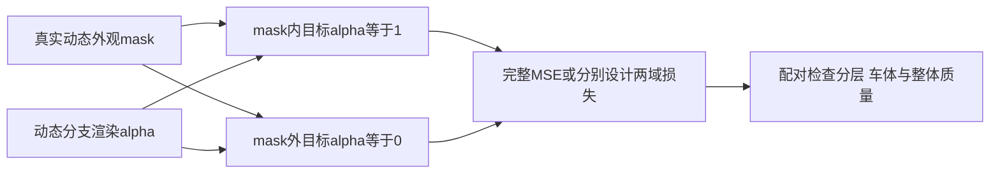

# DrivingEditor 后续默认：完整动态掩码不透明度监督

来源：用户2026-10-12明确要求及工程failure [V82-F01](../research_failures/entries/V82-F01.md)。本页规定后续训练的设计要求；历史B1/B2/S/V仍按各自原配置解释，不能由本页推断已有实现已部署新默认。

1. **默认双域监督**：对动态分支alpha明确约束mask内趋向1、mask外趋向0。只约束mask内不能作为后续正常训练默认；它只可用于登记清楚的历史重放或消融。
2. **形式与权重分开决定**：完整掩码MSE是合理控制，也可使用分别设计的前景/背景项。没有证据将旧系数100或V的.05认证为最优。两域归一化、clamp、数值系数和有效梯度域须在新实验配置中记录并锁定。
3. **损失只操作真实动态alpha**：不能先乘mask把车外alpha强制清零，再声称对原渲染完成了车外监督；显示用的masked alpha也不能替代实际指标。
4. **mask内容明确**：采用可追溯的动态外观二值mask；车辆/行人及阴影范围、未知区域和可见性均需披露。当前body-only输入缺shadow，不能称完整论文mask；阴影外观mask不自动成为actor LiDAR几何mask。
5. **验证分层与代价**：固定同输入、种子、学习率horizon和相机采样，检查掩码内/外动态alpha、背景RGB泄漏、静态背景、actor/core/边界保真、整体重建及移除局部性；保留全部固定帧。必要的从零与长期验证仍需完成。
6. **作者方法与工程默认分别标记**：Eq13监督域未明确，当前作者正式实现未核实。这个默认是用户要求的工程策略，不能认证为作者原式。V既有对照改善分层且损害actor质量，因此完整目标不等于更大权重或完成修复。

具体结果及证据集中在V82-F01。本规则本身不启动训练、不解除研究暂停、不修改已有checkpoint或冻结执行配置。
