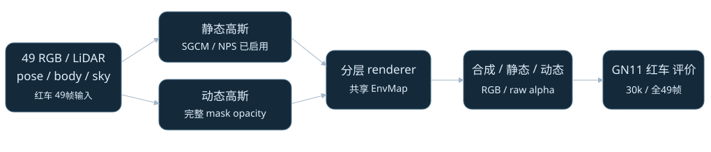
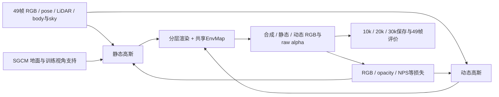

# DrivingEditor 红车 GN11：30k 终态技术报告

生成日期：2026-10-13。对象为 Waymo `scene0029_069_117`，GN11 同时启用 SGCM 与 NPS，seed=0，训练30,000步。报告依据已保存的终态 JSON、原始评价记录、文件/header 合约及本地资产检查；本次写作仅使用本地 CPU 读取，不启动训练、渲染、GPU、Torch、恢复或新 hash。

训练已完成，拥有的训练及收集进程均已退出。全图合成 PSNR 为37.5238558 dB，红车 body 区合成 PSNR 为31.1514364 dB，非天空且 body 外的静态分支 PSNR 为36.9701355 dB。这些是49个已观察训练视角的重建结果；没有 heldout 或独立测试，也没有本场景 C00 对照，不能证明 SGCM/NPS 的独立收益或套用跨场景1 dB gate。模型、Adam、RNG 的实际恢复验证仍为 false；`human_verdict` 保持 null。

## 输入、组件与数据流

上图展示实际启用的模块及主要数据流。模块启用、损失可计算与产物完整，和模块能改善独立测试质量，是不同层级的证据。

输入来自 Waymo scene0029 的 FRONT / `image_0`，原始帧69–117，顺序保留49帧，原图1920×1280，训练/评价480×320。模型时间为−0.48至0.48，步长0.02；这些是模型时间，不可直接当作物理秒。作者展示视频已真实对齐到原始69–89共21帧，能确认展示身份；本地49帧是围绕这些帧的扩展，作者真实训练窗口仍未公开确认。

固定视角跨时间诊断使用 `0029079`，索引10、模型时间−0.28。SGCM 地面坐标基准使用首帧车辆姿态 `0029069`；两者承担不同用途。输入工程记录包括29,725个 world prior 点，以及600,000静态采样点在严格0.1 m body 排除后剩597,734个的真实静态初值；不能将600,000配置数直接当作训练初始实有点数。

## Mask、协议与评价分母

红车 body 关联真实 DEVA instance130。原始98帧存在边界欠分割，99/100帧的159背景大孔及原始 mask 问题保留于工程记录。修复使用真实缓存 SAM 候选，98选 candidate0，99/100选 candidate1；没有用 GT 生成修复框，也没有后处理填洞伪装结果。此处区分原始 DEVA 标签诊断和实际送入训练的选择结果。

监督 mask 为 body-only，shadow mask 缺失；论文所需的 motion detector 尚未实现。body-only 区域之外可包含车辆阴影，故 body 外误差不等于纯静态背景误差。红车离开画面后，body mask 为空，不能将该时段解释成遮挡恢复实验。

49帧全部保留：`0029069`–`0029100`共32帧 body 有效，`0029101`–`0029117`共17帧 body 为空。区域指标采用“每帧先计算、仅在非空区域上等权平均”；空区域的像素数为0、质量数值为 null，不补0，也不删帧。全图和非天空 body 外区域均为49帧有效。PSNR 均值也不能由跨帧平均 MSE 直接替代。

PNG 展示来自保存 FP32 RGB 的 clip[0,1]后8 bit转换，没有逐图归一化或 body 预遮罩。alpha 展示来自未遮罩 raw alpha 的 clip[0,1]、黑0白1，不按各图 min/max 拉伸。质量结论优先使用保存 FP32 评价，不能把展示 PNG 当作原始计算精度。

## 30k 数值结果

| 范围 / 渲染分支 | 有效/总帧 | PSNR dB | 像素数合计 |
|---|---:|---:|---:|
| 全图，合成 | 49/49 | 37.5238557563 | 7,526,400 |
| body，合成 | 32/49 | 31.1514363707 | 115,074 |
| 非天空 body 外，静态 | 49/49 | 36.9701354508 | 5,829,505 |
| 非天空 body 外，合成 | 49/49 | 37.0197722633 | 5,829,505 |
| body 内缩5 px核心，合成 | 32/49 | 39.1470056285 | 74,783 |
| body 内部5 px边界，合成 | 32/49 | 27.3589195243 | 40,291 |
| body 外部5 px边界，合成 | 32/49 | 29.3067881638 | 44,613 |
| 远离 body 5 px，合成 | 49/49 | 37.2039613810 | 5,784,892 |

“36.9701355 dB静态背景”使用静态分支；“37.0197723 dB body外合成”使用合成分支，二者不能混写。原保存的 `eval_30000/metrics.json` 为 split=train，PSNR=37.5238567274、SSIM=0.9688924259、LPIPS=0.0478040088；SSIM/LPIPS 为原评价值，本轮没有重算。原 PSNR 与 FP32 区域 replay 的全图 PSNR 差9.7118×10⁻⁷ dB。

body 外 raw dynamic alpha 均值为0.0001907284，远离 body 5 px后为0.0000333433；body 内为0.9898222275。body 外5 px环的 alpha 均值0.0202501012，dynamic RGB在8 bit大于2的支持比例0.1824261940，提示边界附近仍需检查动态泄漏。这些是区域诊断，不能替代对每个高斯的贡献或遮挡测量。

CPU 导出验证记录49个观察视角与49个固定视角时间的保存 FP32 数组均有限，包括 depth；重放2,200个区域数值、147个固定视角时间数值，最大绝对重放误差均为0。空区域只允许 pixel_count=0。记录共441张 PNG 已本地解码，嵌入 manifest 匹配，SVG解析通过，viewer JavaScript语法检查返回0。以上验证检查数值与产物一致性，不自动产生视觉质量通过结论。

## 三节点产物及恢复边界

原 `completion_contract` 实际结果为 `FOLLOWUP_COMPLETE_CONTRACT_PASS`；10k、20k、30k三个节点均为 `PASS_CHECKPOINT_FILE_AND_FRAME_CONTRACT`，failure_fields为空。每节点含49个唯一顺序 FRONT 视角，196个四分支 PNG IHDR、49个 FP32 NPZ header、49个 boolean mask header及49个固定视角 FP32 NPZ header，尺寸均为480×320，固定 anchor均为0029079。

| checkpoint步 | static bytes | dynamic bytes | environment bytes | training_state bytes |
|---:|---:|---:|---:|---:|
| 10,000 | 754,680,408 | 850,618,974 | 226,494,608 | 44,056 |
| 20,000 | 817,184,088 | 850,618,974 | 226,494,608 | 44,056 |
| 30,000 | 817,184,152 | 850,618,974 | 226,494,608 | 44,056 |

每个文件的 stat bytes与checkpoint事件记录相等。审计不载入这些大文件的 payload；文件大小、header和训练事件的完整性不证明实际续训能恢复。所有节点及全局均保留 `restoration_verified=false`、`actual_model_Adam_RNG_restore_verified=false`。训练记录宣称checkpoint包含 model、Adam、RNG、paired sampler与SGCM lineage，这是保存范围说明，尚无恢复执行证据。

终态 owned training PID124555不存活；本地验证还记录两次collector及其拥有的CPU子进程均已退出。第一次CPU收集因 AssertionError停止且部分资产保留，第二次完成真实保存数组导出；报告依据第二次完整终态，不把第一次失败抹掉。

## NPS、SGCM与采样记录

配置保留 NPS 原 sum/L2语义及0.01权重，不改成mean；采样为两种checkerboard parity、四个轴向1 px邻居，忽略越出图像边缘的邻居，使用到最近静态像素中心的Euclidean距离。NPS、sky=0.05、depth=0.1系数来源中仍标注作者权重未核实。动态RGB和sky RGB权重5、静态RGB权重1、动态opacity权重100，opacity采用全图 raw alpha对binary body mask的MSE。

| 步数 | NPS raw loss | weighted loss | static feature raw L2 | weighted L2 |
|---:|---:|---:|---:|---:|
| 1 | 0 | 0 | 0 | 0 |
| 1,000 | 0.0743702054 | 0.0007437021 | 113.4026947 | 1.1340270 |
| 10,000 | 0.1515526325 | 0.0015155263 | 91.4337997 | 0.9143380 |
| 15,000 | 0 | 0 | 0 | 0 |
| 20,000 | 0.0091351783 | 0.0000913518 | 80.1079941 | 0.8010799 |
| 30,000 | 0.0027798465 | 0.0000277985 | 49.8512688 | 0.4985127 |

六个节点的已记录 NPS 梯度均finite，raw到weighted的0.01缩放检查通过；全部30,000行已记录数值loss有限，NPS启用与缩放检查通过。训练/paired sampler记录连续覆盖1–30,000，真实帧ID集为49；该证据只覆盖本GN11单场景，没有跨arm matched sampler对照。

六节点的 static-feature/static-RGB ratio validity全部false，因为记录中的static-RGB对该feature探针不连通。JSON中的ratio=0是占位值，不能作为“梯度平衡”或“NPS相对RGB可忽略”的测量。部分static-alpha探针ratio有效，也不能由此认证完整Gaussian参数的梯度比较。1步、15k的loss为0是实际记录，不用平滑填值替换。

SGCM实际调用145次：550至14,950，每100步一次，dr=0.5 m，meter-to-model scale=0.1，dr_model=0.05。地面拟合17,458候选点，855/860 inlier/lower-envelope cells，inlier fraction=0.9941860，RMSE=0.0385504 m，相对首帧车辆up方向倾角1.2193762°。

145次调用记录的计数总和为：pruned=506，cloned=236，split parents=13,538，SGCM净topology delta=13,268；inside_region累计1,953,420是逐调用计数和，不是独立点数。逐调用点守恒、guard、cap、candidate检查均通过。maximum additions/call=426，maximum net delta/call=425，minimum headroom=1,969,520。最终static=1,030,480、dynamic=1,084,958；不能用最终与初始点数差全部归因给SGCM。

addition guard采用中心投影frustum、temporal alpha及训练view support proxy，49个训练view ID与source精确匹配；同一初始source lineage至多clone一次，后代继承spent state，split的两子点均需在至少一个训练view有支持。它没有真正测量occlusion，也不等于每Gaussian的准确可见贡献。逐调用日志不能独立证明每个历史lineage身份。可选same-step duplicate字段92次存在、53次缺失；缺失不认证为0。

## 固定视角49时间：静态分支变化

所有节点使用0029079的同一pose/rays与49个已观察模型时间组合。这些counterfactual pose-time组合没有对应GT质量分数。RGB差采用FP32 clip[0,1]，alpha差采用未遮罩raw alpha。

| 节点 | mean RGB MAE相对anchor | max逐帧 RGB MAE | mean alpha MAE | max alpha MAE |
|---:|---:|---:|---:|---:|
| 10k | 0.0185199502 | 0.0279976930 | 0.0086999218 | 0.0141921947 |
| 20k | 0.0236174535 | 0.0347388983 | 0.0049758191 | 0.0083383294 |
| 30k | 0.0252311145 | 0.0370751582 | 0.0055594684 | 0.0099722743 |

30k逐帧 RGB最大绝对差的均值0.7096284567、最大0.8630212545。该静态分支并非严格time invariant。保存的30k静态velocity norm模型单位mean=0.1125460416、max=3.7007737160，temporal width mean=5.774489880，SHM peak-to-peak displacement bound max=0.2355985641；不转换为物理速度或米/秒。

## 时间、显存与资源范围

终态wall=4,956.6735407 s，即82.6112257 min；包含初始化、训练、评价与checkpoint。总wall对应6.0524462 iter/s，training exclusive对应6.4772802 iter/s；最后100步window为20.8284070 s、4.8011353 iter/s，末步forward/backward为139.5521240 ms。不同口径不能混用为“纯训练速度”。独立monitor闭合wall=4,956.8472226 s，和终态wall差约0.174 s。

| 阶段 | 次数 | inclusive / exclusive秒 | alloc峰GiB | reserved峰GiB | sampled PID峰GiB | sampled device峰GiB |
|---|---:|---:|---:|---:|---:|---:|
| initialization | 1 | 16.093 / 16.093 | 0.326885 | 0.416016 | 0.382813 | 0.392578 |
| training | 1 | 4940.752 / 4631.574 | 5.629648 | 6.513672 | 6.740234 | 6.769531 |
| photo_eval | 3 | 290.612 / 269.446 | 4.100036 | 4.443359 | 4.787109 | 4.796875 |
| static_time_eval | 3 | 21.166 / 21.166 | 4.100036 | 4.443359 | 4.787109 | 4.796875 |
| checkpoint | 9 | 18.120 / 18.120 | 2.524710 | 4.443359 | 3.976563 | 3.986328 |
| gradient_diagnostics | 18 | 0.447 / 0.447 | 4.986598 | 5.617188 | unavailable | unavailable |

全程alloc/reserved峰为5.6296477/6.5136719 GiB，PID/device sampled峰为6.7402344/6.7695313 GiB。阶段allocator峰含child和进入阶段前仍存活的分配；父阶段wall含child，exclusive扣child，所以不能把所有inclusive阶段相加。gradient diagnostics没有NV采样，该栏为unavailable，绝不填0。

monitor每1秒采样，共4,958个device有效样本，4,943个PID存在样本，采样错误0。NV采样峰是lower bounds，可能漏瞬时峰；device还可能包括其它进程，PyTorch allocator不覆盖所有CUDA使用。记录设备名为NVIDIA GeForce RTX4080 SUPER；日志的容量字段未在本轮独立硬件核验。该单次观察不能认证24 GiB RTX3090完整四arm容量或目标设备速度，保存的`certified_fit=false`。

## 实际分层与固定时间视觉复核

实际逐帧审查覆盖全部49观察帧的GT/合成/静态/动态/raw alpha_d，以及固定pose0029079的49时间静态RGB/raw alpha_s，共343张必需图；补充alpha_s/body的实际覆盖以工程coverage记录为准。图像以原480×320像素排入contact sheets，无局部滤波、逐图归一化或body预遮罩。人工质量判定仍为`human_verdict=null`。

红车总体形状、红色车身与横穿方向和GT相符，raw98–100右边缘截断可见，没有建立整个车体分支持续崩坏。观察帧raw71–98的静态道路仍留有黑色车底、轮胎或阴影条块，动态分支并未完整承担接地阴影。这些是实际质量代价；完整body opacity监督不等于已实现shadow分离。

固定pose下，raw71–100的黑条块随模型时间由左向右移动，raw101–117仍有右侧路边黑块；树影和道路纹理也随时间变化。raw105–117右侧天空/STOP附近出现细绿线，raw113–117前景道路有局部浅粉斑块。root还直接核对raw113–116的原尺寸静态RGB/alpha contact sheet，确认该反事实伪影；观察49帧没有同样明显的长绿线。固定pose与其它模型时间没有配对GT，因此不能赋予反事实GT PSNR；上述缺陷说明静态分支未达到绝对time invariant。

离场后的17观察帧body为空，动态/alpha_d展示没有明显车体大小的残留；这不证明所有像素严格为0，低阈值支持计数以工程记录为准。两个新scene没有各自C00，不能从这些绝对缺陷推导SGCM/NPS相对回退或模块因果收益，也不把原scene17的1 dB配对gate套用到该scene。

真实浏览器检查覆盖观察序列End=49/raw117及空body表现、共享ROI、播放1→41后暂停、固定时间End=49、raw alpha/body诊断、7个展示图的480×320加载与error[]。页面最终停在raw79原图，静态/动态分支截图保留。[实际视觉记录](../autoresearch/worldsim_v82/drivingeditor_followup_20261013/r1/final_followup_20261013/red_report_metadata/engineering-visual-review.json)与[浏览器QA](../autoresearch/worldsim_v82/drivingeditor_followup_20261013/r1/final_followup_20261013/red_report_metadata/root_browser_QA.json)分别记录像素判断和交互检查。

补充SAM资源记录覆盖模型加载与三帧真实推理：allocated 5.740 GiB、reserved 6.107 GiB、PID采样6.412 GiB、device采样6.422 GiB，11个NV样本、错误0。SAM的2.757秒只计已构造predictor后的三帧处理，不代表含加载的整个任务wall。包含sky/DEVA/SAM的本轮最大预处理观测仍为DEVA设备10.279 GiB，属采样下界。

## 可复核证据与结论边界

用户可从[真实保存产物viewer](C:/Users/dengyunlong/Documents/Codex/2026-10-12/w/outputs/drivingeditor_red_GN11_30k/index.html)、[manifest](../autoresearch/worldsim_v82/drivingeditor_followup_20261013/r1/final_followup_20261013/red_report_metadata/manifest.json)、[本地验证](../autoresearch/worldsim_v82/drivingeditor_followup_20261013/r1/final_followup_20261013/red_report_metadata/local_validation.json)、[三节点合约](../autoresearch/worldsim_v82/drivingeditor_followup_20261013/r1/final_followup_20261013/red_report_metadata/scene0029_10000_20000_30000_completion_contract.json)、[NPS/SGCM accounting](../autoresearch/worldsim_v82/drivingeditor_followup_20261013/r1/final_followup_20261013/red_report_metadata/scene0029_NPS6_SGCM145_accounting_summary.json)、[固定视角时间汇总](../autoresearch/worldsim_v82/drivingeditor_followup_20261013/r1/final_followup_20261013/red_report_metadata/scene0029_fixed_pose_49times_summary.json)、[collector终态](../autoresearch/worldsim_v82/drivingeditor_followup_20261013/r1/final_followup_20261013/red_report_metadata/collector_result.json)复核以上数值与范围。原保存SSIM/LPIPS来源为[photo metrics](../autoresearch/worldsim_v82/drivingeditor_followup_20261013/r1/final_followup_20261013/red_report_metadata/terminal_evidence/eval_30000/metrics.json)，资源来源为[memory summary](../autoresearch/worldsim_v82/drivingeditor_followup_20261013/r1/final_followup_20261013/red_report_metadata/terminal_evidence/memory_summary.json)。

本场景已达到30k训练和真实保存产物的工程完整性要求；证据支持训练重建数值、三节点文件/header、损失与SGCM计数、固定视角变化及已采样资源。作者训练窗口、motion detector、shadow监督、真实恢复、heldout泛化、同场景模块消融、exact Gaussian贡献/occlusion及最终人工视觉通过，仍没有完整证明。
