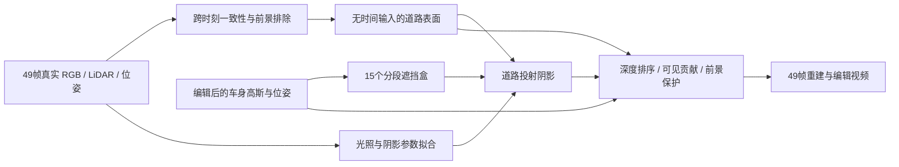

# 跨时刻道路去影与车辆关联阴影：49帧实验记录

task/run：`WS-V82-DRIVINGEDITOR-SHADOW-SEQUENCE-20261016/r1`。
固定 scene0008 raw89–137，原30k checkpoint 初始化；本轮实际完成18,000更新。此文记录已执行试验，执行状态与电源安排统一见 [RESEARCH_STATUS](../RESEARCH_STATUS.md)。

[可编辑组件图](../autoresearch/worldsim_v82/drivingeditor_shadow_20261016/r1/architecture.svg) · [实现与恢复目录](../../scripts/worldsim_v82/drivingeditor_shadow_20261016/) · [完整轻量指标](../autoresearch/worldsim_v82/drivingeditor_shadow_20261016/r1/results.json)。

## 实际执行

| 试验 | 背景 / 阴影 / 联合更新 | 结果用途 |
|---|---|---|
| joint_v1 | 1500 / 2000 / 4500 | 首轮广域道路恢复与49帧评估 |
| repair_union_v1 | 1000 / 500 / 2500 | 归属调整后重新拟合，保留接缝与时间残差 |
| contribution_frozen_v1 | 1000 / 500 / 2500 | 真实 αT 归属与时间固定；红色前景碎片导致视觉否决 |
| unselected_clean_v1 | 500 / 250 / 1250 | 分离未选前景后最终重拟合，入选 |

局部 LiDAR 平面、8cm 网格、26,356 道路高斯；支持面积168.68m²，保守内部152.46m²。道路参考来自真实跨时刻观测；内部88.88%有至少3次、间隔至少6帧且车辆远离4m的额外交叉检查，其中98.06%与参考线性 RGB MAE低于0.02。仍然是伪参考，不是独立密集无影真值。

归属使用49视角原时刻/固定时刻的实际 rasterizer αT 贡献与三轮剥离。DEVA/SAM与三维框匹配保护未选车辆。16k候选把未选车辆的尾灯高斯固定在道路通道锚点时间，造成raw117–137红片；最终将76,246个前景点从该通道分离，实际车辆仍由原场景前景保留，然后追加2k微调。没有重写原 checkpoint。

## 同一最终协议的结果

| 线性 RGB MAE | 有效帧 | 原checkpoint | 旧deferred_R4 | 最终联合版 |
|---|---:|---:|---:|---:|
| 支持道路对跨帧参考 | 49 | 0.011354 | 0.010730 | 0.003449 |
| 删除目标车后原车影区域 | 21 | 0.106015 | 0.090888 | 0.002590 |
| 原车位阴影伪标注，帧等权 | 40 | 0.012060 | 0.013385 | 0.007866 |
| 原车位阴影伪标注，样本加权 | 40 | 0.006335 | 0.008211 | 0.008524 |

道路误差下降69.6%，删除子集下降97.6%。原位阴影样本加权误差没有改善，车身RGB与实例可见贡献也略退化；不把单一平均数当作完整质量通过。
固定相机支持道路时间MAE约1.79e-11；整幅图仍为0.025025，包含未恢复的原表示。删除全部可编辑Actor与无阴影静态渲染最大差为0。

49真实时刻的最终13条视频、全49帧对照、保存加载addon/Adam、有限梯度与独立阴影数学检查已执行。另固定raw101采样49个正负编辑状态：平移±1m、旋转±30°，阴影质心平移等变误差最大0.384mm，首尾RGB逐值一致。数值跟随不代表车辆外观质量通过。

## 边界与失败证据

- raw106–108左下角仍有恢复范围外黑片，整幅画面无残影要求未通过。
- ±30°旋转时原车辆资产严重破面；车身几何、SH外观被冻结，完整资产去污染未认证。
- 遮挡体为15个分段盒，不是精细车身光线积分；接收面固定平面，光照场景共享。
- 46帧梯度采样，但参考和原checkpoint已使用全49帧；无未见帧、新视角或配对编辑GT认证。
- AI逐帧对照与代表编辑帧检查不等于用户人工质量verdict，人工字段保留null。

原始权重、图像、视频、固定表面及日志保留在原本地交付与AutoDL campaign。Git提交保存源码和轻量结果，不是这些资产的完整备份。新增统一HTML入口由源码生成；原历史内容逐字保留。
`failure_ledger_refs=[V82-F01]`；`failure_ledger_delta=none`（仅归档既有证据，未在本次推送新增或改写failure卡）。

## 本次源码归档验证

100个Python文件语法、暂存diff空白、文档新链接与敏感凭据模式检查通过；既有CPU阴影对照、平移等变、删除恒等、sRGB往返检查通过；对比页Node交互fixture覆盖98帧/模式组合。浏览器file://视觉检查受策略限制未执行。没有重新启动GPU。见[归档验证](../autoresearch/worldsim_v82/drivingeditor_shadow_20261016/r1/publish_validation.json)。
