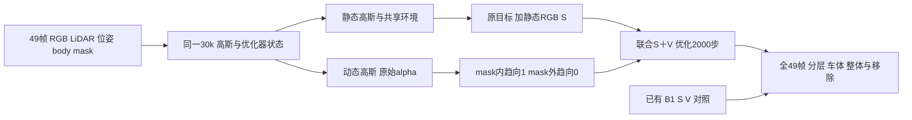

# DrivingEditor S＋V 联合诊断续接

task/run：`WS-V82-DRIVINGEDITOR-SV-20261012/r1`。用户于2026-10-12在新聊天明确要求继续 AutoDL 复现，并指定后续 subagent 默认 `gpt-6.1-sol / max`。GPU由用户自行将 `wm-vgpu-1011` 切回；本轮执行范围为 CPU 源码准备。当前执行状态统一见 [RESEARCH_STATUS](../RESEARCH_STATUS.md)。

## 问题与单次候选

已有B1/B2/S/V从同一saved30k恢复到32k。S改善静态背景RGB，但动态层仍包含背景；V降低车外动态alpha，却损害车体及整体重建。[交接和实测](DRIVINGEDITOR_DEBUG_HANDOFF.md)保留原结果。本轮只新增SV联合臂，以检验两个约束的联合收益和代价；不预设联合必然成功，不开权重网格。

SV沿用S的全图面积归一化 `.8 L1 + .2 DSSIM` 静态RGB，系数1，预测与GT分别乘 `1-Md`。沿用原前景opacity项，系数.05，在真实动态alpha上增加与历史V相同的车外项，系数.05：

`L_V = -mean[(1-Md) * a * log1p(-a/(1+1e-4))]`，`a=clamp(raw_dynamic_alpha,0,1)`。

前景项按原实现 `-mean[Md*(1-a_f)*log(a_f)]`，`a_f=clamp(raw_dynamic_alpha,1e-4,1-1e-4)`。两项都按全图H×W归一化，不按各域像素数重归一。新增V须在现有展示用 `dynamic_alpha *= dynamic_mask` 前计算；预先裁掉车外alpha会令这项失去真实监督作用。

这落实[用户指定的双域默认](DRIVINGEDITOR_OPACITY_DEFAULTS.md)，不是恢复旧 `100*MSE`，也不认证为作者正式实现。当前Md仍为body-only外观mask，缺shadow；完整双域目标与完整论文预处理是不同条件。S训练域包含所有非body像素，评价仍分别列非天空背景、车体/core/边界和全图。

## 固定恢复与评价协议

- 场景：Waymo V1.4.3 `scene0017_000_048`，FRONT raw0–48，共49训练视图，seed0。这些已用于调试，是开发场景。
- 起点：`/root/autodl-tmp/drivingeditor_repro/runs/scene0017_000_048_paper_50000_seed0_resume_vgpu1011_baseline` 的30k静态、动态、环境、训练状态四件检查点。继续30,001–32,000共2,000步，保留50k学习率horizon；不从S或V的32k起点恢复。
- 参数、Adam、RNG、采样器、time_shift与学习率沿用既有完整恢复机制；所有2,000步按已有B1轨迹检查相机/time_shift/LR。节点30,001/30,300/31,000/32,000评价须保存并恢复RNG。
- 终点保存全49帧GT、完整、静态、动态、原始alpha和FP32数组；沿用B1域定义与未预mask渲染。按49帧等权报告static/composite/actor误差、内外alpha、动态RGB泄漏，以及既有5像素core/边界诊断；保留不利帧。
- SV对S是增加V的比较，SV对V是增加S的比较；B1/S/V/SV可描述2×2交互。B2只是既有重复波动参考，不是独立统计噪声界。只有一项背景指标变好不能判修复成功。
- 第一真实backward前检查 `total = original + 1*S + .05*V`，原目标仍单独保存；首步原有损失项必须与相同起点对齐。任何恢复、配对、非有限值或GPU所有权检查失败立即停止，保留日志。

## 本轮准备边界

远端当前CPU模式：cgroup `cpu.max=50000 100000`（0.5核）、`memory.max=2147483648`（2GiB）；没有 `/dev/nvidia*`。四件30k检查点路径存在，大小分别为1,751,701,598 / 805,090,078 / 226,494,608 / 23,640字节。本轮只stat及读取小型配置，不将约2.78GB模型文件加载进2GiB内存；GPU恢复时再核验实际加载。

新候选位于 `/root/autodl-tmp/drivingeditor_repro/campaign/resume_sv_20261012/`，源码准备工具位于 [resume_sv_20261012](../../scripts/worldsim_v82/drivingeditor_debug/resume_sv_20261012/)。原S/V/B1源码、历史绑定与receipt均保留。历史单变量S/V guard拒绝联合新字段，因此必须为SV另接恢复harness，不能复用其旧receipt或直接调用旧launcher。CPU源码与梯度检查不等于GPU首步或完整恢复已通过。

GPU切回后的顺序：适配独立SV恢复harness并完成配置检查 → 单步恢复/真实backward检查 → 有界2k与全49帧评价 → 判定是否值得从零训练与多场景扩展。其他历史场景队列及自动化不因本次授权自动恢复。

## CPU 实测

远端新副本已生成：141个源码文件，共894,460字节。只修改原 `train.py`，新增局部 `utils/resume_sv_losses.py`；旧源码、数据与检查点未覆盖。motionproj环境 `torch 2.4.1+cu121` 实际使用CPU、线程1，7组检查全部通过：历史V值/梯度精确一致、两域梯度方向和全图归一化、shape/finite/binary输入、原目标/S/V账目及原始alpha日志、源码插入与premask顺序、配置锁定与未绑定入口拒绝、全新目标及资产排除。核验的是实际生成的候选，不只是纸面公式。

没有加载大型检查点或导入训练renderer，没有GPU训练或新渲染。完整恢复与实际GPU backward尚未验证；两处训练入口明确拒绝未绑定的SV训练，CPU通过不能作为旧launcher恢复的依据。首版配置校验更新前的文件已保存在远端 `backups/config_validation_v0/`。

[资源与文件入口](../autoresearch/worldsim_v82/drivingeditor_sv_20261012/r1/remote_inventory.json) · [实际候选CPU回执](../autoresearch/worldsim_v82/drivingeditor_sv_20261012/r1/remote_cpu_checks.json) · [远端候选计划](../autoresearch/worldsim_v82/drivingeditor_sv_20261012/r1/remote_candidate_plan.json) · [实际局部补丁](../autoresearch/worldsim_v82/drivingeditor_sv_20261012/r1/remote_source_delta.patch)。

`failure_ledger_refs: [V82-F01, V76-F03]`；`failure_ledger_delta: none`；`human_verdict: null`。本轮没有新GPU结果，不改写历史失败卡或宣布论文复现成功。
