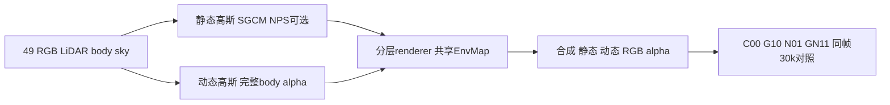

# 四臂终态深色比较工具

仅新目录工具；既有 repo、原始数据、checkpoint、当前训练队列均未修改。复用已验证 C00 exporter 的 `rgb/gray/bbox` 和 viewer 深色样式；复制的 `_legacy_*` 文件保留原代码。本工具不导入 torch、不读取 checkpoint 内容、不重渲染。



## 文件与部署

将以下6个Python源文件放到远端独立 `comparison_tools/` 同一目录，不上传 `fixture_output/`：

- `export_four_arm_assets.py`：CPU终态核验、保存数组导出、正式manifest、自动构建HTML。
- `build_four_arm_viewer.py`：离线深色页构建；不具备gate或human verdict写入功能。
- `fixture_smoke.py`：纯本地受控UI fixture。
- `_legacy_c00_export.py`、`_legacy_c00_viewer.py`、`_legacy_region_metrics.py`：复用来源，只导入图片转换/ROI/样式/FP32指标函数。

运行已有 `/root/autodl-tmp/envs/motionproj/bin/python` 即可，依赖numpy/Pillow/scipy；无需训练环境、GPU或模型。工具自身清空CUDA可见性并限制CPU数值库线程为1。

## 终态心跳的具体调用

部署示例工具根：`/root/autodl-tmp/drivingeditor_repro/campaign/followup_scene_prep_20261013/tools/comparison/`。gate_plan路径使用root实际保存的文件；下例以 `tools/DRIVINGEDITOR_FOLLOWUP_20261013.json` 为例。当前四臂数据仍从原hybrid30k campaign只读获取。

先进行无输出文件的核验：

```bash
CUDA_VISIBLE_DEVICES= PYTHONDONTWRITEBYTECODE=1 OMP_NUM_THREADS=1 OPENBLAS_NUM_THREADS=1 /root/autodl-tmp/envs/motionproj/bin/python /root/autodl-tmp/drivingeditor_repro/campaign/followup_scene_prep_20261013/tools/comparison/export_four_arm_assets.py --runs-root /root/autodl-tmp/drivingeditor_repro/campaign/hybrid30k_20261012/runs --campaign /root/autodl-tmp/drivingeditor_repro/campaign/hybrid30k_20261012 --gate-plan /root/autodl-tmp/drivingeditor_repro/campaign/followup_scene_prep_20261013/tools/DRIVINGEDITOR_FOLLOWUP_20261013.json --output /root/autodl-tmp/drivingeditor_repro/campaign/followup_scene_prep_20261013/reports/four_arm_30k --check-only
```

未完整四臂时输出 `BLOCKED_NO_FINAL_REPORT`，exit1，不创建输出目录。心跳保持等待当前四臂，不将此结果写成科学失败或批准后续训练。四臂齐全时输出 `READY_FOUR_ARM_TERMINAL_CPU_EXPORT`，exit0；这只是可进入导出的只读文件合同边界。

实际导出采用同一命令，移除 `--check-only`。生成：

- `manifest.json`：全部4×49帧、4×49固定相机时间、完整资源与诊断、精确指标路径、全49配对数值/差值/统计。
- `index.html`：深色离线页，默认C00/GN11并列，四臂任意切换、GT可选、同ROI逐帧/播放、完整49分数表。
- `assets/{C00,G10,N01,GN11}/{observed,static_time}/`：1764张PNG，固定clip[0,1]、不预mask、不逐图归一化。

保留整个输出目录再scp回本地 `outputs/`。工具拒绝覆盖已有目录；心跳已生成报告后先检查其manifest状态，不重复导出。不自动打包或修改原始FP32资产，不启动后续训练或电源操作。

如只构建已导出的正式页：

```bash
python build_four_arm_viewer.py --manifest /absolute/path/to/manifest.json --output /absolute/path/to/viewer
```

HTML输出目录中也必须保留相同的assets相对布局，浏览器无需fetch外部JSON或联网。

## 正式报告之前的阻止条件

1. 四臂status均必须complete、iteration=iterations=30000，先快速检查该条件，未齐全不扫描大日志。
2. 各臂10k/20k/30k complete事件、四checkpoint非零且stat大小匹配；只stat，不加载模型/sidecar。49四通道PNG、49 raw NPZ dtype/shape headers、49 static-time NPZ和真实summary行数齐全。
3. scene0017_000_048、FRONT raw0–48固定ID、timestamp、W480×H320。共同resolved config只允许arm/output/SGCM/NPS四字段不同。
4. 四臂 `paired_steps.jsonl` 的全部30000行iteration/frame_id/time_shift/各optimizerLR精确相同。完整保存RNG/sampler/optimizer/scale由事件字段声明；未实际恢复则始终 `restoration_verified=false`。
5. memory_summary终态及采样/各阶段证据完整无错误；NPS六节点日志齐全；G10/GN11 SGCM145个事件schedule/accounting和49相机guard声明符合合同。
6. 导出时实际载FP32 NPZ，GT/body/sky数组跨四臂精确相同。重新用原metrics函数从FP32、clipRGB、rawalpha算指标并核对旧JSON；每帧统一C00 body ROI。任何失败不写正式manifest或HTML；已导出的中间图片目录保留为未完成输出，不当报告发布。

精确指标路径直接读取 `gate_plan.metrics.key_paths`，包含全图/车体合成PSNR、非天空车外staticPSNR、raw动态alpha、动态RGB支撑和composite-static差。PSNR为先逐帧区域计算再49帧等权；不是pooled PSNR。差值始终 arm−C00；各metric保留mean/median/p10/min/max及负差计数，PSNR另列∆<−1dB ID，最不利帧明确为终态后选择。

固定时间遵循实际 `static_time_30000/summary.json` 的 `anchor_pose_frame=0017010`、`anchor_timestamp_model=-.28`、49 `rows[].source_timestamp_frame/timestamp_model`、RGBMAE/maxabs、alphaMAE和rawvelocity/width/SHM bound。它没有对应GT质量分数。采样峰是下界，父子phase不能相加；iter forward/backward毫秒与完整wall秒分列。

## 已完成的受控fixture检查

本地使用既有 `outputs/drivingeditor_C00_30k/manifest.json + assets`：

```powershell
python -X utf8 work/drivingeditor_other_scenes/comparison_tools/fixture_smoke.py --c00-manifest outputs/drivingeditor_C00_30k/manifest.json --gate-plan work/drivingeditor_other_scenes/gate_plan.json --output work/drivingeditor_other_scenes/comparison_tools/fixture_output
```

fixture为 `fixture_ui_only`，四槽重复C00，标题和橙色banner明确说明没有真实G10/N01/GN11结果。没有伪造NPS/SGCM或完整memory，未写human/gatepassed。PASS拒绝：未终态、错timestamp、错帧ID、未显式允许fixture；全部49 observed/49 static-time引用文件存在。Python AST与生成JS `node --check`通过。真实四臂资产导出仍等待四臂终态，不把fixture当作实际终态验收。

另以服务器已有C00 30k做只读schema probe：四checkpoint只stat、全49 node PNG/NPZ headers和49 static-time summary/headers通过；首帧实际FP32重新计算指标与原JSON一致。结果保存于 `real_C00_schema_probe.json`。该检查未加载checkpoint内容，也不构成四臂终态证据；本阶段没有浏览器交互验收。
