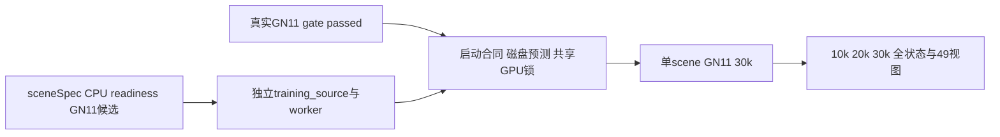

独立 followup 工具只允许单 scene 的 GN11，从零 seed0，30k horizon，10k/20k/30k 完整模型、Adam、RNG、独立 sampler、SGCM 谱系与49全观测评价。默认 validate 不导入 Torch/renderer/CUDA、不启动进程。CPU准备可在 gate pending 时完成，真实 --run 必须同时通过 gate 内容、两30k事件/配置/帧时间合同、当前四臂终态、实际CPU场景准备和独立source冻结检查。



部署时只复制本目录的 .py/.json/README.md；不复制 work/ 里的测试临时资产、GB checkpoint 或数据。root 当前选定入口是 followup_scene_prep_20261013/tools/followup/run_scene_gn11.py。

以下命令在 wm-vgpu-1011 执行，由 root 部署后验证；本 agent 没有执行远端命令。MATRIX_TOOLS 必须是当前 run_matrix.py 与 memory_monitor.py 的真实目录，示例 tools 路径若与既有部署不同，由 root 使用已检查的实际目录。

```bash
cd /root/autodl-tmp/drivingeditor_repro/campaign/followup_scene_prep_20261013
PYTHON=/root/autodl-tmp/envs/drivingeditor/bin/python
MATRIX_TOOLS=/root/autodl-tmp/drivingeditor_repro/campaign/hybrid30k_20261012/tools
# 默认validate：只读实际输入、CPU receipt与小代码；gate未过时明确GPU blocked。
CUDA_VISIBLE_DEVICES= OMP_NUM_THREADS=1 OPENBLAS_NUM_THREADS=1 "$PYTHON" tools/followup/run_scene_gn11.py \
  --scene-spec metadata/scene0008_spec.json \
  --readiness-file metadata/scene0008_cpu_readiness.json \
  --reference-config metadata/scene0008_inherited_training_config_candidate.json \
  --source-repository frozen_repository --matrix-tools-dir "$MATRIX_TOOLS" --campaign-root "$PWD"

# --prepare可在gate pending时完成；从不改frozen_repository/当前四臂队列。
CUDA_VISIBLE_DEVICES= OMP_NUM_THREADS=1 OPENBLAS_NUM_THREADS=1 "$PYTHON" tools/followup/run_scene_gn11.py --prepare \
  --scene-spec metadata/scene0008_spec.json \
  --readiness-file metadata/scene0008_cpu_readiness.json \
  --reference-config metadata/scene0008_inherited_training_config_candidate.json \
  --source-repository frozen_repository --matrix-tools-dir "$MATRIX_TOOLS" --campaign-root "$PWD"

# 用实际Python3.9和已准备source跑关键CPU tests；不运行真实worker。
CUDA_VISIBLE_DEVICES= OMP_NUM_THREADS=1 OPENBLAS_NUM_THREADS=1 "$PYTHON" tools/followup/check_followup_cpu.py \
  --matrix-tools-dir "$MATRIX_TOOLS" \
  --reference-config metadata/scene0008_inherited_training_config_candidate.json \
  --source-repository frozen_repository \
  --output metadata/scene0008_followup_cpu_checks.json

```


--prepare 新增 training_source/scene0008_023_071/、training_support/scene0008_023_071/、training_configs/scene0008_023_071_GN11.json 与 training_metadata/scene0008_023_071_prepared.json。已存在则拒绝覆写。原 helper 的 frozen_repository、inputs 和 CPU证据保留；只在新副本替换 scene-aware static_time helper，原训练、loss、sampler、checkpoint、SGCM和memory monitor代码按原小source复制。worker 仅提取原 run_matrix.py 的 memory hooks/write/run_arm，原 main、固定四臂队列、旧 ROOT/parent 和 scene17 anchor 不存在。

gate_receipt.blocked.example.json 是结构示例，不能改文件名来启动。root 要根据真实四臂结果发布符合 gate_receipt.schema.json 的 passed receipt，明确完整配对与坏帧/静态性视觉复核、无严重数值/视觉退化、allowed_scene_ids、C00/GN11 30k event路径和30000步采样证据。入口再次读取两event和全49逐帧指标，核对config/identity/stamp/实际full/actor严重阈值；还读取当前matrix_status确认 all_four_arms_complete。用户已确认1dB阈值；passed receipt必须写max_psnr_drop_db=1.0，入口拒绝其它阈值。真实启动加 --verify-paired-steps 逐行比对 receipt 指定的两份日志。

真实启动需 gate 通过与 prepared evidence 存在；不要向 reference-config 传已加 followup字段的 training_configs文件。训练候选来自原 metadata config，入口自行添加 followup_scene_spec/anchor 字段并核对旧prepared cfg。只有 --run 会调用继承worker、共享 /root/autodl-tmp/drivingeditor_repro/campaign/gpu_slot.lock 并查询GPU compute apps。默认不 dispatch，不替用户恢复或覆盖已存在 run 输出。

```bash
# 只有真实gate发布passed后才使用；本轮未执行。
OMP_NUM_THREADS=4 OPENBLAS_NUM_THREADS=4 "$PYTHON" -u tools/followup/run_scene_gn11.py --run --verify-paired-steps \
  --gate-file metadata/GN11_gate_passed.json \
  --scene-spec metadata/scene0008_spec.json \
  --readiness-file metadata/scene0008_cpu_readiness.json \
  --reference-config metadata/scene0008_inherited_training_config_candidate.json \
  --source-repository frozen_repository --matrix-tools-dir "$MATRIX_TOOLS" --campaign-root "$PWD"

```


每次 start 记录独立的 disk-before-start attempt，不覆盖旧attempt；slot临时busy且output尚未创建可重新尝试，已创建run输出仍拒绝自动恢复。磁盘预测按实际reference组件大小、SH/完整Adam/point cap/谱系、固定49视图FP32与PNG、static-time、导出和原子临时空间计算；start与checkpoint保存前重查，空间不足不删除任何旧资产，也不换配置或机器。预测是计划成本，非严格体积上界。

scene0008 anchor 必须来自spec的0008033和local index10真实timestamp，没有0017010 fallback。真实run会先核actual Scene49 identities/timestamps/dimensions，再通过来源 scene.paper_sgcm module hook核actual SGCM guard/view/lineage与CPU transform；training()的factory是函数内local import，不能假设trainmodule有global factory。actual绑定通过后才产生专门GPU binding receipt；CPU receipt的training_ready=false不改成formal-ready。

红scene0029已精确匹配作者raw69..89；root本地49扩展raw69..117、anchor0029079。raw准备spec不能直接当runner sceneSpec；需真实49 sky/body/dynamicRGB/actorPLY和actualCPU readiness齐全。red_scene.blocked.json仍是unknown模板，不能当正式receipt。gate allowed_scene_ids明确scene0008_023_071和scene0029_069_117。各scene只一个GN11，不自动再开四臂或新seed/loss网格。

本地最终14组CPU检查通过（cpu_checks_local_20261013_r2.json；Python3.12.7）。覆盖默认dry-run不importTorch/不spawn、gate pending prepare、源码冻结/拒绝覆盖、伪passed名字、实际事件/配置/stamp/阈值、错anchor/未知红scene、缺帧/尺寸、旧restore/CPU临时guard配置、低磁盘保留旧资产、slotbusy attempt重试、无global factory的local-import binding smoke及49时刻成功/异常恢复anchor。fake source/module/renderer只验证实现合同；未加载checkpoint，未验证真实GPU模型/SGCM绑定或恢复。Python3.9实际兼容性由root部署后用上面的validate/prepare/tests回执确认。

Root远端Python3.9 validate/prepare及14项CPU检查通过；用户确认1dB后再次14项通过，含receipt阈值放宽无法绕过严重回退的检查。真实GPU模型、SGCM绑定与完整恢复仍未认证。
