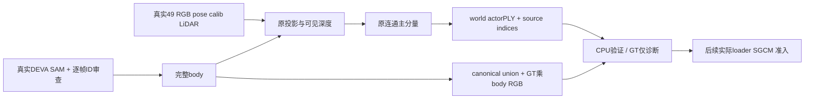

# 红车 actor LiDAR CPU 入口

actor_cpu.py 将旧 scene8 的固定路径、两个 actor 和实例 ID 改为明确输入，默认只做 check。最初验证为真实scene8一帧CPU对照；后续真实红车49帧审查、来源构建和CPU validate另有独立凭据，不能以旧一帧控制代替。真实actor数量、DEVA IDs和逐帧选择必须由实际分割与审查取得，未知时拒绝。



`check` 必须读取真实49 RGB/sky/DEVA PNG、`pred.json` 和既有 validator；检查尺寸、uint8短ID、逐像素实例面积，以及所有 actor 的每帧 reviewed/visibility/instance_ids。未知、缺帧、无审查、非法/重复/重叠 ID、缺真实分割凭据均 exit2；不创建资产。人工/root 工程逐帧查看真实 RGB 与 DEVA 的结果才可写 `status=visually_reviewed`；此选择记录不填写 human quality verdict。一个物体可由多个真实实例 ID 组成；离场/遮挡无可见 body 的帧用空 IDs，不猜 ID、不选择全部实例、不用 GT 框造 body。

选择 JSON 必需字段：`scene` 为精确绝对场景路径、`status=visually_reviewed`，`actors` 为实际非空数量；每个 actor 有连续从0开始的 `actor_index`、物理描述 `description`、仅供诊断的 `raw_track_id`、按原 manifest 顺序排列的49条 `frames`。每条有 `frame_id`、真实整数 `instance_ids`、`visibility=visible|not_visible`、`reviewed=true`、非空 `review_note`。只有 reviewed 的不可见帧允许 `instance_ids=[]`。GT raw track ID 与 DEVA ID 是不同命名域。`selection.pending.json` 仅保存已知 source 与 unknown 状态，不能执行。

执行凭据读取真实attempt终态：当前成功路径为 `metadata/red_masks_20261013_attempt2/status.json`；attempt1因可选pidfd不可用在模型前退出且完整保留，不能继续引用它作为成功凭据。终态 `REAL_RED49_SKY_AND_DEVA_VALIDATED_ACTOR_SELECTION_PENDING`、`scene_id` 与 manifest 相同、`sky_frames=49`、`training_ready=false`；`stages` 为 sky/deva/mask_validation 三条实际 command/returncode0/completed_utc 记录，同目录保存三个真实 `.log`。还检查 command 中的 scene、DEVA input/output；不手写成功凭据。

红车真实审查确认DEVA130在raw99/100被道路ID159侵入形成车尾大孔，98后窗上沿欠分割。原DEVA完整保留，不将159并入、不填洞。隔离 `red_preparation/run_red_sam_candidates.py` 用原图、cached ViT-H、真实130bbox固定80px padding真实推理三帧；无GT框、AMP或后处理。全49 RGB/ID、可见32帧body及三帧候选实际审查后，root选择原模型98=candidate0、99/100=candidate1，101–117真实离场为空。这里的body完整性是工程图像审查，不声称逐像素完美或shadow完整。

selection每帧可选 `body_override`，含source=`cached_SAM_vit_h_real_inference`、原模型候选path/index、真实执行receipt、`root_engineering_reviewed=true`和具体note。check验证实际receipt场景/缓存/源码/解释器、逐帧候选path/area和原uint8二值尺寸，并在写资产前拒绝resolved body重叠；build/validate消费同一精确body，sourceindices/worldXYZ/time/union/dynamicRGB仍按原规则验证。默认无override路径保持原DEVA方法。实际红车CPU构建和validate通过49帧、1actor/29725真实prior点，仍不代替actual loader/SGCM/GPU准入。

科学计算继承原 `dual_actor_cpu.py`：真实 Nx6 车辆系 LiDAR → `Tr_velo_to_cam_0`、`P0`；depth>.01、floor(uv+.5)、图像内、body命中；2×2像素最近深度+.5m；车辆系 .5m 连通分量、主分量至少50%。按原 frame pose 转 world，保存 int32 原 source indices；PLY `nx/ny/nz/time` 均为该帧 model_time，保留 .02 间隔及零初始化颜色。第六 bin 字段是 range-image index，不是时间。静态600k种子不改，原 loader 的严格0.1m动态prior排除规则仍待实际 loader 验证。

`build` 拒绝覆盖任一已有/partial actor 输出。body 有像素但无 LiDAR 会保存完整 body 并记录 `visible_without_lidar`；跨49帧某 actor 全无真实点则拒绝创建空/假 PLY。失败保留 partial 供审查，不自动清洗/覆盖。canonical body 为每 actor 真 body 的严格并集、0/255；动态 RGB 精确为原 GT RGB×union，其余全零。原 loader 后续将多 PLY 合到一个动态分支，不保证独立 actor 编辑。

`validate` 验证现有 source indices、PLY world XYZ、时间属性、canonical union/dynamicRGB。保留旧 GT 中心/尺寸诊断界 `norm(dimensions)/2+2m`，读取新 raw audit 的 `raw_track_id/source_label` schema；异常直接失败，绝不删点。没有移植 scene8 固定 ground-only successor，遇真实异常先审查，不自动造新清洗。验证输出 `PASS_ACTOR_CPU_ONLY` 且 `training_ready=false`；没有 loader/seal/训练入口。

本源部署至独立 `tools/red_actor_adapter/`。完成真实分割、逐49帧审查后按顺序执行以下CPU命令；红车真实构建/验证已经完成，禁止重复build覆盖或重置既有资产：

```bash
F=/root/autodl-tmp/drivingeditor_repro/campaign/followup_scene_prep_20261013
RED="$F/inputs/scene0029_069_117_red_cpu_v1"
PY=/root/autodl-tmp/envs/drivingeditor/bin/python
export CUDA_VISIBLE_DEVICES= PYTHONDONTWRITEBYTECODE=1 PYTHONOPTIMIZE=0
export OMP_NUM_THREADS=1 OPENBLAS_NUM_THREADS=1 MKL_NUM_THREADS=1
"$PY" "$F/tools/red_actor_adapter/actor_cpu.py" check --scene "$RED" \
  --selection "$F/metadata/red_actor_selection.reviewed.json" \
  --execution-receipt "$F/metadata/red_masks_20261013_attempt2/status.json"
# check成功后，按相同参数调用build；build成功后调用validate。
"$PY" "$F/tools/red_actor_adapter/actor_cpu.py" build --scene "$RED" \
  --selection "$F/metadata/red_actor_selection.reviewed.json" \
  --execution-receipt "$F/metadata/red_masks_20261013_attempt2/status.json"
"$PY" "$F/tools/red_actor_adapter/actor_cpu.py" validate --scene "$RED" \
  --selection "$F/metadata/red_actor_selection.reviewed.json" \
  --execution-receipt "$F/metadata/red_masks_20261013_attempt2/status.json" \
  --raw-audit "$F/metadata/red_preparation/scene0029_069_117/raw_actor_identity_frames"
```

验证证据：`scene8_control.json` 为本地只读 copy 的真实 scene8/raw33 控制：177892点；原源码 AST 中原投影/筛点直接执行与适配输出精确一致，已有 actor source indices、world PLY/时间、union/dynamicRGB也精确一致；Jeep body投影273→深度272→连通240，pickup该帧0点与现有资产一致。原 `save_ply` 函数 AST 完全相同。只覆盖一个真实控制帧，不认证红车49帧、完整 loader、最终质量或科学影响。

该工具不认证actual CPU loader/new transform/anchor0029079、SGCM ground/regions、严格.1m排除、独立runtime/runner和GN11准入；后续由red_readiness_adapter及训练入口执行。shadow仍缺，作者训练窗口仍未知。未新增hash，未做下载/候选搜索/worker/训练监控。参考原文件仅只读存于 `reference/`。
