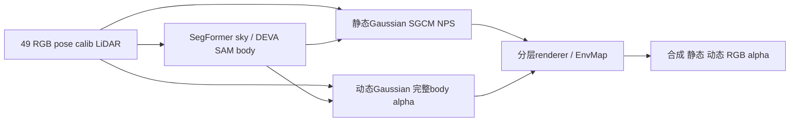

# scene0029：后续真实 GPU 分割与 actor LiDAR 准备

本轮仅只读核对并写本文，未运行模型、下载、安装、修改远端或训练源。新输入为 `/root/autodl-tmp/drivingeditor_repro/campaign/followup_scene_prep_20261013/inputs/scene0029_069_117_red_cpu_v1`：49 FRONT，作者展示 raw69..89，本地扩展 raw69..117，anchor `0029079`；作者训练窗口仍未知。CPU完成不等于训练可用，DEVA instance ID、actor数量与完整body均待实际mask逐帧审查。



GPU预处理只产生图中sky/body候选；actor关联、actual CPU loader/SGCM、独立GN11训练准入是随后阶段。完整body alpha MSE100、static RGB1、time/velocity、LiDAR decay等2024共同合同继续继承。

## Heartbeat准入与串行顺序

原 `campaign/hybrid30k_20261012/matrix_status.json` 必须为 `all_four_arms_complete`，四臂均实际30k，原49帧配对资产完整；canonical `tools/DRIVINGEDITOR_FOLLOWUP_20261013.json` 的 `primary_gate.result.status` 必须为 `expected`。另需真实 `metadata/GN11_gate_passed.json` 内容通过已部署 `tools/followup/contracts.py:gate_contract` 的重新读取：C00/GN11同30k、完整配对、30000行采样证据、49帧指标、视觉/静态时间复核完成、无严重回退，`allowed_scene_ids` 明确包含 `scene0029_069_117`。文件名、旧scene8 handoff、fixture均不授权本stage。

Root可先训scene8 GN11。红车sky和DEVA只能在共享 `/root/autodl-tmp/drivingeditor_repro/campaign/gpu_slot.lock` 可独占且GPU compute apps为空时串行运行；锁忙只保持等待，不启动模型。分割成功不发布human verdict/gate，不自动训练，不改变当前matrix/scene8源码。

## 已核对的真实环境与入口

以下版本来自此前真实成功的scene8 `cpu_setup_status.json` 与 `prepare_masks_runtime_status.json`，本轮仅确认路径与源码存在，未导入大模型重新试跑。

| 阶段 | 精确环境、overlay与源码 |
|---|---|
| sky | `/root/autodl-tmp/envs/dggt_inference/bin/python`；Torch2.4.1+cu121、mmseg0.11.0、mmcv1.2.7；`PYTHONPATH=/root/autodl-tmp/external/dggt_segformer:/root/autodl-tmp/envs/dggt_segformer/overlay` |
| sky入口 | `/root/autodl-tmp/drivingeditor_repro/campaign/next_scene30k_20261012/extract_sky.py`，参数 `--scene --config --checkpoint --device cuda:0`，无AMP上下文；输出 Cityscapes class10二值0/255 |
| sky缓存 | config `/root/autodl-tmp/external/dggt_segformer/local_configs/segformer/B5/segformer.b5.1024x1024.city.160k.py`；checkpoint `/root/autodl-tmp/dggt/pretrained/segformer.b5.1024x1024.city.160k.pth`，1,016,455,151B |
| DEVA | `/root/autodl-tmp/envs/drivingeditor/bin/python`，Python3.9、Torch2.2.2+cu118；隔离源码 `/root/autodl-tmp/drivingeditor_repro/campaign/next_scene30k_20261012/segmentation_repository`，该目录作为cwd及PYTHONPATH |
| DEVA缓存 | `/root/autodl-tmp/drivingeditor_repro/weights/DEVA-propagation.pth` 276,911,801B；同目录 `sam_vit_h_4b8939.pth` 2,564,550,879B；`TORCH_HOME=/root/autodl-tmp/drivingeditor_repro/cache/torch`，已有ResNet18/50 backbone缓存，不另下载 |
| DEVA设置 | demo `--SAM_ENCODER_VERSION vit_h --sam_variant original --chunk_size 4 --temporal_setting semionline --size 480 --use_short_id --suppress_small_objects --SAM_PRED_IOU_THRESHOLD 0.7`；默认64×64 prompts、batch64；省略 `--amp`，eval_args的store_true默认false |
| 既有显存适配 | 隔离源码 `deva/ext/SAM/automatic_mask_generator.py:272` 已将完成的boolean SAM masks搬CPU累计；boxes/scores/NMS及原采样/阈值/分辨率保持。复用该实际成功源码，不换weights或策略 |
| mask验证 | `/root/autodl-tmp/drivingeditor_repro/scripts/validate_deva_masks.py --scene --output`，NumPy/Pillow验证49文件/尺寸/uint8/pred.json，输出真实track_inventory与联系表；不自动判定哪些instance动态 |
| actor关联CPU | 既有 `campaign/next_scene30k_20261012/dual_actor_cpu.py`，同drivingeditor Python3.9环境，SciPy/Plyfile；源码190–281是真实mask投影、原LiDAR source indices及PLY写入，当前绑定scene8，不能直接用于red |

## 可运行的模型核心命令

旧 `run_deva_noamp.py:31` 限制scene必须位于 `data/waymo_paper_scenes/`，新followup input会被拒绝；旧 `launch_next_gpu.py` 及 `start_prepare_masks.sh` 还绑定scene8 TASK/setup/handoff。不要直接传red路径给这些wrapper。下列现有demo与validator本身支持新路径，参数与既有成功wrapper一致；无需改旧源码或把red搬到旧scene目录。

以下是未来heartbeat在准入满足后、前台串行执行的完整shell块；本轮未执行。任一检查/命令失败即停，保留partial输出审查；已有sky/DEVA输出不得自动重跑或覆盖。

```bash
set -euo pipefail
REPRO=/root/autodl-tmp/drivingeditor_repro
FOLLOWUP="$REPRO/campaign/followup_scene_prep_20261013"
OLD="$REPRO/campaign/next_scene30k_20261012"
RED="$FOLLOWUP/inputs/scene0029_069_117_red_cpu_v1"
SEG_REPO="$OLD/segmentation_repository"
SKY_PY=/root/autodl-tmp/envs/dggt_inference/bin/python
DEVA_PY=/root/autodl-tmp/envs/drivingeditor/bin/python
export CUDA_VISIBLE_DEVICES=0 PYTHONDONTWRITEBYTECODE=1 PYTHONOPTIMIZE=0
export OMP_NUM_THREADS=4 OPENBLAS_NUM_THREADS=4 MKL_NUM_THREADS=4 TOKENIZERS_PARALLELISM=false
export TORCH_HOME="$REPRO/cache/torch" PYTORCH_CUDA_ALLOC_CONF=
export PATH="/root/autodl-tmp/envs/drivingeditor/bin:/usr/local/cuda-11.8/bin:$PATH"
export LD_LIBRARY_PATH="/usr/local/cuda-11.8/lib64:/root/autodl-tmp/envs/drivingeditor/lib:${LD_LIBRARY_PATH:-}"
# append打开，不截断锁文件；FD9覆盖两个模型与验证整个生命周期。
exec 9>>"$REPRO/campaign/gpu_slot.lock"
flock -n 9 || exit 75
export DRIVINGEDITOR_PARENT_GPU_OWNER_PID=$$ DRIVINGEDITOR_GPU_LOCK_FD=9
PYTHONPATH="$FOLLOWUP/tools/followup" /root/autodl-tmp/envs/motionproj/bin/python - <<'PY'
from pathlib import Path
from contracts import read_json, gate_contract
f=Path('/root/autodl-tmp/drivingeditor_repro/campaign/followup_scene_prep_20261013')
assert read_json(f/'tools/DRIVINGEDITOR_FOLLOWUP_20261013.json')['primary_gate']['result']['status']=='expected'
gate=f/'metadata/GN11_gate_passed.json'
r=read_json(gate)
reference=read_json(r['events']['GN11'])['config']
proof=gate_contract(gate, {'scene_id':'scene0029_069_117'}, reference)
assert proof['status']=='GATE_PASSED_RECHECKED'
red=f/'inputs/scene0029_069_117_red_cpu_v1'
m=read_json(red/'preparation_manifest.json')
assert m['raw_training_range']==[69,117] and len(m['frames'])==49 and m['num_points']==600000
assert [x['id'] for x in m['frames']]==['0029%03d'%i for i in range(69,118)]
assert m['training_ready'] is False
assert not list((red/'sky/sky_0').glob('*.png')) and not (red/'mask/mask_0').exists()
PY
test -z "$(nvidia-smi --query-compute-apps=pid,process_name --format=csv,noheader)"
PYTHONPATH=/root/autodl-tmp/external/dggt_segformer:/root/autodl-tmp/envs/dggt_segformer/overlay \
  "$SKY_PY" "$OLD/extract_sky.py" --scene "$RED" \
  --config /root/autodl-tmp/external/dggt_segformer/local_configs/segformer/B5/segformer.b5.1024x1024.city.160k.py \
  --checkpoint /root/autodl-tmp/dggt/pretrained/segformer.b5.1024x1024.city.160k.pth --device cuda:0
cd "$SEG_REPO"
PYTHONPATH="$SEG_REPO" "$DEVA_PY" "$SEG_REPO/demo/demo_automatic.py" \
  --model "$REPRO/weights/DEVA-propagation.pth" \
  --SAM_CHECKPOINT_PATH "$REPRO/weights/sam_vit_h_4b8939.pth" \
  --SAM_ENCODER_VERSION vit_h --sam_variant original --chunk_size 4 \
  --img_path "$RED/image/image_0" --temporal_setting semionline --size 480 \
  --output "$RED/mask/mask_0" --use_short_id --suppress_small_objects --SAM_PRED_IOU_THRESHOLD 0.7
PYTHONPATH="$SEG_REPO" "$DEVA_PY" "$REPRO/scripts/validate_deva_masks.py" \
  --scene "$RED" --output "$RED/mask/mask_0"
```

Heartbeat/root应在新followup metadata记录真实stage日志、执行返回码、command/env/source、49 IDs、验证结果与实际solver fallback。直接demo不会生成旧wrapper的 `inference_manifest.json`；仅在真实demo返回0且mask_validation通过后记录新的validated execution receipt，actor适配器据此读取。不要手写通过状态替代实际执行。`extract_sky.py` 会更新新input的preparation_manifest状态为static_inputs_prepared，但保留training_ready=false；该状态不是完整训练ready，metadata中的原CPU receipt也不因此变成final。再确认49 sky均1920×1280、0/255且与RGB同名，DEVA49 Annotations/pred.json齐全。

## Actor关联的最小新scene适配点

1. 在新followup tools隔离适配，不改旧 `dual_actor_cpu.py`。替换固定TASK/setup/source、硬断言0008 raw23..71、蓝pickup/Jeep/Corolla track与固定两actor容器；按新manifest的49 IDs及root审查后的真实actor数量分配。新CPU raw audit在 `metadata/red_preparation/scene0029_069_117/raw_actor_identity_frames/`，字段为 `raw_track_id`、`source_label` 及分组FRONT标签，不能直接套旧raw_track_audit的schema。
2. 逐49帧查看真实RGB+DEVA Annotations，明确同一物体的多instance、离场/遮挡及空mask；记录每actor/frame的instance_ids、visibility、reviewed、review_note。真实DEVA IDs尚unknown，不能提前填、选所有实例或用GT box/近似mask替代。raw GT只做身份/运动/异常诊断；旧propose的box overlap只是待审建议，不是body监督。
3. 保持既有关联规则：车辆系真实Nx6 LiDAR经 `Tr_velo_to_cam_0` 与 `P0` 投影，正depth>.01、最近像素floor(uv+.5)、图像内；真实body命中后2×2最近depth+.5m、车辆系.5m连接分量且主分量至少50%。保存保留source indices；原frame pose转world，nx/ny/nz/time均用对应model_time。第六bin字段是range-image index，不是timestamp。只用真实点，不GT滤点，不加M-detector。
4. Canonical body union写0/255；dynamicRGB精确为原GT×union；离场body空时RGB全零，有真实body但无LiDAR记录visible_without_lidar，保留完整body监督。其他静态前车与非目标实例不得进入目标union。actorPLY必须是精确真实source subset；原loader将多PLY拼进一个动态Gaussian分支，不宣称独立actor编辑。
5. 旧validate的GT中心/尺寸仅用于诊断并失败，不悄悄删除点。旧ground-only successor固定检查actor0/0008029/20点，不能搬到red直接执行；仅遇到真实异常后root决定是否按既有已声明GT-free ground处理，先审查，不发明新清洗。600k静态种子保留，实际loader按原严格.1m动态prior排除规则处理；校验静态前车未误删。
6. 分割/关联之后再做实际CPU loader、new transform、SGCM ground/region、49完整body/static RGB、time/velocity/LiDAR角色审计，并制作red独立scene spec/readiness/config。不得沿用scene8 region/0008033或silver0017010。新训练anchor0029079，0→30k、每10k完整保存；原GN11 gate与新runtime二者都通过后才可使用独立runner。shadow仍缺，整个阶段保持training_ready=false。
