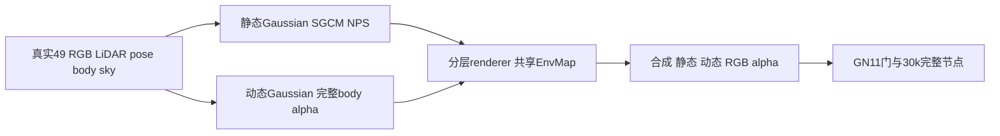

# 红scene0029：最小 CPU 准备

只读盘点并写本地helper；没有下载、远端修改、GPU或训练。Root负责现有5GiB共享ledger内的完整raw接收/镜像验证、精确视频对齐与49训练窗口选择，然后统一启动。比较工具核心已冻结；其README的真实部署路径和exit1已由root修正，本子任务未再改动。



图中body/sky、动态prior与训练均为后续阶段；当前helper只提取真实raw字段和静态混合种子。

| 项目 | 能力与缺口 |
|---|---|
| 新候选 | Waymo train index29；segment10526338824408452410_5714_660_5734_660；作者005533全21视频帧精确对应raw69..89、stride1，mean RGB MAE .0122443467；root明确选择本地49扩展raw69..117，anchor0029079，作者训练窗口仍未公开 |
| 已有缓存 | temporal raw0/25/50/75的CRC/context JSON及缩略图；当时无payload文件、无完整TFRecord，不能从这些生成真实传感器输入 |
| 完整raw | root已接收1,160,423,074B；download_receipt记录pinned完整SHA256/size通过。新helper只读取及校验该receipt，不下载或重置ledger |
| 原CPU工具 | oncoming_preparation_tools/prepare_oncoming_cpu.py固定scene8；调用prepare_waymo_pilot.py与原converter，需要TensorFlow，不能直接改source启动scene29 |
| 新CPU工具 | waymo_numpy_cpu.py + prepare_red_scene_cpu.py，仅protobuf/NumPy/Pillow/已存在CRC库；无Torch/TF、默认plan-only |
| protobuf | 已有dggt_data_cpu/site-packages/waymo_open_dataset；motionproj中的新Googlepb和旧生成代码不兼容默认backend，设置PROTOCOL_BUFFERS_PYTHON_IMPLEMENTATION=python后真实probe通过，未改包 |
| DEVA缓存 | /root/autodl-tmp/drivingeditor_repro/weights/DEVA-propagation.pth，276,911,801B |
| SAM缓存 | 同weights/sam_vit_h_4b8939.pth，2,564,550,879B |
| sky缓存 | /root/autodl-tmp/dggt/pretrained/segformer.b5.1024x1024.city.160k.pth，1,016,455,151B；B5 config1748B，均已在 |
| GPU必要项 | 现有run_deva_noamp.py强制CUDA；extract_sky.py虽有--device cpu入口，但CPU大模型未验证，本轮不试跑。后续用已缓存模型、共享gpu_slot串行做真实49sky和49DEVA/SAM |
| 资源快照 | CPU cgroup16核，按1线程；memory.max约62GiB、当时current约18.1GiB；disk free64,597,692,416B≈60.16GiB。helper另保留30GiB底线+20GiB矩阵余量+1GiB输入预算 |

## 原规则与真实控制帧

NumPy端只翻译现有2024 `DrivingEditor-run/scripts/waymo_converter.py` 与已缓存SDK `range_image_utils.py/transform_utils.py` 的运算：排序五LiDAR、依序双return、原beam inclinations中心与反向、azimuth/extrinsic约定、TOP per-pixel Rz@(Ry@Rx)及world→frame运动补偿、range>0与原NLZ channel3!=1过滤。没有M-detector、GT框滤点或目标分配。第六bin字段是TOP range_image_index/其他−1，不能把它写成物理timestamp。

真实只读对照 `scene0008/raw23` 已执行，记录 `scene0008_raw23_equivalence.json`：

- 178112点，五LiDAR/双return的点数、顺序、intensity/elongation/range-index精确一致；calib文本、pose、RGB精确一致。
- XYZ不是bitwise相同。TOP浮点运算 max L2差0.002013756m、全点RMS0.000600118m；非TOP最大约0.000003822m。预先声明算术对照界 `8*float32_eps*max(abs(frame_world_translation))=.011629m` 内通过；此界不是科学quality阈值，也不认证这些改写对最终训练影响小。
- 控制帧NLZ排除数为0，因此未覆盖真实非零NLZ个案；过滤表达式按原代码保留，不能补写该分支实测通过。
- 10.14秒、单线程；Torch/TF/GPU均未导入或使用、无远端写入。这个port只会用于新red副本，不改已准备scene8。

静态seed保存真实converted world xyz，原RandomState(seed0).choice(...,600000,replace=True)；nx/ny/nz/time保存对应模型时间，RGB字段为原初始化零色，不是测量RGB。另保存真实source采样indices，未创建actor PLY或任何mask。

## Root填入source spec后执行

需要部署两源文件、真实equivalence receipt和 `scene0029_source_spec.json` 到新followup `tools/red_preparation/`。该配置按root明确窗口raw69..117填写，source指向同followup的 `inputs/raw_scene0029/`，targetID仍为null。必须先取得identity任务的all21 frame_match和root独立视觉receipt `metadata/scene0029_identity_review.json`；后者最小字段为global_training_index29、segment、identity_verified=true及审查说明。helper同时校验完整raw的pinned size/SHA256 receipt，以及frame_match相同raw路径/revision/FRONT/全记录CRC，不能用文件名充当通过证据。

另保留 `scene0029_source_spec.template.json` 作为unknown窗口模板；模板不是可执行映射。

Spec中的 `raw_training_range=[start,start+48]` 必须由root明确选择。`author_video_verified_raw_range` 必须精确对应frame_match的range与best_raw_frames；作者展示窗口和本地49训练扩展分开，作者训练窗口仍未公开。helper绝不猜0..48，也不从21作者展示帧自动定49训练窗。

plan-only命令：

```bash
CUDA_VISIBLE_DEVICES= PYTHONDONTWRITEBYTECODE=1 PROTOCOL_BUFFERS_PYTHON_IMPLEMENTATION=python OMP_NUM_THREADS=1 OPENBLAS_NUM_THREADS=1 /root/autodl-tmp/envs/motionproj/bin/python /root/autodl-tmp/drivingeditor_repro/campaign/followup_scene_prep_20261013/tools/red_preparation/prepare_red_scene_cpu.py --scene-spec /root/autodl-tmp/drivingeditor_repro/campaign/followup_scene_prep_20261013/tools/red_preparation/scene0029_source_spec.json --equivalence-receipt /root/autodl-tmp/drivingeditor_repro/campaign/followup_scene_prep_20261013/tools/red_preparation/scene0008_raw23_equivalence.json
```

缺映射/49window/完整raw/identity/control receipt时返回BLOCKED、exit2，不创建输出。Root全部填妥后同一命令加 `--prepare`。输出严格为新 `followup_scene_prep_20261013/inputs/scene0029_START_END_red_cpu_v1/`，已有目录直接拒绝覆盖。

生成49 RGB/calib/pose/physical timestamp/velodyne/raw_front_metadata、真实静态混合600k PLY、metadata中的raw actor identity audit和physical world速度摘要。Audit存原laser/camera/projected标签、track和框，只供身份与运动诊断，不作为training mask、actorprior或点筛选。raw laser ID与DEVA instance ID是不同命名域；selected_actor始终null，等待真实mask审查。固定pose锚点为rawstart+10，不能沿用银车0017010。

sky目录为空；没有dynamic_masks/dynamic_image/actorPLY、没有formal_training_ready。状态 `CPU_RAW_AND_REAL_STATIC_SEED_READY_SKY_BODY_PENDING`，training_ready=false。失败保留partial输入，不自动删除、覆盖或用占位资产补齐。

`plan_rejection_smoke.json` 记录真实远端CPU默认CLI：BLOCKED / exit2 / output=null，unknown与48帧窗口均拒绝。仅stdin注入本地源、读取现有disk统计，无远端文件或模型操作。

## 后续最小串行 GPU 任务

只在root确认当前matrix/scene8任务释放共享 `campaign/gpu_slot.lock` 后执行，不在当前matrix期间CPU试大模型或抢GPU：

1. 真实SegFormer B5 FRONT49 sky，使用已有no-AMP流程与已有权重；输出49真实二值sky，检查尺寸/数量。
2. 真实DEVA/SAM ViT-H FRONT49 instances，使用已有 `run_deva_noamp.py --scene RED_INPUT`。仅prep，不训练，不省AMP策略或下载权重。
3. 根据真实RGB/mask逐49帧审查目标actor、同物体ID与离场空mask；保留其他静态前车及背景，不能选所有DEVA实例、用box/近似mask代替或把raw track ID直接当instance ID。
4. 确认canonical body并集后精确生成dynamicRGB=GT×body；真实mask投影LiDAR关联与actor prior沿既有已声明处理范围，不新加M-detector或GT box过滤。随后实际CPU loader/SGCM/坐标角色/完整mask验证与独立runner准备。

sky具体既有入口：`campaign/next_scene30k_20261012/extract_sky.py --scene RED_INPUT --config /root/autodl-tmp/external/dggt_segformer/local_configs/segformer/B5/segformer.b5.1024x1024.city.160k.py --checkpoint /root/autodl-tmp/dggt/pretrained/segformer.b5.1024x1024.city.160k.pth --device cuda:0`，用已有dggt_inference环境和既有overlay。DEVA用已有drivingeditor环境/隔离segmentation源。完整GPU启动与锁封装由root执行，本文不提供绕锁的自动启动器。

训练继续遵守2024活跃继承：完整raw body alpha MSE100、staticRGB1、duration/velocity .1/.01、LiDAR衰减1等共同项；SGCM/NPS要当前银车GN11门与新场景runtime通过后才训练，从零30k、每10k完整保存。shadow仍缺，不能制造或宣称完整作者预处理。
