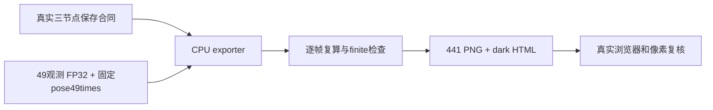

# 保存的新增场景 30k 数组 → 深色查看页

仅CPU读既有FP32评价，保留全部49观测帧和固定pose49模型时间，不加载检查点、模型或启动重渲染。先由独立原 `contracts.completion_contract` 核验10k/20k/30k，传入真实凭据；fixture不能使用。空body区域保留为null，车体均值只对非空帧计算并列出有效数；RGB按原协议clip[0,1]、alpha原数组，禁止逐图归一化。



```bash
PY=/root/autodl-tmp/envs/drivingeditor/bin/python
"$PY" export_saved_followup_cpu.py --source RUN --output NEW_REPORT \
  --verified-contract REAL_COMPLETION_RECEIPT --scene-label GMC \
  --architecture architecture-components.svg
"$PY" build_saved_followup_viewer.py --output NEW_REPORT
```

源路径、报告目录及凭据必须来自实际场景。export拒绝覆盖既有输出，metric回放或数组合同失败就停止。导出PNG不认证大检查点的模型/Adam/RNG恢复。

GMC实际成功远端报告为 `reports/gmc_gn11_30k_saved_cpu_20261013_0910`，本聊天产物 `outputs/drivingeditor_GMC_GN11_30k/`；此前不正确的fixed-time raw RGB指标回放已作为失败的导出目录保留，修复依据原协议clip后在新目录导出，不改实验数组。真实浏览器端点、播放、共ROI、空body尾帧和49时刻控制已检查，额外全覆盖像素复核见结果报告。
